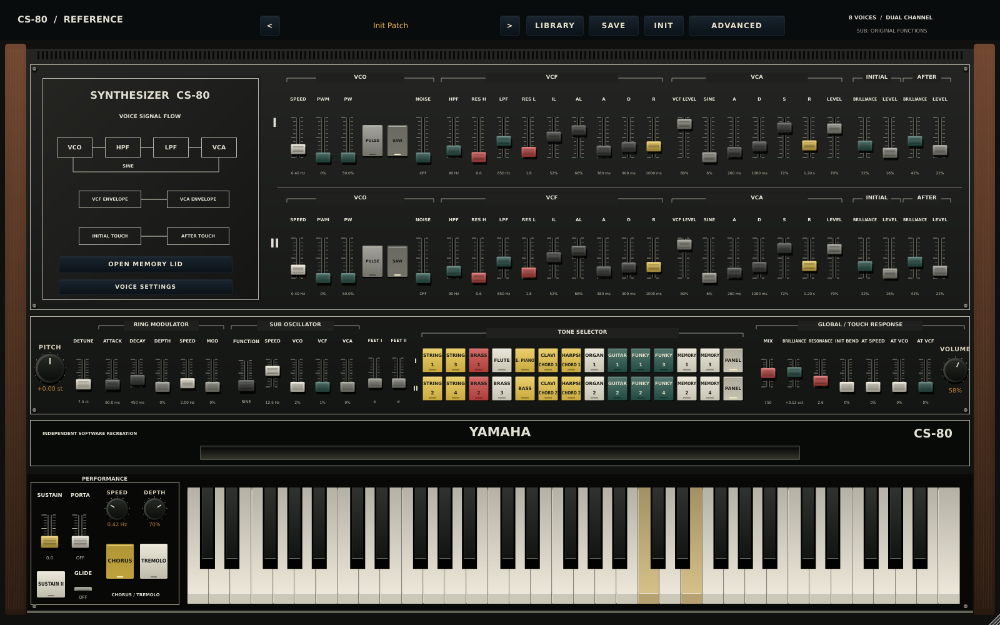
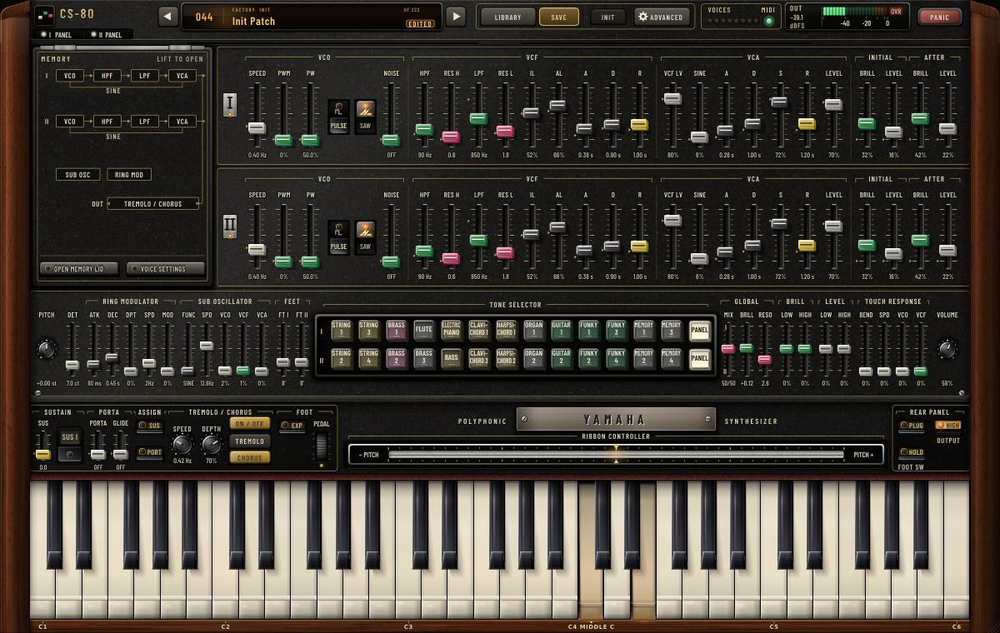

# CS-80 Reference

An independent, code-first recreation of the Yamaha CS-80: eight voices, two independent synthesis ranks per voice (sixteen oscillator / filter / VCA chains), polyphonic pressure, ribbon, ring modulation, SUB oscillator, chorus/tremolo and a modern performance layer. C++20 / JUCE 8, shipped as **VST3, AU (macOS) and Standalone**, with a JUCE-free core library that renders offline.

> **Where this stands, in one paragraph.** Every control on the original panel that has a software meaning now exists, is host-automatable and is wired to the destination the service documents show. The signal path is a **circuit-informed behavioral model**: topology and nominal laws come from Yamaha's service and owner documentation, but almost every numerical law (waveform shapes, filter nonlinearity, envelope time laws, touch dynamics, contour and wah gains, preset voicings) is a labelled placeholder. **It is not a 1:1 analog emulation, and nothing here has been compared against a real CS-80.** Passing tests prove the software obeys its own specification, not that the specification is the instrument. The required end target is [1:1 analog circuit behavior](docs/ANALOG_FIDELITY_REQUIREMENT.md); the work that remains, and what it needs, is in **[docs/PARITY_ROADMAP.md](docs/PARITY_ROADMAP.md)**.

Start with the [original hardware references](docs/HARDWARE_REFERENCES.md), the [fidelity audit](docs/FIDELITY_AUDIT.md) and the [row-by-row hardware coverage ledger](docs/HARDWARE_COVERAGE.md). They separate documented behavior, implemented corrections, provisional calibration and missing circuit models.



The [screenshot workflow](https://github.com/cheshmakzanoon-ops/yamaha-cs80/actions/workflows/screenshots.yml) captures the actual editor and, on `main`, refreshes the images in `docs/screenshots` only when the source commit is still current (see `docs/screenshots/provenance.json`). Never infer that an image validates a newer commit.



| Advanced page | Image |
| --- | --- |
| Modulation / expression | [advanced-page1.png](docs/screenshots/advanced-page1.png) |
| Sub oscillator / ring / chorus / analog voice | [advanced-page2.png](docs/screenshots/advanced-page2.png) |
| FX / macros / output | [advanced-page3.png](docs/screenshots/advanced-page3.png) |
| Arp / performance / about | [advanced-page4.png](docs/screenshots/advanced-page4.png) |
| Searchable preset library | [browser-1600x1000.png](docs/screenshots/browser-1600x1000.png) |
| Memory programmer (four miniature panels) | [memory-programmer-1600x1000.png](docs/screenshots/memory-programmer-1600x1000.png) |

---

## Current state of the engineering

**Status tags** (the same vocabulary as the coverage ledger): **Implemented**: the discrete behavior exists and is tested. **Approximate**: the route exists but its law is provisional. **Offline only**: a circuit reference model exists but deliberately does not drive audio. **Missing**: absent.

Of the 85 control and connector rows in the coverage ledger, counted by first status tag: **29 Implemented, 49 Approximate, 7 Missing**. The seven Missing rows are all physical or electrical-state items (AC power switch, key travel/force, scanner timing, per-voice sample/hold droop, headphone amplifier, power supply, ribbon surface mechanics).

| Subsystem | State | Notes |
| --- | --- | --- |
| Voice structure | Implemented | 8 voices x 2 ranks, cyclic assignment, ninth held key ignored, channel-exact note-off. Real scanner timing and free-running oscillator state **not** established |
| Oscillators | Approximate | PolyBLEP saw (polarity corrected), comparator-style pulse, shaped sine (placeholder 3.5% third harmonic), noise, nominal harmonic footage. Real reset/ramp/shaper behavior unmeasured |
| Filters | Approximate | Two serial 12 dB TPT state-variable stages (HP then LP) with the documented `fc = 125 * Kv * 2^V` law and Q endpoints; nonlinearity, intermediate Q law and loaded nodes are placeholders. Conditional IG00156 graph exists **offline only** |
| Envelopes | Approximate | IL / AL / steady / release-to-IL filter contour, ADSR amplifier contour, global SUSTAIN as release floor, sustain I/II. Time laws and "bend" are heuristics |
| Touch and pressure | Approximate | Held initial-touch path vs separate AC-coupled pitch transient (50 ms nominal), shared max-pressure bus, per-voice pressure, AT to VCO / VCF / SUB speed |
| Keyboard contours | Approximate | Four centre-neutral levers (LOW/HIGH brilliance and level), per-key weights from the KBC octave-tap ladder. Key map and gains provisional |
| Footswitch and assigners | Implemented / Approximate | Jack plugged + contact + independent SUSTAIN and PORTA/GLISS assigners (`!assigned or !plugged or pressed`); tail-shortening and glide-snap edge policy provisional |
| EXP / EXP-WAH, output HIGH/LOW | Approximate | Dedicated post-mix stage stands in for the PRA network; LOW is an arbitrary -20 dB |
| SUB, ring, ribbon | Approximate | Six original SUB functions (0.7-60 Hz), optional mono EXT modulation bus, frequency-envelope ring with documented calibration anchors, relative ribbon (~1 octave) |
| Tone selectors, memories, presets | Approximate / Offline only | 14 positions per rank, 4 independent memory banks (104 automatable controls), PANEL; **all 22 factory tone voicings are placeholders**. A 547-cell passive resistor-matrix solver is offline only (25 cells unresolved) |
| Chorus / tremolo, output stage | Approximate | Generic modulated delay and amplitude tremolo; 10 Hz DC block, soft clip, 255-tap decimator (63 samples latency) |
| Voice variation | Approximate | Per-voice tuning and pan scatter, slow drift, noise floor: arbitrary, not measured tolerances |
| Host / plugin layer | Implemented | 244 append-only host parameters, state migration, preset library, pluginval 10 on every platform |

The 200 "performance" patches and the modern layer (3 LFOs, 4 macros, 3 FX slots, MPE, arpeggiator) are deliberate software extensions, listed in the roadmap so they can be made inert in a future parity mode.

### What the tests and CI prove (and what they do not)

| Check | Count / scope |
| --- | --- |
| Core engine suite (`cs80_tests`) | 11,272 checks: parameters, oscillator/filter/envelope behavior, voice allocation, pressure, MIDI, ring/ribbon, sample rates, all 222 presets render |
| Parity isolation / harness | 121 core isolation checks plus 22 comparison-harness tests; synthetic evidence only |
| Performance controls (`cs80_performance_control_tests`) | 113 checks, mutation-checked: contour, footswitch truth table and edges, EXP-WAH, output switch |
| Offline reference models | passive preset matrix (4,702 checks), conditional IG00156 graph (112), settled-DC keyboard-contour network (160,459) |
| Plugin / UI smoke (`cs80_ui_smoke`) | APVTS contract, append-only IDs and AU hints, state round trips and migration, editor at two sizes, every page, controls and gestures, pedal and key-pressure paths |
| DSP probe | deterministic numerical checks plus `scripts/analyze_dsp.py` plots |
| CI (`build.yml`) | Linux, macOS (VST3, AU, Standalone) and Windows builds and tests; pluginval 1.0.4 at strictness 10 (Linux headless and GUI under Xvfb, macOS VST3 and AU including AU GUI, Windows headless) |

The core and performance suites have also been run under AddressSanitizer and UndefinedBehaviorSanitizer (leak detection off; no leak-clean claim). **None of this compares anything to hardware.** There is no reference capture corpus in the repository. Consult the exact-commit Actions results rather than this table for any specific revision.

---

## Path to 1:1 parity (summary)

**M0 implementation:** opt-in [parity isolation](docs/PARITY_ISOLATION.md) masks modern extensions without rewriting stored patches. The [comparison harness](docs/PARITY_HARNESS.md) validates synthetic stand-ins, provenance and declared latency, with versioned synthetic-only tolerances. Neither establishes hardware agreement. Hardware capture and analog tolerance preregistration remain outstanding.

The full plan is **[docs/PARITY_ROADMAP.md](docs/PARITY_ROADMAP.md)**. In short:

1. **The central constraint.** A substantial part of what remains is *document-derivable* (solving the loaded control-voltage networks, resolving the keyboard key map, transcribing the last preset cells, deriving the true envelope and touch circuits). The rest is **measurement-required**: nonlinear filter and oscillator behavior, envelope laws, noise, drift, tolerances and touch dynamics are simply not in any schematic. **Access to an identified, calibrated CS-80 (with a qualified technician and a safe fixture) or to authorized calibrated captures is the gating prerequisite** for everything past the first milestone.
2. **Define done first.** Per quantity: a source row, a reference, tolerances fixed *before* looking at the output, published residuals across the operating range, stage-level agreement before end-to-end, blind listening last. No "fidelity percentage" without a metric and corpus.
3. **Ordered milestones.**
   - **M0** parity mode (switch off everything the original lacks) and the comparison harness with pre-registered tolerances.
   - **M1** identify the unit and capture the reference corpus.
   - **M2** voltage-domain control layer: loaded R51/R52 and M-card summing, KAS/KBC key map, preset receiver table (no hardware needed).
   - **M3** fit and validate the core path: VCO/shaper, VCF (IG00156), envelopes and VCA, touch.
   - **M4** SUB, ring, PRA wah, chorus, output stage; drive presets from the solved networks.
   - **M5** voice variation from measured tolerances, and interaction/edge-case regressions.
   - **M6** complete-path sign-off; only then may documentation say "parity", for the stated unit and tolerances.
4. **Where to start Monday:** `docs/PARITY_ROADMAP.md` sections 3 (state), 4 (workstreams W0-W12), 5 (register of every provisional value) and 9 (working rules).

---

## Features

| Area | Implementation |
| --- | --- |
| Voices | 8 voices, 2 ranks each, 16 oscillator-filter-VCA chains, cyclic assignment |
| Oscillators | PolyBLEP saw, variable-width pulse, fixed-time reset pulse, shaped sine, noise; harmonic footage 16' to 2' |
| Filters | 12 dB high-pass into 12 dB low-pass, resonance on both |
| Envelopes | Independent filter and amplifier contours; global SUSTAIN and sustain I/II |
| Expression | Velocity, polyphonic aftertouch (MIDI, or drag down an on-screen key), channel pressure, MPE, mod wheel, ribbon, EXP / EXP-WAH foot controller, keyboard contour levers |
| Modulation | SUB oscillator (original six functions, optional EXT bus), ring modulator, three global LFOs |
| Performance | Footswitch with sustain and porta/gliss assigners, portamento / glissando, arpeggiator, pitch-bend range, A4 tuning, HIGH/LOW output |
| Effects | Chorus/tremolo plus three serial modern FX slots |
| Presets | 222 factory programs: 22 provisional hardware-tab studies and 200 original performance patches; searchable library and user presets |
| Parameters | 244 host-automatable: 122 original + 106 programmer/selector + AT VCF + 4 original-SUB + 10 performance controls + parity isolation |
| Formats | VST3 and Standalone everywhere; AU on macOS. AAX is not built (SDK not redistributable) |

### Using the instrument

- **MASTER**: tuning, detune of rank II, mix, brilliance, resonance, SUSTAIN, output volume, initial pitch bend.
- **CHANNEL I / II**: independent VCO, HPF, LPF, filter contour, VCA contour, touch response, pan. The two ranks are mixed and panned in the stereo field.
- **TONE SELECTOR**: 14 positions per rank (11 named tones, two memory banks, PANEL), rank-specific names in the original order. **OPEN MEMORY LID** edits four independent miniature panels (26 controls each); memories 1/3 feed rank I, 2/4 feed rank II. Selecting a source never overwrites the manual sliders; PANEL returns to them.
- **PERFORMANCE**: sustain, portamento, glide mode, chorus / tremolo, sustain II.
- **KEYBOARD / FOOT**: LOW/HIGH BRILLIANCE and LEVEL contour levers (centre = neutral; double-click re-centres), on-screen PEDAL, footswitch PLUG and PRESS, SUSTAIN and PORTA assigners, WAH (EXP-WAH), HIGH (output).
- **RIBBON**: first contact sets the reference; relative motion bends pitch; release restores neutral (up to about an octave).
- **KEYBED**: 61 keys with velocity. On screen, strike a key and drag further down it to press harder (a pointer stand-in for the per-key sensor).
- **Advanced**: LFOs, SUB and ring detail, chorus, FX, macros, MPE, arpeggiator, original/legacy SUB switch, voice dispersion/drift/noise. **LIBRARY / SAVE**: searchable preset browser.

Double-click any control to return it to its default.

**MIDI**: notes, velocity, polyphonic and channel aftertouch, pitch bend, CC1 mod wheel, CC11 expression (also drives the pedal and EXP-WAH), CC64 sustain (a software convention; see below), CC74 brightness, CC120 / CC123 channel-scoped panic. MPE maps per-note bend and pressure on member channels with a separate bend range.

### Behavior notes and compatibility

- **Intentional audible changes** are documented where made. Most recent: the default per-voice tuning scatter (previously up to ~2 semitones off by a missing cents conversion; now about 2.5 cents at default dispersion), and earlier corrections to velocity gain, cutoff tracking (octave per octave), footage ratios, filter contour and sustain semantics. Use an earlier commit for historical renders.
- **State and automation**: host IDs and order are append-only with AU version hints; sessions saved by older builds restore neutral values for newer parameters, never live ones. Preset recall leaves the footswitch jack/contact, EXP/WAH selector and output switch alone (they are wiring, not sound).
- **SUB**: fresh instances use the original six functions and 0.7-60 Hz range; factory programs and old states keep the legacy waveforms/range ([ORIGINAL_SUB_OSCILLATOR.md](docs/ORIGINAL_SUB_OSCILLATOR.md)). EXT accepts an optional mono host input, disabled by default and modulation-only ([EXTERNAL_MODULATION.md](docs/EXTERNAL_MODULATION.md)).
- **Voices**: the cyclic allocator rejects a ninth simultaneously held key rather than stealing; released tails can be reused. Same-pitch duplicate note-ons on one channel are a MIDI ambiguity, not original behavior.
- **Latency**: the output decimator reports 63 host samples; let the host refresh delay compensation.
- **Software conventions that are not original**: MIDI CC64 sustain (including MPE-master rule), the latching virtual footswitch, the sample-rate range 8-768 kHz (48 kHz fallback), digital normalisation of EXT, the on-screen key-pressure gesture. See [PERFORMANCE_CONTROLS.md](docs/PERFORMANCE_CONTROLS.md).
- Footage uses nominal harmonic ratios 0.5, 1, 1.5, 2, 3, 4 (the fifths sit about 1.955 cents above equal temperament); these are nominal circuit targets, not measured tolerances of any instrument.

---

## Build

Requirements: CMake 3.22+, Python 3.10+ (test harness), a C++20 compiler, Ninja (recommended) or Visual Studio 2022; Linux needs ALSA, X11, FreeType, Fontconfig and OpenGL development packages; macOS needs the Xcode command-line tools. JUCE 8.0.6 is fetched by CMake when `deps/juce` is absent.

Ubuntu 24.04:

```bash
sudo apt-get install -y build-essential cmake ninja-build pkg-config \
  libasound2-dev libx11-dev libxext-dev libxrandr-dev libxcursor-dev \
  libxinerama-dev libxrender-dev libxcomposite-dev libgl1-mesa-dev \
  libfreetype-dev libfontconfig1-dev libcurl4-openssl-dev \
  libwebkit2gtk-4.1-dev fonts-dejavu-core
```

```bash
cmake -S . -B build -G Ninja -DCMAKE_BUILD_TYPE=Release
cmake --build build --parallel
ctest --test-dir build --output-on-failure
```

or the checked-in presets (`cmake --preset linux-release`, `cmake --build --preset linux-release`, `ctest --preset linux-release`). For fast engine work without JUCE add `-DCS80_BUILD_PLUGIN=OFF`. On a bare Linux container set `JUCE_FONT_PATH` to a directory containing DejaVu Sans (CI does this) so the UI smoke test can render text.

Artifacts: `build/CS80Reference_artefacts/Release/VST3/CS-80 Reference.vst3`, `.../Standalone/CS-80 Reference`, and `.../AU/CS-80 Reference.component` on macOS.

Headless assets:

```bash
./build/cs80_render --out artifacts/cs80-demo.wav --seconds 12
./build/CS80Snapshots_artefacts/Release/CS80Snapshots --out artifacts/ui --self-test
```

### CI

`.github/workflows/build.yml` builds and tests Linux, macOS and Windows and runs pluginval 1.0.4 at strictness 10 (Linux headless and GUI under Xvfb with a bounded, diagnosed retry for the validator's own teardown crash; macOS VST3 and AU; Windows headless). Other workflows: `screenshots.yml`, `dsp-measurements.yml`, `circuit-inspection.yml` (reads the original service scans inside Actions) and `ci-evidence.yml` (publishes run outcomes as commit statuses). A passing run is software-quality evidence only.

---

## Repository map

```text
src/core/Params.h               parameter table shared by engine, UI, presets and tests (append-only)
src/core/Dsp.h                  oscillator, filters, envelopes, LFO, chorus, phaser, reverb, decimator
src/core/Engine.*               voice allocation, dual-rank engine, modulation, ring, wah, FX, arp, output
src/core/PerformanceControls.h  keyboard-contour weights, footswitch gate, wah and output-switch constants
src/core/HardwareControl.h      offline passive preset resistor-matrix model (does not drive audio)
src/core/OriginalSubOscillator.h, ExternalModulationInterpolator.h
src/core/FactoryPresets.*       22 provisional hardware-tab studies + 200 performance patches
src/reference/                  offline circuit reference models: IG00156Linear.h, KeyboardContour.h
src/plugin/                     JUCE host layer: processor, editor, advanced panel, preset browser, UI components
src/tools/                      render_cli, dsp_probe, ui_snapshot (screenshots + plugin/UI smoke test)
tests/                          CoreTests, PerformanceControlTests, HardwareControlTests, IG00156ReferenceTests,
                                KeyboardContourReferenceTests
scripts/                        DSP analysis, schematic-source inspection, pluginval wrappers and diagnostics
docs/                           evidence ledgers and audits (index below)
```

### Documentation index

| Read this | For |
| --- | --- |
| [PARITY_ROADMAP.md](docs/PARITY_ROADMAP.md) | **The plan to 1:1**: definition of done, blockers, workstreams, provisional-value register, order, rules |
| [ANALOG_FIDELITY_REQUIREMENT.md](docs/ANALOG_FIDELITY_REQUIREMENT.md) | The target, as the owner stated it |
| [FIDELITY_AUDIT.md](docs/FIDELITY_AUDIT.md) | Dated gap register and every correction so far |
| [HARDWARE_COVERAGE.md](docs/HARDWARE_COVERAGE.md) | Every original control, connector and circuit block with status and next acceptance action |
| [HARDWARE_REFERENCES.md](docs/HARDWARE_REFERENCES.md) | Primary sources, tone-selector order, IC-level facts, calibration anchors |
| [PERFORMANCE_CONTROLS.md](docs/PERFORMANCE_CONTROLS.md) | Keyboard contour, footswitch assigners, EXP-WAH, output switch, key pressure |
| [CIRCUIT_MODEL_SPEC.md](docs/CIRCUIT_MODEL_SPEC.md), [IG00156_MODEL_EVIDENCE.md](docs/IG00156_MODEL_EVIDENCE.md), [IG00156_REFERENCE_EXPERIMENT.md](docs/IG00156_REFERENCE_EXPERIMENT.md) | VCO/VCF equations, M-card inventory, recovered filter graph and reference model |
| [OSCILLATOR_CIRCUIT_EVIDENCE.md](docs/OSCILLATOR_CIRCUIT_EVIDENCE.md), [INITIAL_TOUCH_CIRCUIT_EVIDENCE.md](docs/INITIAL_TOUCH_CIRCUIT_EVIDENCE.md), [KEYBOARD_CONTOUR_EVIDENCE.md](docs/KEYBOARD_CONTOUR_EVIDENCE.md), [FOOT_CONTROL_EVIDENCE.md](docs/FOOT_CONTROL_EVIDENCE.md) | Per-circuit evidence and open questions |
| `docs/PRESET_*.md`, [RANK_II_PRESET_TRANSCRIPTION.md](docs/RANK_II_PRESET_TRANSCRIPTION.md) | Preset resistor-matrix transcription, receiver graph, revision gates |
| [DSP_MEASUREMENTS.md](docs/DSP_MEASUREMENTS.md) | Reproducible numerical measurements and their limits |
| [ENGINE.md](docs/ENGINE.md), [RESEARCH.md](docs/RESEARCH.md), [MEMORY_AUTOMATION.md](docs/MEMORY_AUTOMATION.md) | Signal path, scope decisions, programmer automation |
| [VALIDATOR_DIAGNOSTICS.md](docs/VALIDATOR_DIAGNOSTICS.md), [pluginval-fault-diagnostics.md](docs/pluginval-fault-diagnostics.md) | Host-validator crash diagnostics |

---

## Contributing: ground rules

These keep the project honest; the roadmap's section 9 expands them.

- **No parity claims** without per-quantity evidence (source, reference, pre-registered tolerance, residuals).
- **Name unmeasured numbers** (`kProvisional...`, "provisional" comments). Never present a heuristic as hardware behavior and never tune a placeholder by ear.
- **Append-only parameters and neutral defaults**: new behavior must leave existing patches bit-identical until engaged; never reuse or reorder an ID.
- **Document audible changes** and the commit to use for historical renders.
- **Record provenance** for every source read: URL, source-byte SHA-256, crop box, units, review status; keep conflicting sources side by side.
- **Mutation-check new tests** and keep core, UI, sanitizer and host-validator gates green.

---

## Honest scope

This is a circuit-informed behavioral model, not a component-level SPICE simulation, not a measured emulation, and not a copy of Arturia's product (no Arturia artwork, code or presets are used; Yamaha-authored documentation is cited as hardware evidence). The oscillator/filter/envelope topologies, dual-rank structure, pressure routing and performance controls follow the CS-80 architecture; the modern FX, macros, MPE and arpeggiator are original additions. The panel is drawn from Yamaha's photographs and manuals with original code. The plugin should be exercised in the target DAW before any release.

## References

- [Yamaha CS-80 (Wikipedia)](https://en.wikipedia.org/wiki/Yamaha_CS-80)
- [Yamaha CS-80 history (Perfect Circuit)](https://www.perfectcircuit.com/signal/yamaha-cs-80-history)
- [Yamaha CS-80 owner's manual, parts 1-3](https://www.therogoffs.com/cs80/CS80E_1.pdf) ([2](https://www.therogoffs.com/cs80/CS80E_2.pdf), [3](https://www.therogoffs.com/cs80/CS80E_3.pdf)) and [service manual index](https://www.therogoffs.com/cs80/manuals/CS80_Service_Manual/index.html)
- [Yamaha CS-80 owner's manual (PDF mirror)](https://synthfool.com/docs/Yamaha/CS_Series/Yamaha%20CS-80%20Owners%20Manual.pdf)
- [Arturia CS-80 V overview](https://www.arturia.com/products/software-instruments/cs-80v/overview) and [manual](https://dl.arturia.net/products/cs-80v/manual/cs-80-v_Manual_4_0_1_EN.pdf), for the scope of a modern recreation only

This project is not affiliated with or endorsed by Yamaha or Arturia. JUCE is used under its applicable AGPL/commercial license.
