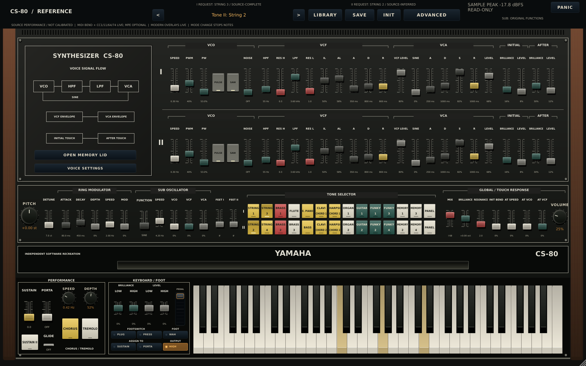
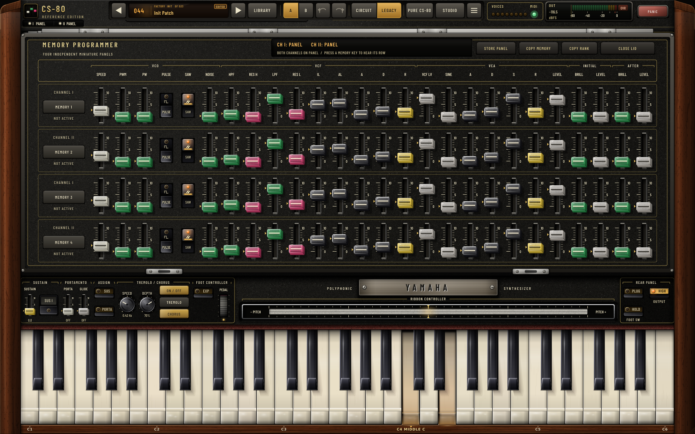
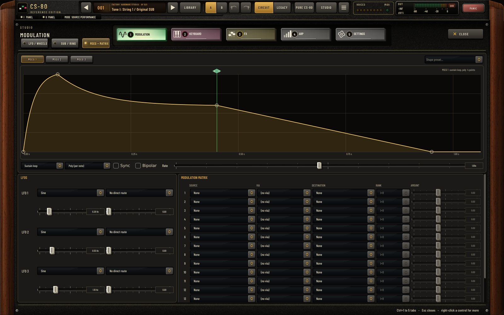
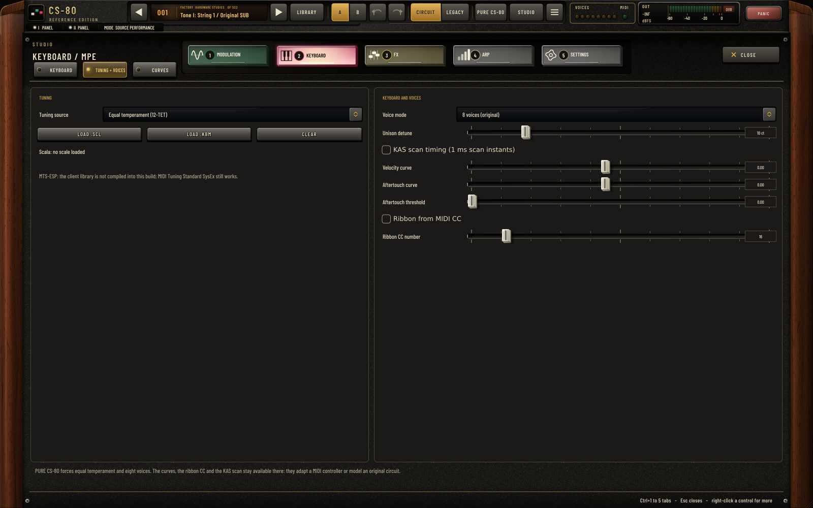
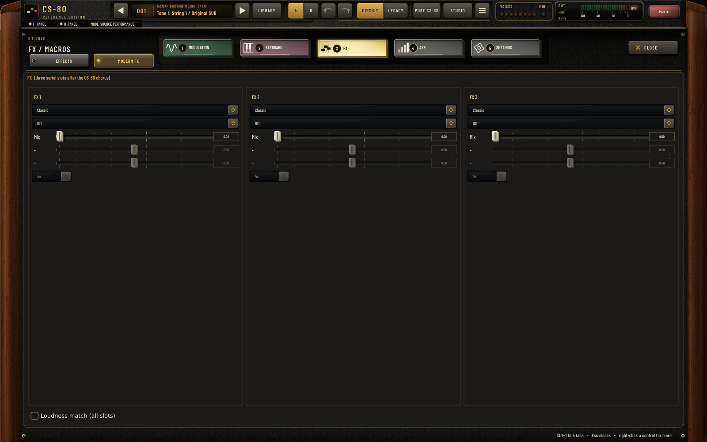
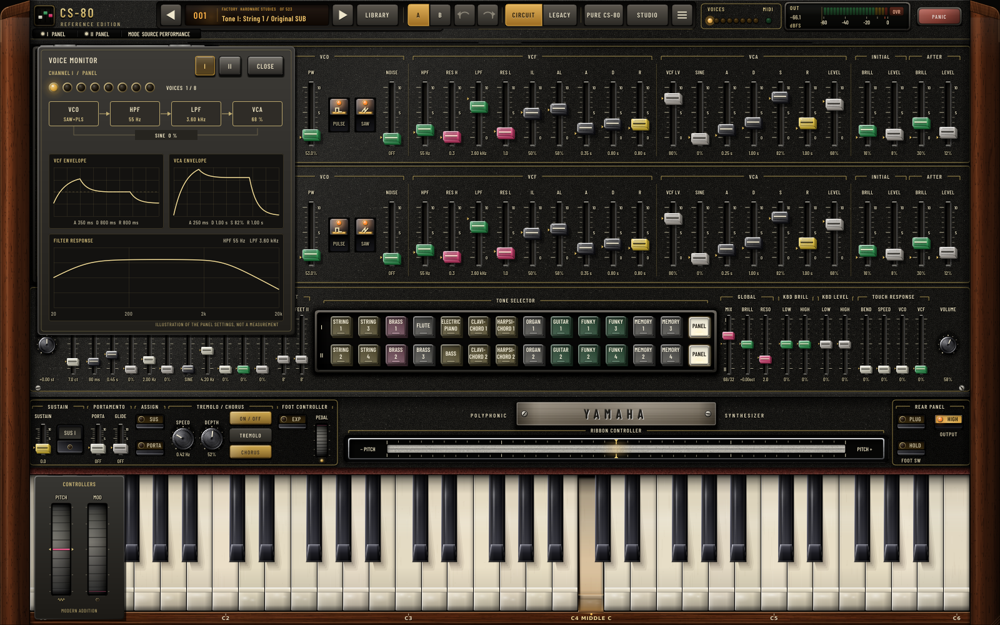

# CS-80 Reference

An independent software reconstruction of the Yamaha CS-80, written in C++20 with JUCE 8: eight dual-rank voices whose oscillators, filters, envelopes, VCAs, keyboard, touch and effects are modelled from the circuits in Yamaha's public service documentation, behind an editor laid out like the original panel. A modern layer (MSEGs, a modulation matrix, effects, microtuning, MPE, voice modes) sits behind it and switches off completely in PURE CS-80.

**What it is not:** a measured clone. No CS-80 has been measured for this project. Every law is either read from a schematic, manual or adjustment page, or is a declared engineering inference with its alternatives recorded. Nothing here claims measured hardware parity.

**State on 2026-10-31:** `main` integrates the eight workstreams of the [improvement plan](docs/IMPROVEMENT_PLAN.md) ([#2](https://github.com/cheshmakzanoon-ops/yamaha-cs80/pull/2), merge [`ec72eed`](https://github.com/cheshmakzanoon-ops/yamaha-cs80/commit/ec72eedb297fce0e5b9803ec96809f0b072f6aa5)) and the CI fixes that followed ([#3](https://github.com/cheshmakzanoon-ops/yamaha-cs80/pull/3), merge [`55bb043`](https://github.com/cheshmakzanoon-ops/yamaha-cs80/commit/55bb04314231a8da78554317095cbc6bbf4ff092)). Per-subsystem detail, the scorecard and the open issues are in [docs/STATUS.md](docs/STATUS.md).

## Downloads

Development builds from `main` at [`55bb043`](https://github.com/cheshmakzanoon-ops/yamaha-cs80/commit/55bb04314231a8da78554317095cbc6bbf4ff092); later commits on `main` change documentation only. **They are unsigned and not notarized**: the release run found no signing secrets, so the macOS package is labelled UNSIGNED and Gatekeeper will block it until you allow it, and Windows SmartScreen will warn. GitHub artifact downloads need a signed-in GitHub account and expire under the repository's retention settings (these on 29 January 2027).

**Install bundles** (build.yml run [41218764120](https://github.com/cheshmakzanoon-ops/yamaha-cs80/actions/runs/41218764120): native build, tests, pluginval and packaging per platform):

| Platform | Architecture | Formats | Download |
| --- | --- | --- | --- |
| Windows | x64 | VST3, Standalone `.exe` | [`cs80-windows-install-bundle`](https://github.com/cheshmakzanoon-ops/yamaha-cs80/actions/runs/41218764120/artifacts/13050450945) |
| macOS Apple Silicon | arm64 | VST3, AU, Standalone `.app` | [`cs80-macos-15-install-bundle`](https://github.com/cheshmakzanoon-ops/yamaha-cs80/actions/runs/41218764120/artifacts/13049492717) |
| macOS Intel | x86-64 | VST3, AU, Standalone `.app` | [`cs80-macos-15-intel-install-bundle`](https://github.com/cheshmakzanoon-ops/yamaha-cs80/actions/runs/41218764120/artifacts/13049702399) |
| Linux (Ubuntu 24.04) | x86-64 | VST3, Standalone | [`cs80-linux-install-bundle`](https://github.com/cheshmakzanoon-ops/yamaha-cs80/actions/runs/41218764120/artifacts/13049791928) |

**Installers** (release.yml run [41218772353](https://github.com/cheshmakzanoon-ops/yamaha-cs80/actions/runs/41218772353), workflow_dispatch on `main`):

| Platform | Contents | Download |
| --- | --- | --- |
| macOS 11+ (universal arm64 + x86-64) | `.pkg` installer (VST3, AU, Standalone), labelled `-UNSIGNED` | [`cs80-macos-universal-installer`](https://github.com/cheshmakzanoon-ops/yamaha-cs80/actions/runs/41218772353/artifacts/13049424181) |
| Windows x64 | setup `.exe` (VST3, Standalone), labelled `-UNSIGNED` | [`cs80-windows-installer`](https://github.com/cheshmakzanoon-ops/yamaha-cs80/actions/runs/41218772353/artifacts/13050675497) |
| Linux x86-64 | `.deb` package and tarball | [`cs80-linux-packages`](https://github.com/cheshmakzanoon-ops/yamaha-cs80/actions/runs/41218772353/artifacts/13049562316) |

CI at `55bb043`: the build run passed all six jobs (Linux, Windows, macOS arm64 and Intel builds and tests; pluginval at strictness 10 on Linux VST3 headless, GUI and seeded, Windows VST3, and VST3, AU and AU GUI on both macOS builds), the release run passed all three jobs, and [DSP measurements 41218763836](https://github.com/cheshmakzanoon-ops/yamaha-cs80/actions/runs/41218763836) passed (legacy byte comparison, circuit V1/V2 compatibility, ASan + UBSan suite). Passing validators are not a DAW qualification, and a passing Linux pluginval run does not explain its intermittent exit 139 (see open items).

The install bundles' macOS builds are separate native arm64 and x86-64 builds; the release installer is a universal binary. macOS bundles are ad-hoc signed so they load locally; Gatekeeper will still warn. Linux builds target Ubuntu 24.04 and are not an AppImage. Unpack the outer ZIP, check `SHA256SUMS`, and follow [Install and quickstart](docs/INSTALL_AND_QUICKSTART.md). `manifest.json` and `SOURCE.txt` inside each package name the exact source commit; the version string `1.0.0` alone does not.

## What is modelled, and how

The engine has three render policies:

- **ENGINE: CIRCUIT** (host parameter "Engine", `source_performance`) renders the circuit models. Fresh instances, INIT and new presets use it.
- **ENGINE: LEGACY (compat)** keeps the earlier voicing byte-identical, so sessions saved before state schema 3 and the Legacy Library sound as they did.
- **PURE CS-80** (`parity_mode`) runs the circuit models with every modern addition removed (see below).

| Subsystem | Circuit engine | Reference |
| --- | --- | --- |
| Oscillator | event-driven wave-shaping-comparator saw, comparator pulse, piecewise-linear sine, shared residual basis | [OSCILLATOR_PROMOTION.md](docs/OSCILLATOR_PROMOTION.md) |
| HP / LP filters | IG00156 nodal stage: input networks, 1.2 MOhm / 180 pF branch, 1 uF couplings, in-loop OTA, Newton solve per sample | [IG00156_NODAL_MODEL.md](docs/IG00156_NODAL_MODEL.md) |
| Envelopes | IG00159 single-RC law | [ENVELOPE_RC_MODEL.md](docs/ENVELOPE_RC_MODEL.md) |
| VCA | IG00151: LI node (0.54 ms), exponential SUB input, pedestal, AC coupling, constant-power pan | [IG00151_VCA_MODEL.md](docs/IG00151_VCA_MODEL.md) |
| Voice variation | 5 % R / 10 % C card draws into tune, cutoff, Q, level and EG times; 1/f thermal drift with warm-up; "worn unit" sine option | [TOLERANCE_DRIFT_MODEL.md](docs/TOLERANCE_DRIFT_MODEL.md) |
| Idle voices | all 16 chains free-run between notes (closed-form idle oscillator, decimated stages, snapshot replay) | [ws3 report](docs/workstreams/ws3-keyboard.md) |
| Keyboard and touch | KAS scan and SH7 hold with droop, ninth-key reconsideration, KBC contour network, TWS touch nodes and TRG5 bus | [ws3 report](docs/workstreams/ws3-keyboard.md) |
| Tone tabs | 22 tabs from the tone-board matrix: 7 complete, 15 with inferred cells; 25 cells stay labelled hypotheses | [PRESET_CIRCUIT_LEDGER.md](docs/PRESET_CIRCUIT_LEDGER.md) |
| SUB, ring modulator | IG00150 exponential converter; ADJ-anchored ring converter with declared carrier feedthrough | [ORIGINAL_SUB_OSCILLATOR.md](docs/ORIGINAL_SUB_OSCILLATOR.md) |
| Chorus / tremolo | OE2 BBD with true L/R paths; OE1 four-VCA tremolo | [BBD_CHORUS_MODEL.md](docs/BBD_CHORUS_MODEL.md) |
| Wah / expression | PRA circuit with declared LDR optics; expression through the same cell | [REALTIME_PRA_WAH_MODEL.md](docs/REALTIME_PRA_WAH_MODEL.md) |
| Noise, output | one SUB29 noise source with declared PSD; -6 dB reference, driver ceiling, output taps; GENERAL / PHONES listening outputs | [OUTPUT_REALTIME_PROPOSAL.md](docs/OUTPUT_REALTIME_PROPOSAL.md) |
| Control and rate | 5 ms smoothing on continuous controls; oversampling Eco 2x / Standard 2x / HQ 8x; reported latency 63 host samples plus the oscillator's 8 internal samples (8/N at Nx) | [STATUS.md](docs/STATUS.md) |

The full register, with what Legacy does for each row, is in [STATUS.md](docs/STATUS.md#model-register); row-by-row evidence and dated findings are in the [coverage ledger](docs/HARDWARE_COVERAGE.md).

### Evidence classes

Laws are labelled with one of these classes in the model documents, the code comments, the editor's evidence view (Studio > SETTINGS) and the per-control help:

| Class | Meaning |
| --- | --- |
| Source-derived | read from a Yamaha schematic, service manual or adjustment page |
| Source-derived route, inferred law | the circuit path is from the sources; how strongly it acts is a declared estimate |
| Engineering inference | a declared model where the public sources leave the behaviour open, with alternatives recorded |
| Modern extension | not on the original instrument; inert in PURE CS-80 |

The [fidelity requirement](docs/ANALOG_FIDELITY_REQUIREMENT.md) also names numerically verified results (what the test gates supply against the slow truth models) and hardware-measured results; nothing in this build is hardware-measured.

## The editor

### Original panel



The first surface is the CS-80 panel: the two rank rows, the tone tabs, the centre and performance deck, the ribbon and the keyboard, re-laid out against the original's control order and legends ([conformance audit](docs/PANEL_CONFORMANCE.md)). It is original vector artwork drawn by the real JUCE editor, not a photograph or a copy. The editor opens between 1120x700 and 1600x1000 logical pixels:


The toolbar along the top ([toolbar on the first library program](docs/screenshots/studio-main-1600x1000.png)) carries program PREV / NEXT and the library, A/B compare, undo / redo, ENGINE CIRCUIT / LEGACY, PURE CS-80, STUDIO and a menu (save, INIT, randomise within the original ranges, display size, voice monitor, controllers strip, computer-keyboard play, MIDI learn, the tour and the evidence register). The memory lid opens the four memory panels for editing:



### Library


523 programs: 301 curated circuit-engine programs and the 222-program Legacy Library, with search, categories, favourites and user saving. Program Change selects them from MIDI.

### Studio layer

STUDIO opens the modern layer as a second panel behind the first, so the primary surface stays a CS-80. Its tabs are MODULATION, KEYBOARD, FX, ARP and SETTINGS.

| Modulation: MSEG and 16-slot matrix | Keyboard: tuning and voice modes | FX: gain-compensated modern effects |
| --- | --- | --- |
|  |  |  |

The voice monitor and controllers strip open from the toolbar menu:



Every screenshot is rendered by the real editor (`CS80Snapshots`, the JUCE software renderer) from the source named in [provenance.json](docs/screenshots/provenance.json); [SHA256SUMS](docs/screenshots/SHA256SUMS) lists the images. The [screenshot directory](docs/screenshots/) holds the complete set. Screenshots show what the editor draws, not how it sounds.

## PURE CS-80

PURE CS-80 (toolbar key, host parameter `parity_mode`) is the circuit engine with every software addition removed:

- masked: the modern FX slots, LFOs 1-3, the macros (held neutral), MSEG, the matrix, the arpeggiator, MPE, microtuning, voice modes, MIDI learn and Program Change;
- ignored: MIDI pitch bend, mod wheel and CC1/11/64/74; the ribbon, polyphonic and channel pressure, the pedals and expression stay, as transports for the original's own inputs;
- zeroed: voice dispersion, drift and background noise, so the eight cards are identical; the original SUB is forced and the controllers strip is hidden.

It is a session policy: program recall keeps it, and switching it off applies the stored ENGINE choice and the player's settings again. Outside PURE CS-80 the modern features are neutral by default, so a fresh instance also starts from the original behaviour. Contract and checks: [PARITY_ISOLATION.md](docs/PARITY_ISOLATION.md).

## Scorecard

`cs80_engine_audit --suite all --rates 44100,48000,96000` and `cs80_source_factory_benchmark` (8 held voices, 48 kHz, 256 frames, minimum of 3 rounds) at the audio commit `00ceccf`, circuit engine, on a shared 4-core cloud container:

| Metric | Target | Before the plan | Now |
| --- | --- | --- | --- |
| Worst saw/pulse non-harmonic content, ring off | <= -70 dB | -33.8 dB | **-88.3 dB** (48 kHz), -88.5 (44.1), -89.5 (96): met |
| Worst tab/program peak at default volume | <= 0 dBFS | +3.9 dBFS | **-0.24 dBFS**: met |
| Worst voice-steal click score | <= 1 | 1.17 | **0.92**: met |
| Worst retrigger click score | <= 1 | — | **1.51** on one legacy-bank program rendered on the circuit engine; 281 of 283 rows <= 1: not met |
| CPU, 8 voices | 0.15-0.20 x realtime | 0.27 | **0.51-0.61** median, p99 0.66-1.00: not met |
| Idle CPU | <= 2 % | 6-7 % | **11 %**: not met |

Ring-modulator rows read -43 dB at every oversampling factor: that is the declared carrier feedthrough, a spectral line, not aliasing. Legacy runs the same row at 0.21-0.27 x realtime.

Legacy audio is pinned byte-identical to `d56911a` and the circuit-engine audio to `00ceccf` by `dsp-measurements.yml`; `scripts/check-compat-gates.sh --strict-v2` runs the same comparisons locally.

## Open items

- **CPU:** the oscillator's event solver and the nodal stages' Newton solve dominate. A structure-of-arrays, segment-cached oscillator path is the route to the target; not done.
- **Validator:** the Linux pluginval run has intermittently exited 139 after printing SUCCESS. Code review and a valgrind teardown probe found no fault in project code; the cause is not established ([validator diagnostics](docs/VALIDATOR_DIAGNOSTICS.md)).
- **Clicks:** retrigger 1.51 on "Bass Stack"; note-off click scores up to 1.65 on percussive circuit-engine programs.
- **Filter:** top-octave small-signal accuracy at 2x/4x internal rate; the ADJ p11 HP point.
- **Not yet:** sample-accurate automation; the MTS-ESP client library (a shim is in place); memory-panel electrical model driving audio; the 25 tone-tab hypothesis cells; tremolo/chorus both-on and both-off panel states.
- **Release:** signing and notarization need the owner's certificates; real-DAW sessions, trademark review and AAX are owner actions ([release qualification](docs/release/RELEASE_QUALIFICATION.md)).

## Build from source

Requirements: a C++20 compiler, Git, CMake 3.22+ (3.25+ for the presets), Python 3.10+ for tests, Ninja or Visual Studio 2022; Xcode command-line tools on macOS. CMake fetches the pinned JUCE 8.0.11 commit when `deps/juce` is absent.

Linux packages, as on the Ubuntu 24.04 CI runners:

```bash
sudo apt-get update
sudo apt-get install -y build-essential cmake ninja-build pkg-config git python3 \
  libasound2-dev libx11-dev libxext-dev libxrandr-dev libxcursor-dev \
  libxinerama-dev libxrender-dev libxcomposite-dev libgl1-mesa-dev \
  libfreetype-dev libfontconfig1-dev libcurl4-openssl-dev \
  libwebkit2gtk-4.1-dev fonts-dejavu-core xvfb xauth openbox x11-utils
```

Plugin and tests with the preset for your platform (`linux-release`, `macos-release`, `windows-release`):

```bash
cmake --preset linux-release
cmake --build --preset linux-release --parallel
ctest --preset linux-release
```

The JUCE-free core, its tests and the offline tools:

```bash
cmake -S . -B build-core -DCMAKE_BUILD_TYPE=Release -DCS80_BUILD_PLUGIN=OFF -DCS80_BUILD_TESTS=ON
cmake --build build-core --parallel
ctest --test-dir build-core --output-on-failure
./build-core/cs80_engine_audit --out artifacts/audit --suite all --rates 44100,48000,96000
./build-core/cs80_source_factory_benchmark --out artifacts/bench --source-commit "$(git rev-parse HEAD)" --rate 48000 --block 256
scripts/check-compat-gates.sh --strict-v2
```

Screenshots, headless on Linux:

```bash
JUCE_FONT_PATH=/usr/share/fonts/truetype/dejavu bash scripts/run-ui-smoke-linux.sh \
  ./build/CS80Snapshots_artefacts/Release/CS80Snapshots --out artifacts/ui --self-test
```

Plugin outputs are under `build/CS80Reference_artefacts/Release/` (`VST3/`, `Standalone/`, and `AU/` on macOS). [CI distribution status](docs/CI_DISTRIBUTION_STATUS.md) explains the package manifests and checksums.

## Documentation

| Read | For |
| --- | --- |
| [STATUS.md](docs/STATUS.md) | model register, phase progress, scorecard, compatibility pins, open issues |
| [IMPROVEMENT_PLAN.md](docs/IMPROVEMENT_PLAN.md), [workstreams/HANDOVER.md](docs/workstreams/HANDOVER.md) | the plan and how the eight workstreams were merged |
| [HARDWARE_COVERAGE.md](docs/HARDWARE_COVERAGE.md), [HARDWARE_REFERENCES.md](docs/HARDWARE_REFERENCES.md) | row-by-row behaviour, dated findings, primary sources |
| [ANALOG_FIDELITY_REQUIREMENT.md](docs/ANALOG_FIDELITY_REQUIREMENT.md) | the target and the evidence rules |
| [ENGINE.md](docs/ENGINE.md), [ENGINE_AUDIT.md](docs/ENGINE_AUDIT.md) | signal paths and the audit tool |
| [INSTALL_AND_QUICKSTART.md](docs/INSTALL_AND_QUICKSTART.md), [release/RELEASE_QUALIFICATION.md](docs/release/RELEASE_QUALIFICATION.md) | installing builds and what a release still needs |
| [VALIDATOR_DIAGNOSTICS.md](docs/VALIDATOR_DIAGNOSTICS.md) | pluginval history and the exit 139 investigation |

`src/core/` holds the engine, `src/plugin/` the JUCE plugin and editor, `src/reference/` the slow truth models the tests compare against, `src/tools/` the render, audit, benchmark and snapshot tools, `tests/` the checks, `scripts/` the CI and analysis helpers.

## Contributing

- Host parameters are append-only, in workstream blocks; missing state restores to documented neutral defaults.
- Keep the evidence classes honest: never relabel an inference, a recording or a passing test as a measurement.
- Legacy audio must stay byte-identical. Record every intentional circuit-engine sound change and the commit that reproduces earlier renders.
- Do not weaken or skip a gate to get a green run.

## Licence

CS-80 Reference is licensed under the [GNU Affero General Public License v3](LICENSE). JUCE is used under its AGPLv3 option; every package carries JUCE's licence as `licenses/JUCE-LICENSE.md`. The editor artwork, code and programs are independent work; no Yamaha or Arturia artwork, code or preset banks are copied. Yamaha manuals and schematics are cited as hardware evidence. This project is not affiliated with or endorsed by Yamaha; "CS-80" is used to identify the instrument being modelled.
