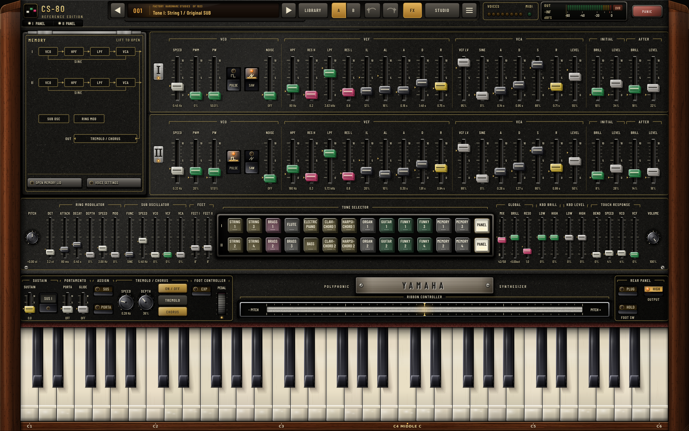

# CS-80 Reference

An independent software instrument based on the Yamaha CS-80. Eight voices play
two synthesizer layers per note, each with its own oscillator, high-pass and
low-pass filters, and amplifier. The ribbon, polyphonic aftertouch, ring
modulator, chorus and tremolo bring the original's performance controls into
a DAW or a standalone app.

[Downloads](#downloads) · [First sound](#play-your-first-sound) · [Preset guide](docs/PRESET_GUIDE.md) ·
[How it was modeled](#from-schematic-to-sound) · [CPU evidence](#how-we-reduced-cpu-work) ·
[Build from source](#build-from-source)



*Rendered from the actual circuit-only editor. Versioned layout captures cover [1600 × 1000](tests/golden/main-1600x1000.png) and [1120 × 700](tests/golden/main-1120x700.png).*

## Downloads

**2026.11.1 development candidates — the full release is blocked by a Linux
GUI validator crash.** All four native build/test/package jobs passed, and
Windows and both Mac targets passed their required validators. The Linux
randomized GUI validator printed SUCCESS and then terminated by SIGSEGV
(raw −11 / wrapper 139). The complete build therefore **failed**; the automatic
publisher was skipped and no qualified 2026.11.1 prerelease was published.

These pinned ZIPs contain the complete 300-program redesign plus the twelve
2026.11.1 refinements. Their actual downloaded bytes, package inventories,
architectures and installation contents have been checked. **They remain
unsigned development candidates; Linux has the unresolved GUI validation
failure above.** No GitHub sign-in is required for these links.

| Platform | Formats | Candidate download |
| --- | --- | --- |
| Windows x64 | VST3, Standalone | [Windows candidate ZIP](https://nightly.link/cheshmakzanoon-ops/yamaha-cs80/actions/artifacts/14763872941.zip) |
| macOS Apple Silicon (arm64) | VST3, AU, Standalone | [Apple Silicon candidate ZIP](https://nightly.link/cheshmakzanoon-ops/yamaha-cs80/actions/artifacts/14763761497.zip) |
| macOS Intel (x86-64) | VST3, AU, Standalone | [Intel Mac candidate ZIP](https://nightly.link/cheshmakzanoon-ops/yamaha-cs80/actions/artifacts/14763644216.zip) |
| Linux x86-64 (Ubuntu 24.04 build) | VST3, Standalone | [Linux experimental ZIP — GUI validation failed](https://nightly.link/cheshmakzanoon-ops/yamaha-cs80/actions/artifacts/14768807632.zip) |

Binary source:
[`6d3cc220`](https://github.com/cheshmakzanoon-ops/yamaha-cs80/commit/6d3cc220edef5a4a2c7cd968ea8a786c7c83198c) ·
[Build 45044040694, attempt 1 — failed](https://github.com/cheshmakzanoon-ops/yamaha-cs80/actions/runs/45044040694) ·
[Download hashes and public GET evidence](docs/preset-evidence/2026.11.1/final-ci/public-candidates/summary.json) ·
[Four-archive installation checks](docs/preset-evidence/2026.11.1/final-ci/installation/artifact-proof.json) ·
[Linux validator failure](docs/preset-evidence/2026.11.1/final-ci/linux-x86_64/ci-proof.json)

[Consolidated qualification](docs/preset-evidence/2026.11.1/ci/release-qualification.json) ·
[Acceptance of the reviewed downloads](docs/preset-evidence/2026.11.1/ci/acceptance/FINAL-ACCEPTANCE-2026_11_1.md)

**Hear the revised factory bank:** [24 unnormalized WAV excerpts](https://nightly.link/cheshmakzanoon-ops/yamaha-cs80/actions/artifacts/14769036590.zip)
from the same source, including every refined program: **117 seconds** of
48 kHz stereo audio, with inventory, metrics, provenance and checksums.
Pressure Lead is captured with aftertouch; the excerpts do not cover every
natural release or performance history. These are core-engine captures and do
not certify the failed Linux GUI gate.
[Actual audition verification](docs/preset-evidence/2026.11.1/final-ci/auditions/artifact-proof.json)

Unzip the outer artifact, verify its included `SHA256SUMS`, and unpack the inner
archive without splitting the plug-in or app bundle. The linked download record
above gives the outer ZIP hashes. Each manifest and `SOURCE.txt` retains the
exact binary source; an application version or later `main` commit does not
identify these bytes. Follow the
[verification instructions](docs/INSTALL_AND_QUICKSTART.md#offline-inventory-verification-python-310)
and [install paths](docs/INSTALL_AND_QUICKSTART.md#install-only-the-formats-you-need).

Choose the Mac bundle for the **host process** architecture; these are separate
arm64 and x86-64 builds without release signing or notarization. Linux requires
compatible system libraries. These are retained GitHub Actions artifacts, with
API expiry **20 February 2027 at 16:28:38 UTC**, rather than permanent release
assets. If the mirror is unavailable, use the same build's GitHub **Artifacts**
list while they remain retained.

The [refinement report](docs/PRESET_REFINEMENT_2026_11_1.md) separates passing
native/archive checks from the failed Linux validator and the pre-existing
VST3 Program queue limitation. The earlier **2026.11** downloads, original
review and their separate failure/retry history remain in the
[distribution history](docs/CI_DISTRIBUTION_STATUS.md) and
[original revision report](docs/PRESET_REVISION_2026_11.md).
The [2026.11.1 60-agent review](docs/TEAM_REVIEW_2026_11_1.md) records this
refinement's assignments and their qualification limits separately from the
earlier review.

## Play your first sound

Launch **Standalone** and select your audio output and MIDI input, or install
VST3/AU and load **CS-80 Reference** on a software-instrument track. A fresh
instance opens **Brass Swell I**. Hold a chord, then
open **Library** to explore the other voices. With polyphonic aftertouch,
press just one note harder to brighten it; you can also drag down on a held
on-screen key to try pressure.

- **One circuit instrument** plays every program. The panel exposes the two ranks,
  22 tone tabs, four memory panels, ribbon and performance controls. There are
  no Legacy or Pure engine choices.
- **Library** contains all **523 existing programs** in one catalogue. The original
  222 addresses now use authored circuit voicings; their names and program numbers
  remain available alongside the later 301 programs.
- **Studio** exposes controls for a modulation matrix, drawable envelopes, MPE, microtuning,
  arpeggiation, effects and expanded voice modes. These are software additions,
  not features of the original hardware. See the [circuit and session contract](docs/PARITY_ISOLATION.md)
  and [editor gallery](docs/screenshots/).

## Revoiced factory library — 2026.11.2

The existing **222 original-address programs** now use explicit instrument recipes
and controlled variations in place of randomized voicings. The **24 keyboard
programs** in the later collection have revised strike/body balance, velocity
response, decay and key-release damping. Focused refinements also improve brass and bowed attacks, wind onsets, bass decay, plucked-string harmonics, vibraphone partials, centered leads and five tremolo voices. No presets were added or renamed.
The [revision report](docs/CIRCUIT_LIBRARY_2026_11_2.md) explains the sound changes,
program addressing and compatibility consequences.

| Try | Revised character and playing suggestion |
| --- | --- |
| Electric Piano I / Electric Piano II | A more audible short strike above a separately decaying body. Compare soft and firm notes, then release early to hear damping. |
| Tine Piano | A velocity-sensitive third-harmonic strike that follows the keyboard and fades before the body. Compare low, middle and high notes. |
| Reed Piano / Stage Keys / Saw Pulse Piano | More defined bark or hammer-like onset followed by a falling body. Hold a key to hear the decay. |
| Toy Piano / Celesta / Vibes Keys | Distinct upper strikes and ringing bodies with their own decay times and registers. Start with single notes. |
| Analog Piano / Bright Keys / Slow Keys 106 | Existing original addresses now inherit specific keyboard recipes. Even the longer-decaying variation keeps a struck onset. |
| Tone I: E. Piano / Tone II: Bass | The named rank now carries the dominant instrument instead of being outweighed by the unrelated opposite rank. |

**Pressure Lead requires aftertouch** and is intentionally silent until pressure
is applied. Use channel/polyphonic aftertouch or drag downward on a held
on-screen key. For on-screen pressure, leave **KAS Scan Timing** off (the default);
MIDI aftertouch also works with scan timing enabled. The **modern** tag identifies
programs using optional effects, modulation or arpeggiation; those features remain
available in the same circuit instrument. The [preset guide](docs/PRESET_GUIDE.md)
explains registrations and playing techniques.

**Older sessions using Legacy or Pure intentionally change sound.** Their saved
controls and parameter identities are retained, but obsolete engine settings
resolve to the circuit engine with normal MIDI and optional Studio features.
There is no promise of identical old rendering. Reload a factory program from
**Library** to hear its revised voicing; merely opening a saved session does not
replace its stored patch with the current factory recipe. Keep the older binary
and a rendered reference when an existing project's exact sound must be retained.

Instrument names describe synthesized interpretations. This instrument does not
contain sampled pianos or physical models of acoustic instruments, and the software checks do
not establish an exact acoustic or physical CS-80 match. Build and validator
results belong to the specific download and source commit listed above. The
earlier [2026.11.1 report](docs/PRESET_REFINEMENT_2026_11_1.md) also records a native
VST3 Program-queue controller dependency; **Library** selection is the direct
way to audition a current factory sound.

## From schematic to sound

The primary reference was the [Yamaha CS-80 Service Manual](https://therogoffs.com/cs80/manuals/CS80_Service_Manual/),
Yamaha's original scans and foldouts hosted by David Rogoff. The work starts by
tracing a signal or control through the drawings, then implementing the
documented relationship and checking the resulting behavior in software.
Where a drawing gives the route but not a full response curve, the model
records the assumptions.

| Manual evidence | How it was used |
| --- | --- |
| M voice card and harness, pp. 41 and 44 | The saw and pulse feed high-pass then low-pass; the sine bypasses both filters. The harness drawing resolves the HP-to-LP link. See the [oscillator](docs/OSCILLATOR_PROMOTION.md), [filter reconstruction](docs/IG00156_NODAL_MODEL.md) and [filter code](src/core/Ig00156Filter.h). |
| TWS and TRG, pp. 17, 19 and 23 | The drawings separate sustained initial brilliance and level from the transient pitch bend. The nominal 50 ms pitch path comes from the documented capacitor and resistor network; MIDI-to-touch behavior is modeled rather than measured. See the [circuit analysis](docs/INITIAL_PITCH_TRANSIENT.md) and [implementation](src/core/TouchCircuit.h). |
| OE1/OE2, pp. 55–58 | The detailed drawings identify the chorus delay send and four returns, and resolve a contradictory foldout pin label. See the [board trace](docs/OE2_CIRCUIT_EVIDENCE.md) and the [real-time chorus model](docs/BBD_CHORUS_MODEL.md) for what actually ships. |

Other sources answer questions the service drawings alone do not:

- The [Yamaha owner's manual](https://www.therogoffs.com/cs80/CS80E_2.pdf#page=25)
  describes how touch changes the sub-oscillator's filter modulation.
  That behavior informs the [per-note pressure route](docs/AFTERTOUCH_SUB_VCF.md).
  The [Yamaha museum photograph](https://www.yamaha.com/en/about/experience/innovation-road/collection/detail/2039/)
  and panel drawing guided the independently drawn [editor layout](docs/PANEL_CONFORMANCE.md).
- Yamaha's [adjustment sheets](https://www.therogoffs.com/cs80/CS80%20Adjustment%20Procedures%20and%20updates.PDF)
  anchor the [offline ring-oscillator reference](docs/RING_TIME_REFERENCE.md) at nominal periods
  of 150 ms and 5 ms under specified service settings. These are calibration
  targets from the document, not voltages or timings measured by this project.
- The [Yamaha IC Guide Book](https://www.goltsynth.com/resources/downloads/CS/yamaha_ic_guidebook.pdf)
  helped trace the [oscillator reset and waveform shaper](docs/OSCILLATOR_CIRCUIT_EVIDENCE.md).
  Panasonic's [BBD handbook](https://www.ka-electronics.com/images/pdf/Panasonic_BBD.pdf)
  informed the [MN3001 clock and output timing reference](docs/MN3001_CLOCK_EVENT_DESIGN.md).

The [source ledger](docs/HARDWARE_REFERENCES.md) and [coverage map](docs/HARDWARE_COVERAGE.md)
separate documented facts, engineering estimates, software test results and
unresolved behaviors. No calibrated physical CS-80 was measured for this
project; the tests do not establish a hardware match.

## How we reduced CPU work

The engine does less redundant work without lowering the render quality:
the oscillator screens pairs of crossings before the same scalar solve,
filter controls reuse identical results within a sample, and the output
oversampling filter computes independent tap products together while keeping
the original sum order. The plug-in also avoids scanning unused automation
lanes. Qualified GCC/x86-64 builds also use an exact
[AVX2 filter path](docs/experiments/avx-default/) with a scalar fallback. The
[engineering reports](docs/experiments/cumulative-cpu-2026-11-19/continued-exact-hotpaths/)
describe the guards and fallbacks.

| Matched VST3 workload | Fewer guest instructions |
| --- | ---: |
| Eight held notes at varied velocities | 23.4–23.7% |
| Fresh silence | 45.5–46.5% |

These are [matched instruction counts](docs/experiments/cumulative-cpu-2026-11-19/compact-cutoff-publication/)
for runtime `0c4abd85` versus the historical `db02cd8` baseline on Linux x86-64
(GCC 14.2 Release, 48 kHz, 16/32/64-frame buffers). Native replay for the
latest optimization pass matched tested audio and exposed state bit for bit;
Standard still reports **67 samples (1.40 ms at 48 kHz)** of plug-in latency.
That is not round-trip latency. Instruction counts show work removed, not a
DAW CPU percentage. [Physical CPU-budget qualification](docs/experiments/cumulative-cpu-2026-11-19/q0-evidence/PHYSICAL-TARGET.md)
is still open.

## Build from source

Use a C++20 toolchain and CMake 3.25+ for the presets. The build pins JUCE
8.0.11. On Ubuntu 24.04, start with the [dependencies in the build workflow](.github/workflows/build.yml).

```sh
cmake --preset linux-release
cmake --build --preset linux-release --parallel
ctest --preset linux-release
```

Use `macos-release` with Xcode command-line tools and Ninja, or
`windows-release` with Visual Studio 2022. The plug-in and standalone outputs
are under `build/CS80Reference_artefacts/Release/`. For a JUCE-free core build,
configure with `-DCS80_BUILD_PLUGIN=OFF -DCS80_BUILD_TESTS=ON`.

## Further reading

- [Engine architecture](docs/ENGINE.md), [model register](docs/STATUS.md#model-register)
  and [DSP measurements](docs/DSP_MEASUREMENTS.md)
- [Distribution and checksums](docs/CI_DISTRIBUTION_STATUS.md) and
  [release qualification](docs/release/RELEASE_QUALIFICATION.md)
- [Fidelity requirements and contribution standards](docs/ANALOG_FIDELITY_REQUIREMENT.md):
  preserve the documented circuit behavior, retain diagnostic references, and explain intentional sound changes.

## Licence

[GNU Affero General Public License v3](LICENSE). JUCE is used under its AGPLv3
option. CS-80 Reference is independent and is not affiliated with or endorsed
by Yamaha.
