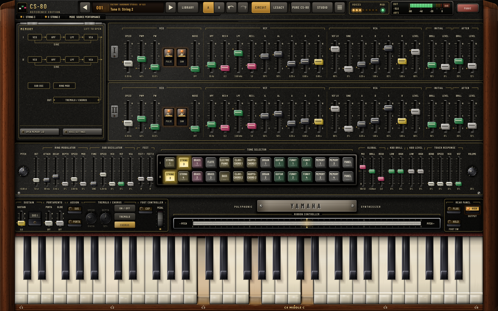
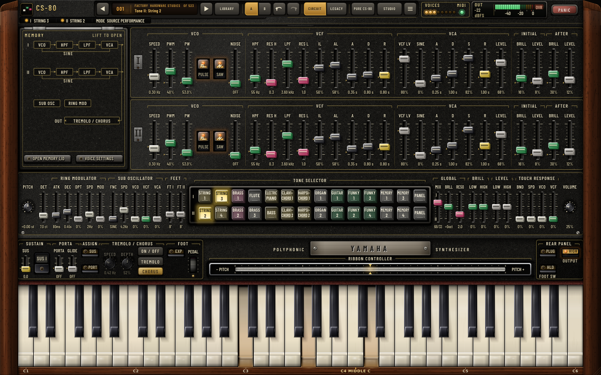
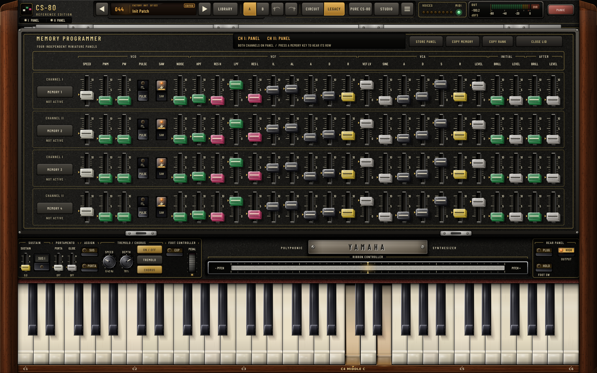
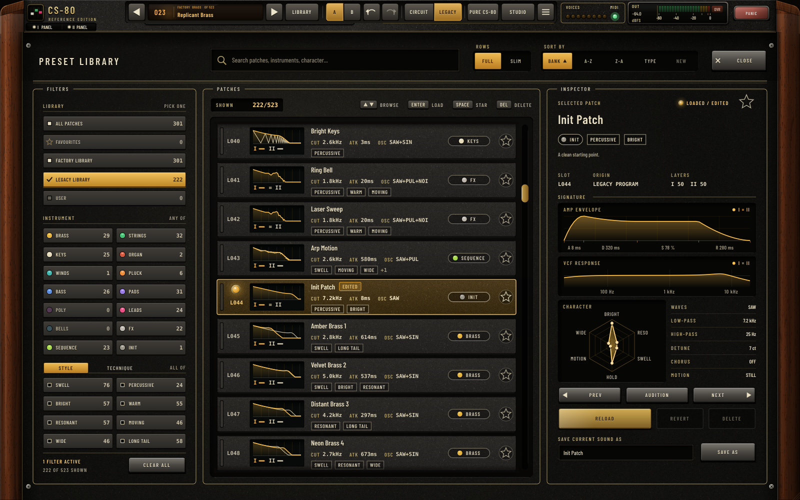
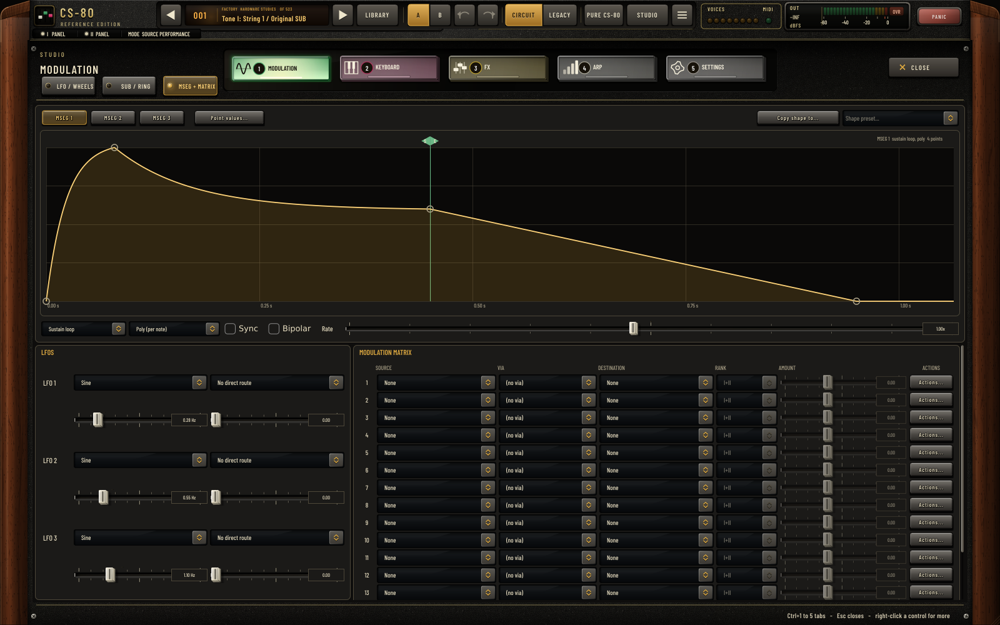
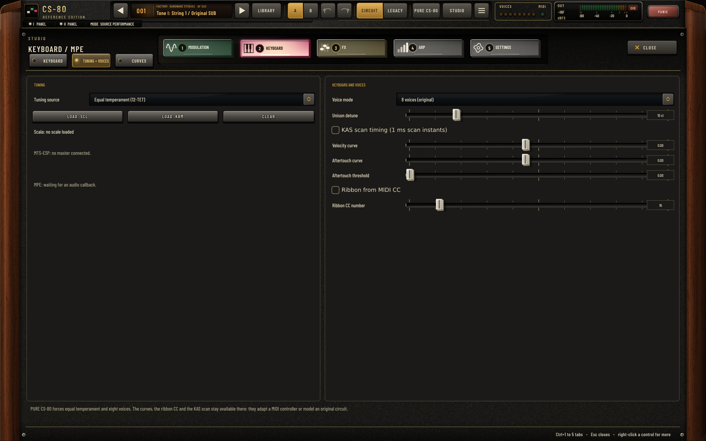
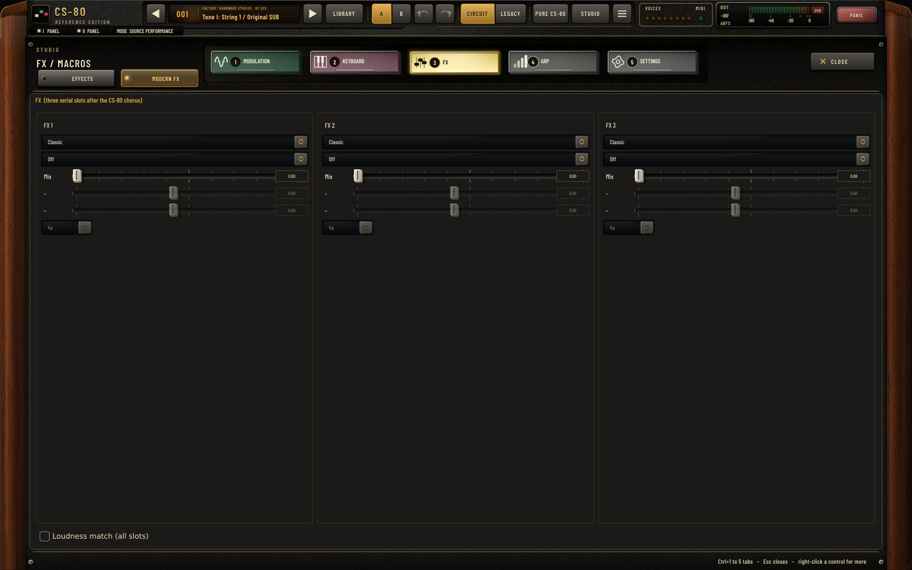
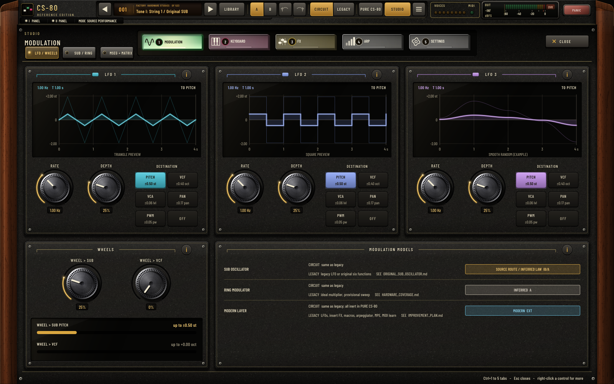
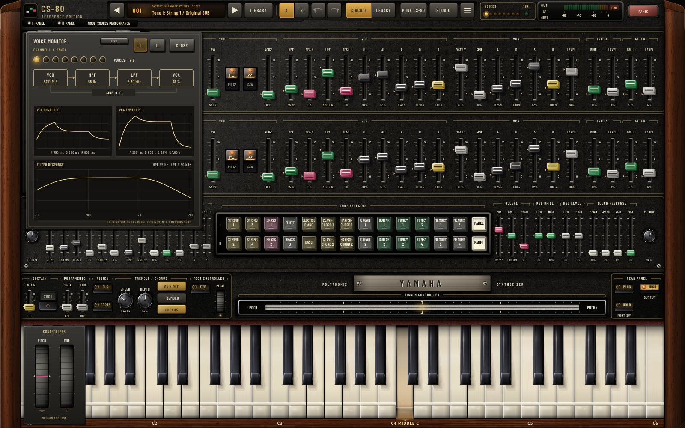

# CS-80 Reference

An independent software reconstruction of the Yamaha CS-80, written in C++20 with JUCE 8: eight dual-rank voices whose oscillators, filters, envelopes, VCAs, keyboard, touch and effects are modelled from the circuits in Yamaha's public service documentation, behind an editor laid out like the original panel. A modern layer (MSEGs, a modulation matrix, effects, microtuning, MPE, voice modes) sits behind it and switches off completely in PURE CS-80.

**What it is not:** a measured clone. No CS-80 has been measured for this project. Every law is either read from a schematic, manual or adjustment page, or is a declared engineering inference with its alternatives recorded. Nothing here claims measured hardware parity.

**State on 2026-11-09:** the integration includes [sixteen-voice on-screen note/pressure ownership](docs/SIXTEEN_VOICE_UI_OWNERSHIP.md), [bounded tuning admission](docs/TUNING_ADMISSION_SAFETY.md), and [block-independent live dispersion envelope timing](docs/LIVE_DISPERSION_TIMING.md), on top of distribution verification and installer preflight source [`a6569a0`](https://github.com/cheshmakzanoon-ops/yamaha-cs80/commit/a6569a079e4c8f40975ba041e34e513abe0560b8). These are scoped software corrections, not hardware-parity or release qualification. The loaded memory-panel reference remains offline, not wired into audio.

Latest checked implementation [`c7595a4`](https://github.com/cheshmakzanoon-ops/yamaha-cs80/commit/c7595a4ea5171b4bf710e53c635938aa7d363e27) passed [build 42574049408](https://github.com/cheshmakzanoon-ops/yamaha-cs80/actions/runs/42574049408) (all six native/validator jobs), [DSP 42574049467](https://github.com/cheshmakzanoon-ops/yamaha-cs80/actions/runs/42574049467) (all five jobs) and [screenshots 42574049530](https://github.com/cheshmakzanoon-ops/yamaha-cs80/actions/runs/42574049530), verified November 9. The preceding `4278da7` Windows validator-download failures and `34358cee` Linux GUI validator failure remain recorded in [STATUS](docs/STATUS.md). This success does not explain those failures or establish real-DAW/release qualification.

**Current integration:** [keyboard-operated performance wheels](docs/PERFORMANCE_WHEEL_KEYBOARD.md), [finite preset-preview boundaries](docs/PRESET_PREVIEW_BOUNDARIES.md) and [termination diagnostics](docs/VALIDATOR_DIAGNOSTICS.md) are included. [`c7595a4` bounds and pins the official Windows validator download](docs/PLUGINVAL_WINDOWS_DOWNLOAD.md) without changing validation commands or retrying validator failures. Offline [verified-log](docs/analysis/memory-certificate-cost.md), [point-operand](docs/analysis/memory-interval-cost.md) and [endpoint-extrema](docs/analysis/memory-interval-extrema-cost.md) work does not qualify audio-rate memory integration; its sparse solver still exceeds the proposed update budget. [Rejected one-log prototypes](docs/analysis/memory-log-span-cost.md) remain archived outside `src/`. Diagnostics are not a crash repair, and memory-panel electrical controls and receivers remain outside Engine audio.

**Downloads remain at `0996a15`; screenshots now show `c7595a4`.** The four native download links retain the earlier source whose [post-merge build](https://github.com/cheshmakzanoon-ops/yamaha-cs80/actions/runs/42381017495), DSP and screenshot runs passed. Those archives do not acquire later fixes, packaging guards or notices when main changes. The current 68 real-editor screenshots were rendered from `c7595a4` and published in screenshot-only child [`68fcb88`](https://github.com/cheshmakzanoon-ops/yamaha-cs80/commit/68fcb884d49afb2a938dd703328529fca06f331d), not from the retained download source. See [docs/STATUS.md](docs/STATUS.md) for source, artifact and qualification scope.

Since the October 31 integration:

- **Tuning-table inspection:** inspect an [applied note/channel table entry](docs/TUNING_NOTE_INSPECTION.md), including unmapped Scala keys and channel-specific MTS pitches. This is table state before performance offsets, not measured sounding audio.
- **Applied MPE status:** the Keyboard and Tuning page shows [negotiated zones and effective bend ranges](docs/MPE_STATUS_DISPLAY.md) from the last completed audio callback, rather than assuming the stored fallback knobs still apply.
- **MPE initial expression:** member-channel bend, pressure and CC74 received before a note now initialize its accepted onset using the current range and pressure curve. [The bounded contract and evidence](docs/MPE_MEMBER_ONSET.md) cover both active instruments. [Released member targets](docs/MPE_RELEASED_TARGETS.md) now retain bend/pressure/timbre after accepted release while later onsets receive fresh cached values; reset/global exceptions and inactive-extension handoff limits remain explicit.
- **Repeated-note release:** [Immediate sixteen-voice Note Off](docs/SIXTEEN_VOICE_NOTE_RELEASE.md) cancels one matching waiter or releases the newest comparable held group across the two instruments, preserving unison groups and UI source guards. Deferred-scanner and arpeggiator releases still use the existing broadcast fallback.
- **Sixteen-voice keyboard:** accepted on-screen notes in the second instrument retain release and gesture-pressure ownership; cross-engine host aliases remain excluded. [Activity telemetry](docs/VOICE_ACTIVITY_TELEMETRY.md) now includes both instruments with a coherent 8/16 denominator and an extension lamp row. See [scope and regressions](docs/SIXTEEN_VOICE_UI_OWNERSHIP.md).
- **Signed Scala mapping:** [Negative keyboard-map degrees are playable, distinct from unmapped x](docs/SCALA_NEGATIVE_MAPPING_DEGREES.md).
- **Scala formal octave:** [Nonuniform keyboard maps advance scale degrees correctly](docs/SCALA_FORMAL_OCTAVE_MAPPING.md), verified against an official Scala CLI oracle.
- **Scala reference mapping:** [Restricting the playable key range preserves the mapped tuning reference](docs/SCALA_REFERENCE_OUTSIDE_RANGE.md), even when that reference key lies outside the range.
- **Tuning admission:** KBM integers are checked before narrowing, constructed tuning tables must produce positive finite nominal float frequencies, and scale/octave MTS messages reject reserved bits. No arbitrary audible-frequency clamp or new Scala/KBM editor workflow is added. See [evidence and limits](docs/TUNING_ADMISSION_SAFETY.md).
- **Live dispersion:** Source Performance envelope timing now follows the smoothed per-card ratios each internal sample instead of depending on repeated host frames. Moving dispersion intentionally changes affected envelopes and can cost up to 32 extra envelope `exp` evaluations per internal sample per eight-voice engine; settled controls skip that work. [Static compatibility checks](docs/LIVE_DISPERSION_TIMING.md) are not a CPU-budget pass.
- **Distribution checks:** [offline native-bundle verification](docs/INSTALL_AND_QUICKSTART.md), Windows payload preflight/reparse-point rejection and macOS/Debian staging-permission guards are implemented. They do not refresh the retained downloads, install the product or qualify a release.
- **Preset deletion safety:** [#90](https://github.com/cheshmakzanoon-ops/yamaha-cs80/pull/90) removes the explicit permanent-delete fallback after a failed trash operation and reports that failure instead. This does not change native OS trash semantics or guarantee recoverability on unsupported filesystems/volumes.
- **CC88 release-prefix fix:** [Note Off now consumes its channel's high-resolution velocity prefix](docs/CC88_RELEASE_PREFIX.md), so a release prefix cannot change the next unprefixed strike. This does not add release-velocity synthesis or change positive Note On arithmetic.
- **Linux packaging:** the Debian installer derives versioned runtime dependencies from both delivered ELF products and rejects invalid primary payloads. The [native packaging evidence check](docs/release/LINUX_PACKAGE_QUALIFICATION.md) passed with pinned inputs, recording libc6 >= 2.38 and libstdc++6 >= 13.1. Its output is text/JSON evidence, not a downloadable `.deb` or installation/release qualification; that historical package predates #70 notice coverage. Current packaging recipes include the embedded Barlow font licence/source notice and MTS-ESP licence; this does not retroactively change older downloads or qualify a new installer.
- **Native archive identity:** the package gate checks the delivered ELF, PE and Mach-O binary format and architecture, rather than trusting filenames alone. The Debian installer also rejects an architecture mismatch; these checks do not establish runtime compatibility.
- **macOS packaging:** the [universal installer guard](docs/MACOS_INSTALLER_ARCHITECTURE_GATE.md) requires executable VST3, AU and Standalone binaries with both x86-64 and arm64 slices before staging. Native development bundles remain separate. Real universal-installer/signing/notarization qualification remains open.
- **MSEG correctness:** [mono onset retention and poly retrigger-rate isolation](docs/MSEG_COMBINED_INTEGRATION.md) now work together. A dormant mono envelope retains its phrase onset, and a restarted poly envelope clears only its old per-voice rate history. Affected routed performances intentionally change in Legacy and Circuit; default/no-route playback and PURE CS-80 remain unchanged.
- **Zero-EI VCA fast path:** [#91](docs/IG00151_ZERO_EI.md) avoids `exp2` only when exponential drive is signed zero. Nonzero inputs retain the existing path; focused exact-output checks do not establish the whole-instrument CPU target or replace post-merge qualification.
- **Filter and external modulation:** the [IG00156 cache](docs/IG00156_RESONANCE_CACHE.md) reuses cutoff-dependent coefficients for resonance-only updates; [sparse external interpolation](docs/EXTERNAL_INTERPOLATOR_SPARSE.md) skips guaranteed-zero FIR work while preserving the existing accumulation order. These are numerical optimizations, not new circuit laws or proof that the whole-instrument CPU target is met.
- **Delay-reader safety:** the [rounded wrap fix](docs/DELAY_LINE_WRAP_SAFETY.md) prevents an out-of-bounds read at the circular buffer boundary while preserving arithmetic for previously valid positions. The later [minimum-buffer guard (#99)](https://github.com/cheshmakzanoon-ops/yamaha-cs80/pull/99) keeps Hermite clamp bounds ordered for a four-sample buffer.
- **Offline tools:** [render timing/input checks (#97)](https://github.com/cheshmakzanoon-ops/yamaha-cs80/pull/97) dispatch demo events at their sample frames, reject invalid render arguments and report buffered write failures. [Benchmark preflight (#98)](https://github.com/cheshmakzanoon-ops/yamaha-cs80/pull/98) rejects invalid or empty selections before creating output artifacts. These tool corrections do not establish the instrument's CPU target. The [optional filter-envelope comparison](docs/FILTER_PRODUCTION_COMPARISON.md) now observes actual production FilterEnv against the independent analytic reference with explicit fresh/retained events and all-row descriptive metrics; it adds no runtime DSP or hardware-parity gate.
- **VST3 automation:** twenty key parameters (including both rank pans) preserve host sample offsets in modern circuit policy. Legacy, PURE CS-80, unsupported parameters and AU retain their existing block-rate behavior. See [host automation](docs/HOST_AUTOMATION.md).
- **MIDI and voices:** fixes cover channel-scoped pressure and MPE controllers, note-release ownership, short notes in the optional KAS scanner, bounded CC121 controller defaults, live pitch-bend range changes and shared unison glide onset.
- **Modulation and state:** fixes cover MSEG trigger and sustain boundaries, synced rate modulation across host blocks, modern FX transitions, A/B and undo, preset names, and state validation. The [pinned MTS-ESP client](docs/MTS_ESP_INTEGRATION.md) is now included; a separately installed external master is still needed.
- **Editor:** [voice activity](docs/VOICE_ACTIVITY_TELEMETRY.md) covers both instruments; [keyboard menus and complete typed-unit admission](docs/workstreams/ws8-studio.md) improve editing; [Scala mapping ownership](docs/SCALA_KBM_SESSION_OWNERSHIP.md) follows the processor across editor reopen and state replacement. Studio LFO previews follow the selected waveforms. The screenshots below come from the actual editor, with source and run provenance.

**Historical handover (2026-10-31 PDF):** [CS80_PLAN_COMPLETION_AND_HANDOVER.pdf](docs/CS80_PLAN_COMPLETION_AND_HANDOVER.pdf) records the original plan delivery. It predates the corrections above; use the current status page for implemented features and open work.

## Downloads

### Native development bundles

All four native bundles below were built from [`0996a15`](https://github.com/cheshmakzanoon-ops/yamaha-cs80/commit/0996a15af334f9dcfd63ed8c1d574a22b6804f00) in successful November 7 [build run 42381017495](https://github.com/cheshmakzanoon-ops/yamaha-cs80/actions/runs/42381017495). The matching [DSP measurements 42381017482](https://github.com/cheshmakzanoon-ops/yamaha-cs80/actions/runs/42381017482) passed. They include the CC88 fix, MSEG integration, delay-reader safety fix, filter resonance cache and sparse external interpolation. They supersede the previous `59b1b3c` download checkpoint. These are native development bundles, not refreshed universal or platform installers.

The preceding packaging integration's [build at `58ed29e`](https://github.com/cheshmakzanoon-ops/yamaha-cs80/actions/runs/42373292449) remains a historical **failure** at `Validate GUI state regression seed 0x2da72db` in the [Linux validation job](https://github.com/cheshmakzanoon-ops/yamaha-cs80/actions/runs/42373292449/job/128411618538); the other five jobs passed. The newer `0996a15` success does not establish that failure's cause, prove flakiness, or show that the CC88 change fixed it.

The earlier [post-merge build at `228cc8d`](https://github.com/cheshmakzanoon-ops/yamaha-cs80/actions/runs/42274477424) failed with its Apple Silicon job canceled. That historical run remains failed; later passing checkpoints, including `0996a15`, supply successful four-platform CI and ARM bundles without changing that outcome. The still-earlier [build at `f921f54`](https://github.com/cheshmakzanoon-ops/yamaha-cs80/actions/runs/42175969425) failed its Linux fixed-seed GUI validation step. Later passing runs do not establish that failure's cause or resolve the intermittent validator issue. No DAW or release qualification is inferred from these CI outcomes.

| Platform | Architecture | Formats | Download |
| --- | --- | --- | --- |
| Windows | x64 | VST3, Standalone `.exe` | [`cs80-windows-install-bundle`](https://github.com/cheshmakzanoon-ops/yamaha-cs80/actions/runs/42381017495/artifacts/13578896066) |
| macOS Apple Silicon | arm64 | VST3, AU, Standalone `.app` | [`cs80-macos-15-install-bundle`](https://github.com/cheshmakzanoon-ops/yamaha-cs80/actions/runs/42381017495/artifacts/13578581043) |
| macOS Intel | x86-64 | VST3, AU, Standalone `.app` | [`cs80-macos-15-intel-install-bundle`](https://github.com/cheshmakzanoon-ops/yamaha-cs80/actions/runs/42381017495/artifacts/13579180804) |
| Linux (Ubuntu 24.04) | x86-64 | VST3, Standalone | [`cs80-linux-install-bundle`](https://github.com/cheshmakzanoon-ops/yamaha-cs80/actions/runs/42381017495/artifacts/13577754951) |

GitHub artifact downloads require a signed-in GitHub account. These four artifacts were downloaded and checked: archive checksums, manifest-listed file hashes and sizes, source stamps, and native binary architecture headers all matched. Authenticated download access and archive digests were checked on November 7. All four remain unexpired, with recorded expiry **5 February 2027 at 14:19 UTC**. If a link has expired, check the [main build history](https://github.com/cheshmakzanoon-ops/yamaha-cs80/actions/workflows/build.yml?query=branch%3Amain) for a completed successful run and its artifacts.

**These are development builds, not release-qualified installers.** macOS bundles are separate native builds. Package inspection verified contents and architecture, not code signatures or notarization; no Developer ID, notarization or Windows publisher-signature claim is made. Gatekeeper or SmartScreen may warn. Linux targets Ubuntu 24.04 and is not an AppImage or a portable Linux runtime. Passing automated checks is not DAW qualification and does not establish the cause of the intermittent Linux validator failure.

Unpack the outer ZIP, check `SHA256SUMS`, and follow [Install and quickstart](docs/INSTALL_AND_QUICKSTART.md). `manifest.json` and `SOURCE.txt` inside each native bundle identify its source commit; the version string `1.0.0` alone does not.

### Historical installers: October 31 source

The latest installer workflow is still [release run 41218772353](https://github.com/cheshmakzanoon-ops/yamaha-cs80/actions/runs/41218772353), built from [`55bb043`](https://github.com/cheshmakzanoon-ops/yamaha-cs80/commit/55bb04314231a8da78554317095cbc6bbf4ff092). **These installers do not include the November corrections above.** All three packaging jobs passed, but the macOS and Windows installers are unsigned and macOS is not notarized. Their artifact expiry is **29 January 2027**.

| Platform | Contents | Historical download |
| --- | --- | --- |
| macOS 11+ (universal arm64 + x86-64) | `.pkg` installer (VST3, AU, Standalone), labelled `-UNSIGNED` | [`cs80-macos-universal-installer`](https://github.com/cheshmakzanoon-ops/yamaha-cs80/actions/runs/41218772353/artifacts/13049424181) |
| Windows x64 | setup `.exe` (VST3, Standalone), labelled `-UNSIGNED` | [`cs80-windows-installer`](https://github.com/cheshmakzanoon-ops/yamaha-cs80/actions/runs/41218772353/artifacts/13050675497) |
| Linux x86-64 | `.deb` package and tarball | [`cs80-linux-packages`](https://github.com/cheshmakzanoon-ops/yamaha-cs80/actions/runs/41218772353/artifacts/13049562316) |

No tagged GitHub Release is published. The native bundles and historical installers above are GitHub Actions artifacts, with separate source revisions and retention dates.

## What is modelled, and how

The engine has three render policies:

- **ENGINE: CIRCUIT** (host parameter "Engine", `source_performance`) renders the circuit models. Fresh instances, INIT and new presets use it.
- **ENGINE: LEGACY (compat)** retains the earlier synthesis voicing and is selected for sessions saved before state schema 3 and the Legacy Library. Compatibility gates cover pinned render cases; the event-handling corrections described below can change affected performances.
- **PURE CS-80** (`parity_mode`) runs the circuit models with every modern addition removed (see below).

| Subsystem | Circuit engine | Reference |
| --- | --- | --- |
| Oscillator | event-driven wave-shaping-comparator saw, comparator pulse, piecewise-linear sine, shared residual basis | [OSCILLATOR_PROMOTION.md](docs/OSCILLATOR_PROMOTION.md) |
| HP / LP filters | IG00156 nodal stage: input networks, 1.2 MOhm / 180 pF branch, 1 uF couplings, in-loop OTA, Newton solve per sample | [IG00156_NODAL_MODEL.md](docs/IG00156_NODAL_MODEL.md) |
| Envelopes | IG00159 single-RC law | [ENVELOPE_RC_MODEL.md](docs/ENVELOPE_RC_MODEL.md) |
| VCA | IG00151: LI node (0.54 ms), exponential SUB input, pedestal, AC coupling, constant-power pan | [IG00151_VCA_MODEL.md](docs/IG00151_VCA_MODEL.md) |
| Voice variation | 5 % R / 10 % C card draws into tune, cutoff, Q, level and EG times; 1/f thermal drift with warm-up; "worn unit" sine option | [TOLERANCE_DRIFT_MODEL.md](docs/TOLERANCE_DRIFT_MODEL.md) |
| Idle voices | all 16 chains free-run between notes (closed-form idle oscillator, decimated stages, snapshot replay) | [ws3 report](docs/workstreams/ws3-keyboard.md) |
| Keyboard and touch | KAS scan and SH7 hold with droop, ninth-key reconsideration, KBC contour network, TWS touch nodes and TRG5 bus | [ws3 report](docs/workstreams/ws3-keyboard.md) |
| Tone tabs | 22 tabs from the tone-board matrix: 7 complete, 15 with inferred cells; 25 cells stay labelled hypotheses | [PRESET_CIRCUIT_LEDGER.md](docs/PRESET_CIRCUIT_LEDGER.md) |
| SUB, ring modulator | IG00150 exponential converter; ADJ-anchored ring converter with declared carrier feedthrough | [ORIGINAL_SUB_OSCILLATOR.md](docs/ORIGINAL_SUB_OSCILLATOR.md) |
| Chorus / tremolo | OE2 BBD with true L/R paths; OE1 four-VCA tremolo | [BBD_CHORUS_MODEL.md](docs/BBD_CHORUS_MODEL.md) |
| Wah / expression | PRA circuit with declared LDR optics; expression through the same cell | [REALTIME_PRA_WAH_MODEL.md](docs/REALTIME_PRA_WAH_MODEL.md) |
| Noise, output | one SUB29 noise source with declared PSD; -6 dB reference, driver ceiling, output taps; GENERAL / PHONES listening outputs | [OUTPUT_REALTIME_PROPOSAL.md](docs/OUTPUT_REALTIME_PROPOSAL.md) |
| Control and rate | 5 ms smoothing on continuous controls; oversampling Eco 2x / Standard 2x / HQ 8x; reported latency 63 host samples plus the oscillator's 8 internal samples (8/N at Nx) | [STATUS.md](docs/STATUS.md) |

The full register, with what Legacy does for each row, is in [STATUS.md](docs/STATUS.md#model-register); row-by-row evidence and dated findings are in the [coverage ledger](docs/HARDWARE_COVERAGE.md).

### Evidence classes

Laws are labelled with one of these classes in the model documents, the code comments, the editor's evidence view (Studio > SETTINGS) and the per-control help:

| Class | Meaning |
| --- | --- |
| Source-derived | read from a Yamaha schematic, service manual or adjustment page |
| Source-derived route, inferred law | the circuit path is from the sources; how strongly it acts is a declared estimate |
| Engineering inference | a declared model where the public sources leave the behaviour open, with alternatives recorded |
| Modern extension | not on the original instrument; inert in PURE CS-80 |

The [fidelity requirement](docs/ANALOG_FIDELITY_REQUIREMENT.md) also names numerically verified results (what the test gates supply against the slow truth models) and hardware-measured results; nothing in this build is hardware-measured.

## The editor

### Original panel



The first surface is the CS-80 panel: the two rank rows, the tone tabs, the centre and performance deck, the ribbon and the keyboard, re-laid out against the original's control order and legends ([conformance audit](docs/PANEL_CONFORMANCE.md)). It is original vector artwork drawn by the real JUCE editor, not a photograph or a copy. The editor opens between 1120x700 and 1600x1000 logical pixels:



The toolbar along the top ([toolbar on the first library program](docs/screenshots/studio-main-1600x1000.png)) carries program PREV / NEXT and the library, A/B compare, undo / redo, ENGINE CIRCUIT / LEGACY, PURE CS-80, STUDIO and a menu (save, INIT, randomise within the original ranges, display size, voice monitor, controllers strip, computer-keyboard play, MIDI learn, the tour and the evidence register). The memory lid opens the four memory panels for editing:



Parameter-backed illuminated switches, including the eight memory SAW/PULSE switches, offer right-click or Shift+F10 menus for MIDI learn and default reset. Core switches also offer control help. Custom Studio switches, selectors, combo boxes and memory faders remain outside this increment ([scope and tests](docs/SWITCH_CONTEXT_MENUS.md)).

Plugin undo/redo now brackets effective parameter changes with host edit gestures; active edits must finish before replay ([scope and tests](docs/UNDO_REPLAY_GESTURES.md)).

### Library



523 programs: 301 curated circuit-engine programs and the 222-program Legacy Library, with search, categories, favourites and user saving. Program Change selects them from MIDI.

### Studio layer

STUDIO opens the modern layer as a second panel behind the first, so the primary surface stays a CS-80. Its tabs are MODULATION, KEYBOARD, FX, ARP and SETTINGS.

| Modulation: MSEG and 16-slot matrix | Keyboard: tuning and voice modes | FX: gain-compensated modern effects |
| --- | --- | --- |
|  |  |  |

The LFO / WHEELS page now previews each selected waveform instead of always drawing a sine:



The voice monitor and controllers strip open from the toolbar menu:



The [screenshot directory](docs/screenshots/) contains captures rendered by the real plugin editor. Its [provenance.json](docs/screenshots/provenance.json) records the source commit, GitHub Actions run and renderer for the current capture set; [SHA256SUMS](docs/screenshots/SHA256SUMS) records the image hashes. Screenshot-only refresh commits can follow a runtime commit, so use that provenance rather than assuming the images show the current branch tip. These images do not establish interaction, sound, numerical-model or release qualification.

## PURE CS-80

PURE CS-80 (toolbar key, host parameter `parity_mode`) is the circuit engine with every software addition removed:

- masked: the modern FX slots, LFOs 1-3, the macros (held neutral), MSEG, the matrix, the arpeggiator, MPE, microtuning, voice modes, MIDI learn and Program Change;
- ignored: MIDI pitch bend, mod wheel and CC1/11/64/74; the ribbon, polyphonic and channel pressure, the pedals and expression stay, as transports for the original's own inputs;
- zeroed: voice dispersion, drift and background noise, so the eight cards are identical; the original SUB is forced and the controllers strip is hidden.

It is a session policy: program recall keeps it, and switching it off applies the stored ENGINE choice and the player's settings again. Outside PURE CS-80 the modern features are neutral by default, so a fresh instance also starts from the original behaviour. Contract and checks: [PARITY_ISOLATION.md](docs/PARITY_ISOLATION.md).

## Recorded scorecard: October 31 baseline

`cs80_engine_audit --suite all --rates 44100,48000,96000` and `cs80_source_factory_benchmark` (8 held voices, 48 kHz, 256 frames, minimum of 3 rounds) at the audio commit `00ceccf`, circuit engine, on a shared 4-core cloud container:

| Metric | Target | Before the plan | Recorded at `00ceccf` |
| --- | --- | --- | --- |
| Worst saw/pulse non-harmonic content, ring off | <= -70 dB | -33.8 dB | **-88.3 dB** (48 kHz), -88.5 (44.1), -89.5 (96): met |
| Worst tab/program peak at default volume | <= 0 dBFS | +3.9 dBFS | **-0.24 dBFS**: met |
| Worst voice-steal click score | <= 1 | 1.17 | **0.92**: met |
| Worst retrigger click score | <= 1 | — | **1.51** on one legacy-bank program rendered on the circuit engine; 281 of 283 rows <= 1: not met |
| CPU, 8 voices | 0.15-0.20 x realtime | 0.27 | **0.51-0.61** median, p99 0.66-1.00: not met |
| Idle CPU | <= 2 % | 6-7 % | **11 %**: not met |

Ring-modulator rows read -43 dB at every oversampling factor: that is the declared carrier feedthrough, a spectral line, not aliasing. Legacy runs the same row at 0.21-0.27 x realtime.

These are historical measurements of the named audio commit, not a new benchmark of current `main`. The CPU and click targets remain open until new measurements demonstrate otherwise.

`dsp-measurements.yml` checks the pinned Legacy default/tail renders against `d56911a` and circuit-engine compatibility cases against `00ceccf`; `scripts/check-compat-gates.sh --strict-v2` runs the same comparisons locally. This is not a guarantee that every earlier MIDI performance is unchanged. In particular, the optional KAS scanner now preserves same-pitch event arrival order, which can change allocation and playback in affected saved performances ([compatibility note](docs/workstreams/ws3-keyboard.md)).

## Open items

- **CPU:** the oscillator's event solver and the nodal stages' Newton solve dominate the recorded baseline. Resonance-only coefficient caching and sparse external interpolation are merged; their focused measurements do not establish whole-instrument target completion. The structure-of-arrays, segment-cached oscillator path remains open.
- **Validator:** the Linux pluginval run has intermittently exited 139 after printing SUCCESS. Code review and a valgrind teardown probe found no fault in project code; the cause is not established ([validator diagnostics](docs/VALIDATOR_DIAGNOSTICS.md)).
- **Clicks:** retrigger 1.51 on "Bass Stack"; note-off click scores up to 1.65 on percussive circuit-engine programs.
- **Filter:** top-octave small-signal accuracy at 2x/4x internal rate; the ADJ p11 HP point.
- **MTS-ESP:** the [pinned 0BSD client](src/vendor/mts-esp/README.md) is included. A separately installed master and platform library are required. [Channel-specific master tables](docs/MTS_ESP_CHANNEL_MASTER.md) are supported for conventional MIDI; MPE uses global master tuning. Live external-master DAW qualification remains open.
- **Automation:** sample-offset handling is limited to twenty key VST3 parameters in modern circuit policy. AU scheduled ramps, unsupported parameters and DAW-level automation qualification remain open ([scope](docs/HOST_AUTOMATION.md)).
- **Not yet:** memory-panel electrical model driving audio; the 25 tone-tab hypothesis cells; tremolo/chorus both-on and both-off panel states. CC121 uses documented global/MPE routes and PURE exceptions, not complete MIDI/MPE conformance ([scope](docs/CONTROLLER_RESET.md)).
- **Release:** signing and notarization need the owner's certificates; real-DAW sessions, trademark review and AAX are owner actions ([release qualification](docs/release/RELEASE_QUALIFICATION.md)).

## Build from source

Requirements: a C++20 compiler, Git, CMake 3.22+ (3.25+ for the presets), Python 3.10+ for tests, Ninja or Visual Studio 2022; Xcode command-line tools on macOS. CMake fetches the pinned JUCE 8.0.11 commit when `deps/juce` is absent.

Linux packages, as on the Ubuntu 24.04 CI runners:

```bash
sudo apt-get update
sudo apt-get install -y build-essential cmake ninja-build pkg-config git python3 \
  libasound2-dev libx11-dev libxext-dev libxrandr-dev libxcursor-dev \
  libxinerama-dev libxrender-dev libxcomposite-dev libgl1-mesa-dev \
  libfreetype-dev libfontconfig1-dev libcurl4-openssl-dev \
  libwebkit2gtk-4.1-dev fonts-dejavu-core xvfb xauth openbox x11-utils
```

Plugin and tests with the preset for your platform (`linux-release`, `macos-release`, `windows-release`):

```bash
cmake --preset linux-release
cmake --build --preset linux-release --parallel
ctest --preset linux-release
```

The JUCE-free core, its tests and the offline tools:

```bash
cmake -S . -B build-core -DCMAKE_BUILD_TYPE=Release -DCS80_BUILD_PLUGIN=OFF -DCS80_BUILD_TESTS=ON
cmake --build build-core --parallel
ctest --test-dir build-core --output-on-failure
./build-core/cs80_engine_audit --out artifacts/audit --suite all --rates 44100,48000,96000
./build-core/cs80_source_factory_benchmark --out artifacts/bench --source-commit "$(git rev-parse HEAD)" --rate 48000 --block 256
scripts/check-compat-gates.sh --strict-v2
```

Screenshots, headless on Linux:

```bash
JUCE_FONT_PATH=/usr/share/fonts/truetype/dejavu bash scripts/run-ui-smoke-linux.sh \
  ./build/CS80Snapshots_artefacts/Release/CS80Snapshots --out artifacts/ui --self-test
```

Plugin outputs are under `build/CS80Reference_artefacts/Release/` (`VST3/`, `Standalone/`, and `AU/` on macOS). [CI distribution status](docs/CI_DISTRIBUTION_STATUS.md) explains the package manifests and checksums.

## Documentation

| Read | For |
| --- | --- |
| [STATUS.md](docs/STATUS.md) | current integration state, model register, historical scorecard, compatibility pins, open issues |
| [IG00156_RESONANCE_CACHE.md](docs/IG00156_RESONANCE_CACHE.md), [EXTERNAL_INTERPOLATOR_SPARSE.md](docs/EXTERNAL_INTERPOLATOR_SPARSE.md), [DELAY_LINE_WRAP_SAFETY.md](docs/DELAY_LINE_WRAP_SAFETY.md) | merged numerical optimizations, their scope and the delay-reader safety correction |
| [HOST_AUTOMATION.md](docs/HOST_AUTOMATION.md), [MTS_ESP_INTEGRATION.md](docs/MTS_ESP_INTEGRATION.md) | current VST3 automation scope and embedded tuning client |
| [CONTROLLER_RESET.md](docs/CONTROLLER_RESET.md), [MSEG_TRANSPORT_RATE.md](docs/MSEG_TRANSPORT_RATE.md) | recent MIDI reset and modulation timing corrections |
| [PRESET_CATALOGUE_REFRESH.md](docs/PRESET_CATALOGUE_REFRESH.md) | stable preset selection, removed-file safety and refresh without unintended audition |
| [MSEG_COMBINED_INTEGRATION.md](docs/MSEG_COMBINED_INTEGRATION.md), [MONO_MSEG_ROUTING.md](docs/MONO_MSEG_ROUTING.md), [MSEG_RETRIGGER_RATE.md](docs/MSEG_RETRIGGER_RATE.md) | merged mono/poly MSEG corrections, compatibility scope and review evidence |
| [IMPROVEMENT_PLAN.md](docs/IMPROVEMENT_PLAN.md), [workstreams/HANDOVER.md](docs/workstreams/HANDOVER.md) | the plan and how the eight workstreams were merged |
| [HARDWARE_COVERAGE.md](docs/HARDWARE_COVERAGE.md), [HARDWARE_REFERENCES.md](docs/HARDWARE_REFERENCES.md) | row-by-row behaviour, dated findings, primary sources |
| [ANALOG_FIDELITY_REQUIREMENT.md](docs/ANALOG_FIDELITY_REQUIREMENT.md) | the target and the evidence rules |
| [ENGINE.md](docs/ENGINE.md), [ENGINE_AUDIT.md](docs/ENGINE_AUDIT.md) | signal paths and the audit tool |
| [INSTALL_AND_QUICKSTART.md](docs/INSTALL_AND_QUICKSTART.md), [release/RELEASE_QUALIFICATION.md](docs/release/RELEASE_QUALIFICATION.md) | installing builds and what a release still needs |
| [VALIDATOR_DIAGNOSTICS.md](docs/VALIDATOR_DIAGNOSTICS.md) | pluginval history and the exit 139 investigation |

`src/core/` holds the engine, `src/plugin/` the JUCE plugin and editor, `src/reference/` the slow truth models the tests compare against, `src/tools/` the render, audit, benchmark and snapshot tools, `tests/` the checks, `scripts/` the CI and analysis helpers.

## Contributing

- Host parameters are append-only, in workstream blocks; missing state restores to documented neutral defaults.
- Keep the evidence classes honest: never relabel an inference, a recording or a passing test as a measurement.
- Legacy audio must stay byte-identical. Record every intentional circuit-engine sound change and the commit that reproduces earlier renders.
- Do not weaken or skip a gate to get a green run.

## Conditional filter-to-VCA experiments

The [fixed-filter to VCA endpoint workflow](docs/REFERENCE_CHAIN.md) composes the
offline stage exporters with explicit LC/EI/envelope controls, exact input and
binary snapshots, optional all-production stage comparison and shared-gain WAVs.
It preserves individual stage diagnostics; its piecewise-linear interstage
approximation is not a jointly integrated whole-note or hardware reference.

## Licence

CS-80 Reference is licensed under the [GNU Affero General Public License v3](LICENSE). JUCE is used under its AGPLv3 option; every package carries JUCE's licence as `licenses/JUCE-LICENSE.md`. The editor artwork, code and programs are independent work; no Yamaha or Arturia artwork, code or preset banks are copied. Yamaha manuals and schematics are cited as hardware evidence. This project is not affiliated with or endorsed by Yamaha; "CS-80" is used to identify the instrument being modelled.
