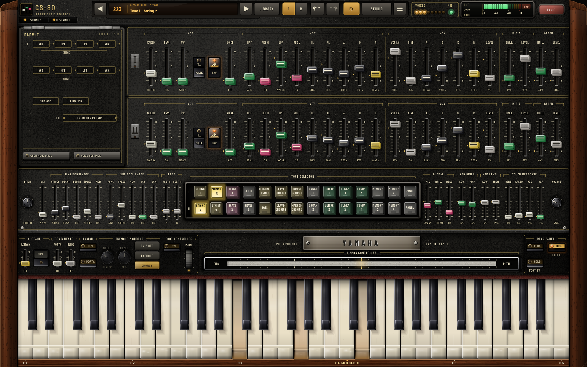

# CS-80 Reference

An independent software instrument based on the Yamaha CS-80. Eight voices play
two synthesizer layers per note, each with its own oscillator, high-pass and
low-pass filters, and amplifier. The ribbon, polyphonic aftertouch, ring
modulator, chorus and tremolo bring the original's performance controls into
a DAW or a standalone app.

[Downloads](#downloads) · [First sound](#play-your-first-sound) · [Preset guide](docs/PRESET_GUIDE.md) ·
[How it was modeled](#from-schematic-to-sound) · [CPU evidence](#how-we-reduced-cpu-work) ·
[Build from source](#build-from-source)



*Captured from the actual plug-in editor. See [screenshot provenance](docs/screenshots/provenance.json) for the exact build.*

## Downloads

Choose your platform for a **direct ZIP download** from the latest successful
`main` build. No GitHub sign-in is required for these links.

| Platform | Formats | Download |
| --- | --- | --- |
| Windows x64 | VST3, Standalone | [Windows ZIP](https://nightly.link/cheshmakzanoon-ops/yamaha-cs80/workflows/build/main/cs80-windows-install-bundle.zip) |
| macOS Apple Silicon (arm64) | VST3, AU, Standalone | [Apple Silicon ZIP](https://nightly.link/cheshmakzanoon-ops/yamaha-cs80/workflows/build/main/cs80-macos-15-install-bundle.zip) |
| macOS Intel (x86-64) | VST3, AU, Standalone | [Intel Mac ZIP](https://nightly.link/cheshmakzanoon-ops/yamaha-cs80/workflows/build/main/cs80-macos-15-intel-install-bundle.zip) |
| Linux x86-64 (Ubuntu 24.04 build) | VST3, Standalone | [Linux ZIP](https://nightly.link/cheshmakzanoon-ops/yamaha-cs80/workflows/build/main/cs80-linux-install-bundle.zip) |

The direct links use [nightly.link](https://nightly.link/) to serve the public
GitHub Actions artifacts. If that mirror is unavailable or you prefer to
download from GitHub, sign in and use [GitHub Actions](https://github.com/cheshmakzanoon-ops/yamaha-cs80/actions/workflows/build.yml?query=branch%3Amain+event%3Apush+is%3Asuccess):
open the newest successful `main` build and find your `*-install-bundle` under
**Artifacts**. A pending or failed build does not replace the verified download.

Unzip the GitHub artifact, verify `SHA256SUMS`, and unpack the inner archive
without splitting the plug-in or app bundle. The package manifest and
`SOURCE.txt` identify the source commit; the version number alone does not.
Follow the [verification instructions](docs/INSTALL_AND_QUICKSTART.md#offline-inventory-verification-python-310)
and [install paths](docs/INSTALL_AND_QUICKSTART.md#install-only-the-formats-you-need).

These are CI development bundles, not signed and notarized releases. Choose
the Mac bundle for the **host process** architecture; the Mac downloads are
not universal. Linux requires compatible system libraries. Automated build and
plug-in checks are not a guarantee of compatibility with every DAW.

## Play your first sound

Launch **Standalone** and select your audio output and MIDI input, or install
VST3/AU and load **CS-80 Reference** on a software-instrument track. A fresh
instance opens **Brass Swell I** from the Circuit library. Hold a chord, then
open **Library** to explore the other voices. With polyphonic aftertouch,
press just one note harder to brighten it; you can also drag down on a held
on-screen key to try pressure.

- **Circuit** is the default. The original-style panel exposes the two ranks,
  22 tone tabs, four memory panels, ribbon and performance controls. The
  separate software library has 301 Circuit and 222 Legacy programs.
- **Pure CS-80** uses the Circuit engine and disables modern extensions.
  **Legacy** keeps the older voicing for saved sessions and Legacy presets.
- **Studio** exposes controls for a modulation matrix, drawable envelopes, MPE, microtuning,
  arpeggiation, effects and expanded voice modes. These are software additions,
  not features of the original hardware. See the [mode contract](docs/PARITY_ISOLATION.md)
  and [editor gallery](docs/screenshots/).

## Revoiced Circuit library — 2026.11.1

The **300 musical Circuit programs** were redesigned in 2026.11, with distinct
rank roles, articulation, touch response and separately calibrated levels.
**2026.11.1 refines twelve of those programs** after measuring their details in
the finished mix. Init Circuit remains the 301st program.

| Try | Latest refinement and playing suggestion |
| --- | --- |
| Flute / Breathy Flute | Stronger sustained air beneath the pitch; compare a gentle hold with added pressure. |
| Harp / Kalimba | More distinct upper glint and ping; hold a note to hear that detail disappear before the body. |
| Sine Bass / Upright Pluck | Clearer short click or finger attack while retaining the rounded low foundation. |
| Ether Pad | A more present, late air texture above its sine body; allow the pad to develop. |
| Noir Swell Brass / Brass Ensemble 16 | Gently separated ranks give the held ensemble a measured stereo spread. |
| Neo-Noir Pad / Arctic Pad / Synthwave Chords | Broader stereo information with controlled channel balance and mono retention. |

The new character regression suite passes **128 checks** on the final calibrated
bank; the previous bank fails **16** of the same checks. The complete library
audit and 136 voicing checks also pass. Platform build publication is pending: the [refinement report](docs/PRESET_REFINEMENT_2026_11_1.md)
identifies the current status, measurement conditions and evidence. The
[original revision report](docs/PRESET_REVISION_2026_11.md) covers the complete
300-program redesign.

**Pressure Lead requires aftertouch** and is intentionally silent until pressure
is applied. Use channel/polyphonic aftertouch or drag downward on a held
on-screen key. **Pure CS-80 centers rank pans**, so the added stereo spread is
available in ordinary Circuit mode. Pure also disables the software additions
identified by the **modern** tag. The [preset guide](docs/PRESET_GUIDE.md)
explains these modes, registrations and playing techniques.

Existing saved sessions retain their serialized sound. Program names, order and
host indexes are unchanged, and all **222 Legacy programs** retain their original
data. Reload a Circuit factory program to hear its revised voicing; a host that
restores only a program number selects the current factory sound. Instrument
names describe synthesized interpretations; the measurements verify software
behavior rather than an acoustic-instrument or physical-hardware match.

Factory selection through Library and the VST3 controller, plus saved-state
restore, passed the documented local checks. A pre-existing limitation remains
for program changes sent only through the VST3 audio-processing queue; that
route did not load the requested factory program in the tested native modules.
See the [host-program qualification](docs/PRESET_REFINEMENT_2026_11_1.md#native-recall-and-host-program-qualification).

## From schematic to sound

The primary reference was the [Yamaha CS-80 Service Manual](https://therogoffs.com/cs80/manuals/CS80_Service_Manual/),
Yamaha's original scans and foldouts hosted by David Rogoff. The work starts by
tracing a signal or control through the drawings, then implementing the
documented relationship and checking the resulting behavior in software.
Where a drawing gives the route but not a full response curve, the model
records the assumptions.

| Manual evidence | How it was used |
| --- | --- |
| M voice card and harness, pp. 41 and 44 | The saw and pulse feed high-pass then low-pass; the sine bypasses both filters. The harness drawing resolves the HP-to-LP link. See the [oscillator](docs/OSCILLATOR_PROMOTION.md), [filter reconstruction](docs/IG00156_NODAL_MODEL.md) and [filter code](src/core/Ig00156Filter.h). |
| TWS and TRG, pp. 17, 19 and 23 | The drawings separate sustained initial brilliance and level from the transient pitch bend. The nominal 50 ms pitch path comes from the documented capacitor and resistor network; MIDI-to-touch behavior is modeled rather than measured. See the [circuit analysis](docs/INITIAL_PITCH_TRANSIENT.md) and [implementation](src/core/TouchCircuit.h). |
| OE1/OE2, pp. 55–58 | The detailed drawings identify the chorus delay send and four returns, and resolve a contradictory foldout pin label. See the [board trace](docs/OE2_CIRCUIT_EVIDENCE.md) and the [real-time chorus model](docs/BBD_CHORUS_MODEL.md) for what actually ships. |

Other sources answer questions the service drawings alone do not:

- The [Yamaha owner's manual](https://www.therogoffs.com/cs80/CS80E_2.pdf#page=25)
  describes how touch changes the sub-oscillator's filter modulation.
  That behavior informs the [per-note pressure route](docs/AFTERTOUCH_SUB_VCF.md).
  The [Yamaha museum photograph](https://www.yamaha.com/en/about/experience/innovation-road/collection/detail/2039/)
  and panel drawing guided the independently drawn [editor layout](docs/PANEL_CONFORMANCE.md).
- Yamaha's [adjustment sheets](https://www.therogoffs.com/cs80/CS80%20Adjustment%20Procedures%20and%20updates.PDF)
  anchor the [offline ring-oscillator reference](docs/RING_TIME_REFERENCE.md) at nominal periods
  of 150 ms and 5 ms under specified service settings. These are calibration
  targets from the document, not voltages or timings measured by this project.
- The [Yamaha IC Guide Book](https://www.goltsynth.com/resources/downloads/CS/yamaha_ic_guidebook.pdf)
  helped trace the [oscillator reset and waveform shaper](docs/OSCILLATOR_CIRCUIT_EVIDENCE.md).
  Panasonic's [BBD handbook](https://www.ka-electronics.com/images/pdf/Panasonic_BBD.pdf)
  informed the [MN3001 clock and output timing reference](docs/MN3001_CLOCK_EVENT_DESIGN.md).

The [source ledger](docs/HARDWARE_REFERENCES.md) and [coverage map](docs/HARDWARE_COVERAGE.md)
separate documented facts, engineering estimates, software test results and
unresolved behaviors. No calibrated physical CS-80 was measured for this
project; the tests do not establish a hardware match.

## How we reduced CPU work

The engine does less redundant work without lowering the render quality:
the oscillator screens pairs of crossings before the same scalar solve,
filter controls reuse identical results within a sample, and the output
oversampling filter computes independent tap products together while keeping
the original sum order. The plug-in also avoids scanning unused automation
lanes. Qualified GCC/x86-64 builds also use an exact
[AVX2 filter path](docs/experiments/avx-default/) with a scalar fallback. The
[engineering reports](docs/experiments/cumulative-cpu-2026-11-19/continued-exact-hotpaths/)
describe the guards and fallbacks.

| Matched VST3 workload | Fewer guest instructions |
| --- | ---: |
| Eight held notes at varied velocities | 23.4–23.7% |
| Fresh silence | 45.5–46.5% |

These are [matched instruction counts](docs/experiments/cumulative-cpu-2026-11-19/compact-cutoff-publication/)
for runtime `0c4abd85` versus the historical `db02cd8` baseline on Linux x86-64
(GCC 14.2 Release, 48 kHz, 16/32/64-frame buffers). Native replay for the
latest optimization pass matched tested audio and exposed state bit for bit;
Standard still reports **67 samples (1.40 ms at 48 kHz)** of plug-in latency.
That is not round-trip latency. Instruction counts show work removed, not a
DAW CPU percentage. [Physical CPU-budget qualification](docs/experiments/cumulative-cpu-2026-11-19/q0-evidence/PHYSICAL-TARGET.md)
is still open.

## Build from source

Use a C++20 toolchain and CMake 3.25+ for the presets. The build pins JUCE
8.0.11. On Ubuntu 24.04, start with the [dependencies in the build workflow](.github/workflows/build.yml).

```sh
cmake --preset linux-release
cmake --build --preset linux-release --parallel
ctest --preset linux-release
```

Use `macos-release` with Xcode command-line tools and Ninja, or
`windows-release` with Visual Studio 2022. The plug-in and standalone outputs
are under `build/CS80Reference_artefacts/Release/`. For a JUCE-free core build,
configure with `-DCS80_BUILD_PLUGIN=OFF -DCS80_BUILD_TESTS=ON`.

## Further reading

- [Engine architecture](docs/ENGINE.md), [model register](docs/STATUS.md#model-register)
  and [DSP measurements](docs/DSP_MEASUREMENTS.md)
- [Distribution and checksums](docs/CI_DISTRIBUTION_STATUS.md) and
  [release qualification](docs/release/RELEASE_QUALIFICATION.md)
- [Fidelity requirements and contribution standards](docs/ANALOG_FIDELITY_REQUIREMENT.md):
  preserve tested Legacy behavior and document intentional changes to the Circuit engine.

## Licence

[GNU Affero General Public License v3](LICENSE). JUCE is used under its AGPLv3
option. CS-80 Reference is independent and is not affiliated with or endorsed
by Yamaha.
