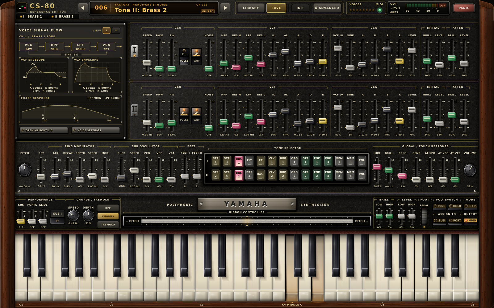
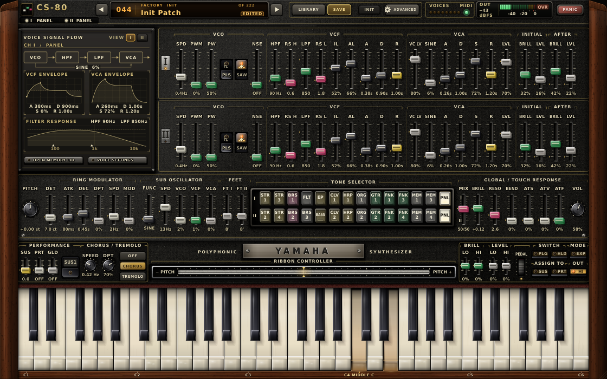
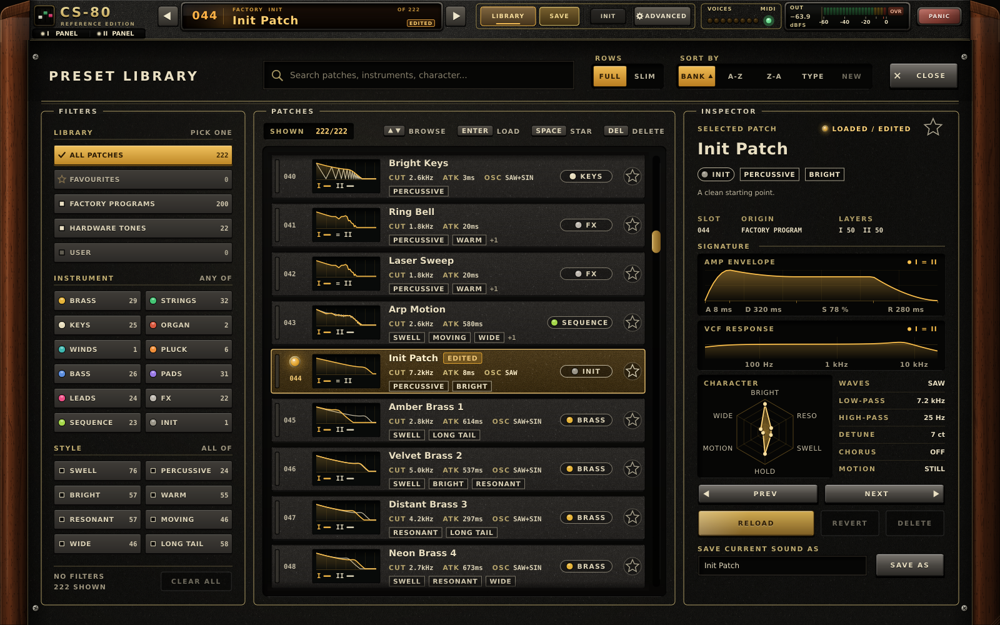
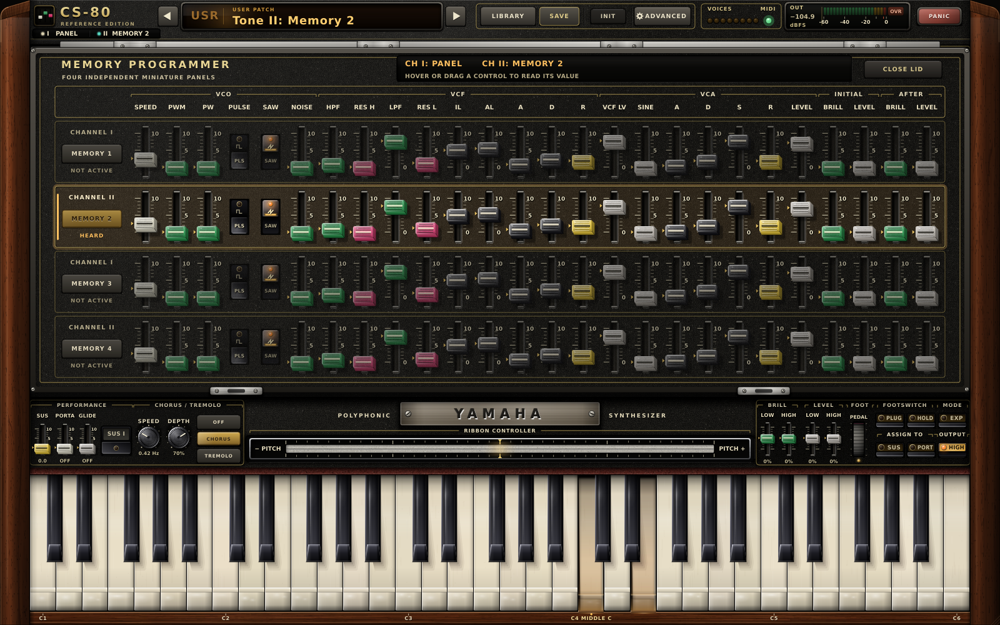
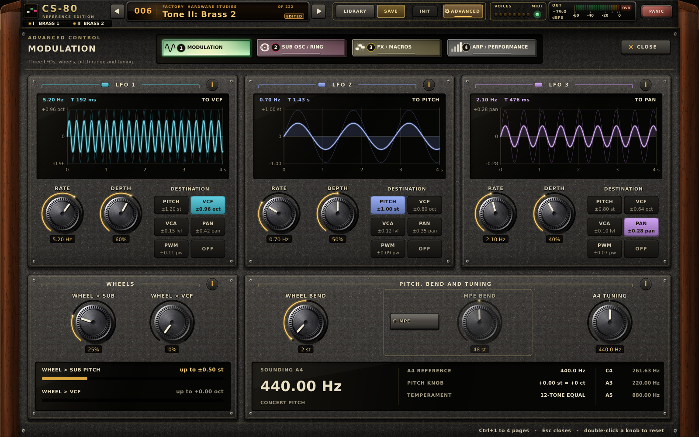
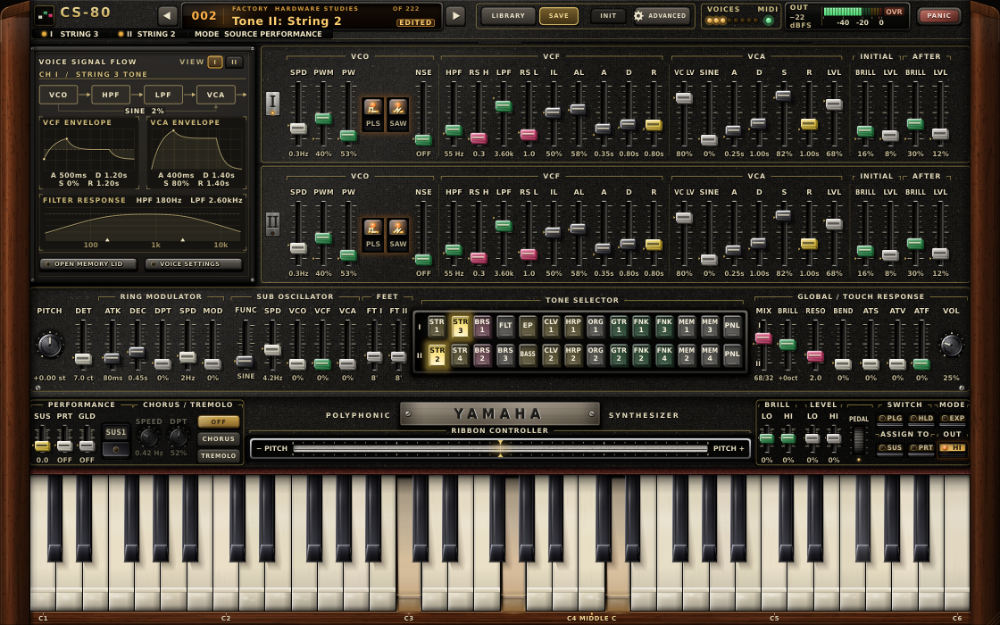
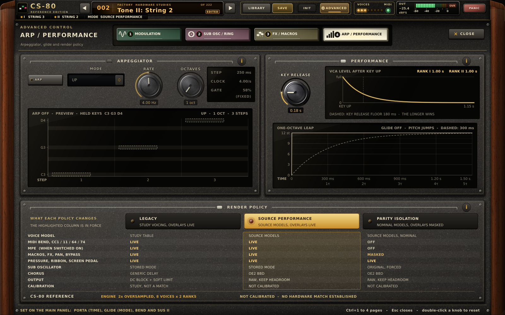

# CS-80 Reference

An independent, code-first recreation of the Yamaha CS-80: eight voices, two independent synthesis ranks per voice (sixteen oscillator / filter / VCA chains), polyphonic pressure, ribbon, ring modulation, SUB oscillator, chorus/tremolo and a modern performance layer. C++20 / JUCE 8, built as **VST3, AU (macOS) and Standalone**, with a JUCE-free core library that renders offline.



*The actual plugin editor, rendered by the real code in GitHub Actions, not a mockup. Tone tabs BRASS 1 and BRASS 2 are lit and two keys are held. [provenance.json](docs/screenshots/provenance.json) records the exact commit and run of every image in this README.*

## The editor

The editor is an original vector drawing of a CS-80 front panel, built from JUCE paint calls with no bitmaps: no Yamaha or Arturia artwork, icons or text are used. It evokes the instrument. It is **not** a pixel copy of a particular hardware unit, and no side-by-side comparison against photographs was measured.

| Area | What is there |
| --- | --- |
| Toolbar | Preset display with provenance (`FACTORY` or `USER`, slot, an **EDITED** flag), previous/next, **LIBRARY**, **SAVE**, **INIT**, **ADVANCED**, eight voice lamps, MIDI lamp, output sample-peak meter, **PANIC** |
| Voice signal flow plate | Live VCO → HPF → LPF → VCA chain, filter and amplifier contour curves and the filter response of the viewed rank (I or II) |
| Channel I and II rows | Two identical rows of long faders (VCO, VCF, VCA, initial and after touch) with colour-coded caps, PULSE/SAW rocker switches and engraved value readouts |
| Centre row | Ring modulator, SUB oscillator, feet, the 14-position × 2-rank backlit **tone selector**, and the global / touch-response faders with the volume and pitch knobs |
| Performance deck | Sustain / porta / glide, chorus and tremolo keys, nameplate, a wide ribbon controller, brilliance and level levers, pedal, footswitch and output switches |
| Keybed | Full-width 61-key keyboard in a walnut frame. Depressed keys sink and are tinted; drag down a key for pressure |
| Overlays | Searchable preset **library** (filters, favourites, sort, spectrum thumbnails, loaded/edited markers), four-page **Advanced** panel and the **memory lid** with four miniature programmer panels |

The material language is dark walnut cheeks, a fine black crinkle finish, cream and gold silkscreen legends, lit-from-upper-left bevels and cast shadows. The window opens between 1120×700 and 1600×1000 and scales the 1600×1000 design space. See the [design specification](docs/UI_DESIGN_SPEC.md).

**Known editor limits.** Independent review passes judged it clearly a CS-80 but not photographic. The control surface is evenly lit, with few bezels, ambient occlusion or translucency. At 1120×700 the smallest legends and readouts are tight. Hover, drag and tooltip states were checked only in test harnesses, not in a DAW.

## Current working instrument

**A playable development build, not a claimed measured 1:1 hardware clone.**

- **Sound and control:** eight dual-rank voices, 245 automatable parameters, 22 source-model hardware tone tabs, four memory panels, and 222 separate library programs. Seven source columns are complete; fifteen use explicitly documented hypotheses. Neither classification means calibrated device behavior.
- **Source Performance:** the current source-derived tone, live-envelope, PRA wah and loaded output models work with ordinary MIDI, optional MPE and the modern effects/modulation layer. Strict comparison isolation remains a separate mode.
- **Everyday use:** searchable presets, explicit overwrite confirmation and save errors, display-aware initial sizing, a notes-only **PANIC** button, and read-only **SAMPLE PEAK / OVER-RANGE / NON-FINITE** indication.
- **Formats:** VST3 and Standalone on Linux/Windows/macOS; AU on macOS, with separate Intel and Apple Silicon builds. These are development packages, not signed/notarized public releases.
- **Known limits:** oscillator, nonlinear-filter, envelope, touch and effect laws still contain provisional assumptions. The old Linux validator has an unresolved intermittent post-SUCCESS crash; the fresh passing checkpoint below does not erase earlier failed invocations. No identified hardware instrument has been measured against this software.

### Play the current source models

1. Follow the [installation and first-play guide](docs/INSTALL_AND_QUICKSTART.md), select audio/MIDI routing, and start with low monitoring volume.
2. In **Advanced → About**, turn **SOURCE PERFORMANCE on** and **PARITY ISOLATION off** before playing. Effective mode changes stop existing notes.
3. Select the hardware tone tabs. The toolbar identifies each rank's requested source and whether it uses a complete or inferred column. Library recall instead returns to PANEL and turns Source Performance off.

Keep output headroom: source models are not normalized or limited. PANIC stops existing notes/holds, not retained effects or noise. The [mode contract](docs/SOURCE_PERFORMANCE.md), [Panic behavior](docs/PANIC_CONTROL.md), and [meter scope](docs/OUTPUT_METER.md) explain these boundaries.

### Development packages (last fully verified: `deb34f4`)

These links identify **deb34f4**, the last commit whose full-platform build, tests and stable validators all passed ([run 41011794181, attempt 1](https://github.com/cheshmakzanoon-ops/yamaha-cs80/actions/runs/41011794181)). **They contain the previous editor.** Packages for the current editor are the artifacts of the `build` workflow run for the head of `main`. Its production core/plugin sources are unchanged from **00624e2 / 428e4b2**; the experimental continuity kernel is **not selected by the plugin**. GitHub artifact downloads may require sign-in and expire under repository retention settings.

| Platform | Package |
| --- | --- |
| Windows x64 | [VST3 + Standalone](https://github.com/cheshmakzanoon-ops/yamaha-cs80/actions/runs/41011794181/artifacts/12958651204) |
| macOS Apple Silicon | [VST3 + AU + Standalone](https://github.com/cheshmakzanoon-ops/yamaha-cs80/actions/runs/41011794181/artifacts/12958327444) |
| macOS Intel | [VST3 + AU + Standalone](https://github.com/cheshmakzanoon-ops/yamaha-cs80/actions/runs/41011794181/artifacts/12958735030) |
| Linux x86-64 | [VST3 + Standalone](https://github.com/cheshmakzanoon-ops/yamaha-cs80/actions/runs/41011794181/artifacts/12957648144) |

Verify package checksums and architecture; read the [distribution/signing limitations](docs/CI_DISTRIBUTION_STATUS.md). Package creation and validator loading are not a claim of a real musician's DAW installation/session test.

### Research code versus playable behavior

The [continuous voice-circuit kernel](docs/VOICE_CIRCUIT_CONTINUITY.md) and its timing evidence are experimental. They do **not** yet change the plugin's idle oscillator/filter behavior. The experimental reconstructed oscillator is also not activated. Current production behavior and unresolved work are kept separate in the [roadmap](docs/PARITY_ROADMAP.md).

## Development mandate: best reconstruction from public knowledge

**Updated by the user on 2026-10-29.** The goal is **1:1 CS-80 parity as far as publicly available knowledge and sound engineering can achieve**. Missing access to hardware is **not a development, implementation or integration blocker**.

- Use Yamaha documentation, schematics, manufacturer information and usable public instrument evidence first. Where a known feature's exact internal behavior is unavailable, implement a defensible physical, reduced-order or behavioral model using engineering judgment rather than leaving the feature absent indefinitely.
- Separate **documented facts**, **circuit-derived results**, **engineering inferences/assumptions**, and **measurements**. Record uncertain parameters, rationale, sensitivity and alternatives; make them revisable. An inferred value does not become a transcribed source fact.
- Move models into the working synth after circuit/behavior review, numerical stability and convergence checks, interaction tests and compatibility/host validation. Lack of a reference instrument alone must not keep a useful model offline.
- Hardware measurements are an optional future calibration/refinement path. Public recordings may inform qualitative or explicitly qualified comparisons; they do not magically become calibrated voltage traces.
- Keep the ambition high without inventing evidence: describe delivered behavior as public-knowledge reconstruction where appropriate, and reserve **measured agreement**, **verified hardware equivalence** and error bounds for comparisons actually performed.

The [fidelity requirement](docs/ANALOG_FIDELITY_REQUIREMENT.md) and [roadmap](docs/PARITY_ROADMAP.md) define this policy. They supersede older hardware-first implementation gates in historical audits. Existing **offline**, **unmeasured** or **unknown** labels still describe today's implementation/evidence; they are not permanent bans on completing an explicitly inferred model.

Start with the [original hardware references](docs/HARDWARE_REFERENCES.md), the [fidelity audit](docs/FIDELITY_AUDIT.md) and the [row-by-row hardware coverage ledger](docs/HARDWARE_COVERAGE.md). They separate documented behavior, implemented corrections, provisional calibration and missing circuit models.

## Actual editor screenshots

All **23 images** were rendered by the real plugin editor in the [screenshot workflow](https://github.com/cheshmakzanoon-ops/yamaha-cs80/actions/workflows/screenshots.yml), which also runs the full plugin/UI self-test (control bounds, accessibility names, keyboard focus, hardware-slider count, initial size, host, state and gesture fixtures) and must pass before images are published. The commit and run are recorded in [provenance.json](docs/screenshots/provenance.json), with [PNG checksums](docs/screenshots/SHA256SUMS). A screenshot does not validate later code changes or prove analog equivalence.

### Default state at 1600×1000


### Minimum supported size, 1120×700



### Preset library and memory programmer





### Advanced panel (modulation page, populated)



### Source Performance and comparison isolation are separate





| View | Actual capture |
| --- | --- |
| Populated panel (Brass tones, LFOs, effects, arpeggiator) | [1600×1000](docs/screenshots/main-populated-1600x1000.png) |
| Full-size Source Performance | [1600×1000 panel](docs/screenshots/main-source-performance-1600x1000.png) |
| Deliberate high-output fixture | [Real +11.9 dBFS / OVER-RANGE indication](docs/screenshots/main-source-performance-over-range-1600x1000.png) |
| Legacy/PANEL workflow | [Legacy panel](docs/screenshots/main-legacy-1600x1000.png) |
| Panel after repeated overlay open/close transitions | [Restored panel](docs/screenshots/main-restored-1600x1000.png) |
| 1200×760 layout | [Panel at intermediate size](docs/screenshots/main-1200x760.png) |
| Modulation / expression | [Advanced page 1](docs/screenshots/advanced-page1.png), [populated](docs/screenshots/advanced-populated-page1.png) |
| Sub oscillator / ring / chorus / analog voice | [Advanced page 2](docs/screenshots/advanced-page2.png), [populated](docs/screenshots/advanced-populated-page2.png) |
| FX / macros / output | [Advanced page 3](docs/screenshots/advanced-page3.png), [populated](docs/screenshots/advanced-populated-page3.png) |
| Arp / performance / about | [Advanced page 4](docs/screenshots/advanced-page4.png), [populated](docs/screenshots/advanced-populated-page4.png) |
| External modulation input | [EXT-enabled panel](docs/screenshots/main-ext-enabled-1600x1000.png), [Advanced sub page](docs/screenshots/advanced-sub-ext-enabled.png) |
| Four memory programmer panels | [Memory lid open](docs/screenshots/memory-programmer-1600x1000.png) |

The over-range image deliberately uses legal high-level PANEL settings and eight notes. Its actual host output peak was finite and above full scale; the normal meter timer produced the warning. This is a **stress demonstration, not a recommended listening level**, and no meter text/telemetry was fabricated. Nonfinite warning behavior is covered by tests, not presented as an observed DSP failure.

The workflow refreshes the repository images from `main` only after its checks pass and while the source commit remains current.

---

## Current state of the engineering

**Status tags** (the same vocabulary as the coverage ledger): **Implemented**: the discrete behavior exists and is tested. **Approximate**: the route exists but its law is provisional. **Offline only**: a tested circuit reference exists but is not yet integrated into audio; integration may proceed with documented engineering assumptions. **Missing**: absent.

Of the 85 control and connector rows in the coverage ledger, counted by first status tag: **29 Implemented, 49 Approximate, 7 Missing**. The seven Missing rows are all physical or electrical-state items (AC power switch, key travel/force, scanner timing, per-voice sample/hold droop, headphone amplifier, power supply, ribbon surface mechanics).

| Subsystem | State | Notes |
| --- | --- | --- |
| Voice structure | Implemented | 8 voices x 2 ranks, cyclic assignment, ninth held key ignored, channel-exact note-off. Real scanner timing and free-running oscillator state **not** established |
| Oscillators | Approximate | PolyBLEP saw (polarity corrected), comparator-style pulse, shaped sine (placeholder 3.5% third harmonic), noise, nominal harmonic footage. Real reset/ramp/shaper behavior unmeasured |
| Filters | Approximate | Two serial 12 dB TPT state-variable stages (HP then LP) with the documented `fc = 125 * Kv * 2^V` law and Q endpoints; nonlinearity, intermediate Q law and loaded nodes are placeholders. Conditional IG00156 graph exists **offline only** |
| Envelopes | Approximate | IL / AL / steady / release-to-IL filter contour, ADSR amplifier contour, global SUSTAIN as release floor, sustain I/II. Live S/IL/AL tracking in source modes uses an explicit engineering policy; time laws and "bend" remain inferred |
| Touch and pressure | Approximate | Held initial-touch path vs separate AC-coupled pitch transient (50 ms nominal), shared max-pressure bus, per-voice pressure, AT to VCO / VCF / SUB speed |
| Keyboard contours | Approximate | Four centre-neutral levers (LOW/HIGH brilliance and level), per-key weights from the KBC octave-tap ladder. Key map and gains provisional |
| Footswitch and assigners | Implemented / Approximate | Jack plugged + contact + independent SUSTAIN and PORTA/GLISS assigners (`!assigned or !plugged or pressed`); tail-shortening and glide-snap edge policy provisional |
| EXP / EXP-WAH, output HIGH/LOW | Circuit-derived networks in source modes; calibration inferred | Stateful four-capacitor PRA graph, always-clocked dry/wet histories and source-verified routing; optical/trim/loading profile inferred. Source-model HIGH/LOW uses the loaded 10µF/resistor graph with inferred source/load values; GENERAL is diagnostic-only. Legacy wah and scalar output retained in Legacy performance |
| SUB, ring, ribbon | Approximate | Six original SUB functions (0.7-60 Hz), optional mono EXT modulation bus, frequency-envelope ring with documented calibration anchors, relative ribbon (~1 octave) |
| Tone selectors, memories, presets | All 22 source/hypothesis tabs integrated / device laws inferred | 14 positions per rank, 4 independent memory banks (104 automatable controls), PANEL. Source modes use 7 complete matrix columns and 15 columns completed by explicit hypotheses for 25 unresolved cells; nominal device/touch laws remain inferred. The separate 22 legacy library studies are retained, not silently replaced |
| Chorus / tremolo, output stage | Approximate / circuit-derived | Both source modes run chorus mode through an OE2 BBD delay path with inferred clock range, level and polarity ([model](docs/BBD_CHORUS_MODEL.md)); legacy and tremolo keep the generic laws. Both source modes use physical output-coupling states; legacy retains 10Hz DC block and soft clip. Both retain the 255-tap decimator (63 samples latency) |
| Voice variation | Approximate | Per-voice tuning and pan scatter, slow drift, noise floor: arbitrary, not measured tolerances |
| Host / plugin layer | Implemented | 245 append-only host parameters, state migration, safe preset saving, MPE discovery, Panic and read-only output metering; current validator outcomes are disclosed below |

The 200 "performance" patches and the modern layer (3 LFOs, 4 macros, 3 FX slots, MPE, arpeggiator) are deliberate software extensions. The opt-in isolation mode makes them inert without rewriting stored patches. Separately, default-off **SOURCE PERFORMANCE** combines the current source models with these declared software overlays and ordinary expressive MIDI. Its native host/UI checks and stable validators passed at `deb34f4`; earlier intermittent Linux failures remain disclosed below. It does not change existing sessions by default.

### Current quality checkpoint

The latest verified **native-build/validator and capture checkpoint** is [`deb34f4`](https://github.com/cheshmakzanoon-ops/yamaha-cs80/commit/deb34f495de6d78a30c7d5475243e0f5766520e9), passing on **attempt 1**. This is a fresh successful invocation, not proof that the older intermittent Linux exit139 has been repaired.

| Evidence | Exact result |
| --- | --- |
| [Native builds, tests and stable validators](https://github.com/cheshmakzanoon-ops/yamaha-cs80/actions/runs/41011794181) | All six jobs passed: Linux 45/45, Apple Silicon 40/40, Intel Mac 40/40, Windows 38/38; all four packages created; Windows/macOS validation passed |
| Stable Linux validation | Headless seed `0x3980ffe`, primary GUI `0x5a0edc0` and fixed GUI `0x2da72db` passed |
| [Actual-editor captures](https://github.com/cheshmakzanoon-ops/yamaha-cs80/actions/runs/41011794159) | 17 verified images; [source-matched artifact 12957961885](https://github.com/cheshmakzanoon-ops/yamaha-cs80/actions/runs/41011794159/artifacts/12957961885) |
| [Official beta3 comparison](https://github.com/cheshmakzanoon-ops/yamaha-cs80/actions/runs/41013202960) | Exact `deb34f4` Linux artifact `12957867464`: 25 headless / 31 GUI tests passed |
| [Earlier DSP/compatibility/sanitizer evidence: `00624e2`](https://github.com/cheshmakzanoon-ops/yamaha-cs80/actions/runs/41007847313) | All five jobs passed; leak-enabled ASan/UBSan 40/40. Production core/plugin sources are byte-unchanged at `deb34f4`; **this is not a newly executed DSP workflow at `deb34f4`** |

Historical failures remain failed: [`428e4b2`](https://github.com/cheshmakzanoon-ops/yamaha-cs80/actions/runs/41003223729/job/123895901926) exited139 after SUCCESS in fixed GUI seed `0x2da72db`; [`00624e2`](https://github.com/cheshmakzanoon-ops/yamaha-cs80/actions/runs/41007847302/job/123909705477) did so in primary GUI seed `0x322bd8b`. Neither normal diagnostic replays nor this later passing invocation establish crash ownership or a repair. See [playable readiness](docs/PLAYABLE_RELEASE_READINESS.md) and the [00624e2 evidence appendix](docs/voice-continuity/AUDIT.md). These results are software-test evidence, **not measured analog equivalence, experimental-model activation or a real DAW installation/session qualification**.

The next priority is **audible, integrated fidelity improvements**, not accumulating offline models indefinitely: replace generic/provisional behavior with the best source-constrained engineering models, complete missing feature behavior, and improve the 22 hardware-tone studies while retaining explicit uncertainty and regression coverage. The coverage counts are feature-ledger categories, not a fidelity percentage.

### What the tests and CI prove (and what they do not)

| Check | Count / scope |
| --- | --- |
| Core engine suite (`cs80_tests`) | 11,300 checks: parameters, oscillator/filter/envelope behavior, voice allocation, pressure, MIDI, ring/ribbon, sample rates, all 222 presets render |
| Keyboard handoff | Bounded non-audio-producer/audio-consumer queue, epoch/overflow regressions and host integration tests; not a whole-plugin hard-realtime claim |
| Live envelope timing | 91,672 checks of isolation-only A/D/R refresh without retrigger; level behavior now has a separate inferred model |
| Live envelope levels | 221,594 checks of state-continuous S/IL/AL response and high-rate convergence; stage-selection/tracking laws explicitly inferred |
| Envelope numerical accuracy | 22,732 checks of long-envelope convergence, double state/clocks/coefficients and valid high-rate settings; three reduced-precision mutants rejected |
| Active-tail continuity | 49,696 checks of opt-in isolation phase/filter-state retention and release-tail envelope continuity; no full idle-clock claim |
| OE2 BBD chorus (`cs80_bbd_chorus_tests`) | 70 checks of the source-policy chorus path; clock range and polarity are inferred |
| Parity isolation / harness | 126 core isolation checks, 22 comparison-harness tests and 13 candidate-export tests; no hardware evidence |
| Performance controls (`cs80_performance_control_tests`) | 113 checks, mutation-checked: contour, footswitch truth table and edges, EXP-WAH, output switch |
| Offline reference models | passive preset matrix (4,702 checks), conditional IG00156 graph (112), settled-DC keyboard-contour network (160,459), conditional loaded cutoff-control pair (8,132) eight-voice rank network (14,012), and conditional RC transients (1,882) |
| Plugin / UI smoke (`cs80_ui_smoke`) | APVTS contract, append-only IDs and AU hints, state round trips and migration, editor at two sizes, every page, controls and gestures, pedal and key-pressure paths |
| Legacy compatibility CI | Same-compiler byte comparison against pinned baseline: shipped 222 presets at 3 rates, normal and noisy reassignment scenarios |
| Experimental voice continuity (not selected) | [Electrical-input kernel](docs/VOICE_CIRCUIT_CONTINUITY.md): 151,578 owned and 33,962 independent checks; first paired-eight timing gate passed. Continuous idle cost is real; full Engine adapter and production activation remain unqualified |
| Experimental oscillator (not selected) | 1,418,466 standalone checks; linear 2x path passes, but nonlinear-filter aliasing and full-bank CPU gates remain unqualified |
| Source factory-tone converter | 373,977 standalone and 135,739 integration checks; independent overlay/network review and exact V1 seven-tone regression; 7 complete + 15 inferred tabs |
| Realtime output network | 6,506,427 module checks and 184,745 Engine integration checks; loaded HIGH/LOW, coupling charge and separate GENERAL diagnostics; inferred symmetric profile |
| Output-tap AC reference | 11,016 checks of conditional HIGH/LOW loading, DC/open/short limits and explicit conflicting resistor values; independent oracle for the realtime model |
| Level control DC reference | 54,272 checks of 16 separately loaded LC nodes and 43 explicit source ports; no IC5 gain or loudness calibration |
| Resonance control DC reference | 28,059 checks of 32 individually loaded VQ nodes and shared cross-rank RES bus; no internal Q law |
| OE2 filter AC reference | 10,190 checks of independent nodal models of the input/reconstruction filters and unequal AC-coupled gain stages; no BBD voltage or chorus calibration |
| Realtime PRA wah | 8,758,418 module checks, 226,798 combined wah/output Engine integration checks, independent transient/AC oracles; inferred profile, not measured instrument calibration |
| PRA wah AC reference | 28,686 independent nodal/KCL checks of an idealized conditional network; no calibrated pedal or WI-to-WO transfer |
| BBD clock-event reference | 97,650 normalized signal-packet checks; not a charge, voltage or calibrated audio model |
| DSP probe | deterministic numerical checks plus `scripts/analyze_dsp.py` plots |
| CI (`build.yml`) | Linux, native Apple Silicon and Intel macOS (VST3, AU, Standalone), and Windows builds and tests; pluginval 1.0.4 at strictness 10 (Linux headless and GUI under Xvfb, macOS VST3 and AU including AU GUI, Windows headless) |

The [expressive Source Performance benchmark](docs/performance/2026-10-30-source-performance/SUMMARY.md) at `d7b6e85` covers eight voices with MPE, CC11/64/74 and two effect combinations: typical held-callback cost was 24–30% of budget at 44.1/48 kHz and 128/256 samples. All 156 cases passed integrity checks, but 127 of 256,402 callbacks exceeded budget, including a 29.143 ms callback. This is measured cloud-core behavior, not a glitch-free DAW guarantee.

A newer [all-22 source-route baseline](docs/performance/2026-10-30-source/SUMMARY.md) at `932c6d4` measured typical eight-voice source-core cost at 24–29% of a callback budget at 44.1/48 kHz, with real deadline exceedances retained. It does not qualify the later source-performance/FX combinations or a DAW.

A [source-pinned cloud timing audit](docs/performance/2026-10-29/SUMMARY.md) measured eight dual-rank voices: at 48kHz/256 samples, isolation median callback time was 1.24–1.29ms against a 5.33ms budget. At 192kHz the budget was tight and many callbacks exceeded it. These are limited cloud-core timings, not a DAW or hard-realtime guarantee.

Historical local core/performance sanitizer runs disabled leak detection; the separately linked `00624e2` CI run passed 40/40 with leak detection enabled. Neither is a general leak-free-host claim. **None of this compares anything to hardware.** There is no reference capture corpus in the repository. Consult the exact-commit Actions results rather than this table for any specific revision. The known intermittent Linux validator post-SUCCESS exit139 remains a failed gate when it occurs; [recorded checkpoints](docs/VALIDATOR_DIAGNOSTICS.md) distinguish successful tests from unsuccessful process exit.

---

## Path to public-knowledge parity (summary)

**Implemented groundwork:** opt-in [isolation](docs/PARITY_ISOLATION.md), reproducible [comparison/candidate capture tools](docs/PARITY_HARNESS.md), live A/D/R transaction probes, loaded control-network references, modulation/output circuit references, and host/compatibility safeguards. Their current scope and limitations are listed above. They are a foundation for implementation, not a substitute for improving the audible engine.

The full plan is **[docs/PARITY_ROADMAP.md](docs/PARITY_ROADMAP.md)**:

1. **Do not wait for hardware.** Resolve what public sources establish; for remaining known behavior, select and document an engineering model, uncertainty range and acceptance tests. Research and implementation proceed together.
2. **Validate the claim actually being made.** Check topology, documented nominal anchors, numerical convergence, aliasing, boundedness, interaction behavior and host compatibility. Use public audio with its limitations stated. Hardware residuals are reported only when suitable hardware data exists.
3. **Milestones:** M0 tools/isolation; M1 ongoing public evidence and optional reference acquisition; M2 voltage-domain control/preset integration; M3 oscillator/filter/envelope/VCA/touch reconstruction; M4 modulation/output and electrically informed presets; M5 variation/interactions; M6 whole-instrument public-knowledge acceptance with a published uncertainty ledger. **M1 hardware access is not a gate for M2–M6.**
4. **Immediate direction:** integrate reviewed models with explicit inferred boundaries; implement live envelope-target behavior using a documented state-continuous policy; replace stand-in wah/chorus and arbitrary variation with source-constrained models; advance preset voicings and the unresolved keyboard mapping without presenting assumptions as recovered chip truth.

Calibrated recordings or instrument access remain valuable if they become available, but their absence must not pause this program.

---

## Features

| Area | Implementation |
| --- | --- |
| Voices | 8 voices, 2 ranks each, 16 oscillator-filter-VCA chains, cyclic assignment |
| Oscillators | PolyBLEP saw, variable-width pulse, fixed-time reset pulse, shaped sine, noise; harmonic footage 16' to 2' |
| Filters | 12 dB high-pass into 12 dB low-pass, resonance on both |
| Envelopes | Independent filter and amplifier contours; global SUSTAIN and sustain I/II |
| Expression | Velocity, polyphonic aftertouch (MIDI, or drag down an on-screen key), channel pressure, MPE, mod wheel, ribbon, EXP / EXP-WAH foot controller, keyboard contour levers |
| Modulation | SUB oscillator (original six functions, optional EXT bus), ring modulator, three global LFOs |
| Performance | Footswitch with sustain and porta/gliss assigners, portamento / glissando, arpeggiator, pitch-bend range, A4 tuning, HIGH/LOW output |
| Effects | Chorus/tremolo plus three serial modern FX slots |
| Presets | 222 factory programs: 22 provisional hardware-tab studies and 200 original performance patches; searchable library and user presets |
| Parameters | 245 host-automatable: 122 original + 106 programmer/selector + AT VCF + 4 original-SUB + 10 performance controls + parity isolation + source performance |
| Formats | VST3 and Standalone everywhere; AU on macOS. AAX is not built (SDK not redistributable) |

### Using the instrument

- **MASTER**: tuning, detune of rank II, mix, brilliance, resonance, SUSTAIN, output volume, initial pitch bend.
- **CHANNEL I / II**: independent VCO, HPF, LPF, filter contour, VCA contour, touch response, pan. The two ranks are mixed and panned in the stereo field.
- **TONE SELECTOR**: 14 positions per rank (11 named tones, two memory banks, PANEL), rank-specific names in the original order. **OPEN MEMORY LID** edits four independent miniature panels (26 controls each); memories 1/3 feed rank I, 2/4 feed rank II. Selecting a source never overwrites the manual sliders; PANEL returns to them.
- **PERFORMANCE**: sustain, portamento, glide mode, chorus / tremolo, sustain II.
- **KEYBOARD / FOOT**: LOW/HIGH BRILLIANCE and LEVEL contour levers (centre = neutral; double-click re-centres), on-screen PEDAL, footswitch PLUG and PRESS, SUSTAIN and PORTA assigners, WAH (EXP-WAH), HIGH (output).
- **RIBBON**: first contact sets the reference; relative motion bends pitch; release restores neutral (up to about an octave).
- **KEYBED**: 61 keys with velocity. On screen, strike a key and drag further down it to press harder (a pointer stand-in for the per-key sensor). On-screen pressure is tied to an accepted UI strike; it is conservatively suppressed during arpeggiation or ambiguous host-note overlap. Host MIDI aftertouch remains available. See [pressure ownership and reset safety](docs/KEY_PRESSURE_HANDOFF.md).
- **Advanced**: LFOs, SUB and ring detail, chorus, FX, macros, MPE, arpeggiator, original/legacy SUB switch, voice dispersion/drift/noise. **LIBRARY / SAVE**: searchable preset browser.

Double-click any control to return it to its default. The [PANIC button](docs/PANIC_CONTROL.md) stops existing notes, MIDI sustain holds and arpeggiator keys at the next audio block without changing the patch; retained effects/noise may remain, and newly received host notes can play.

**MIDI**: notes, velocity, polyphonic and channel aftertouch, pitch bend, CC1 mod wheel, CC11 expression (also drives the pedal and EXP-WAH), CC64 sustain (a software convention; see below), CC74 brightness, CC120 / CC123 channel-scoped panic. MPE maps per-note bend and pressure on member channels with a separate bend range.

To play the source-derived tabs with normal MIDI expression, enable **Advanced → About → SOURCE PERFORMANCE** with **PARITY ISOLATION off before playing**, then select any of the 11 hardware tone tabs per rank. Rank I String 3/Flute/Funky 1 and rank II Brass 3/Organ 2/Funky 2/Funky 4 use complete classified columns; the other 15 use explicit hypotheses. These are the hardware-panel tabs, not replacements for the library programs. The nominal model is unnormalized and can exceed digital full scale on extreme chords; leave monitoring headroom.

PARITY ISOLATION remains the separate strict comparison mode and wins when both switches are on. Effective mode changes stop notes. Source performance is saved with sound presets; old presets and library programs reset it off, while isolation retains its existing session-policy behavior. See the [mode and compatibility contract](docs/SOURCE_PERFORMANCE.md).

A [reproducible all-22 audition tool](docs/SOURCE_FACTORY_AUDITION.md) renders the same phrase at one fixed quiet master setting, with segment/provenance metadata and no per-tone normalization.

The [output readout](docs/OUTPUT_METER.md) shows final-output **sample peak**, with textual OVER-RANGE and NON-FINITE events. It does not measure true peak/loudness and never limits or changes audio; retain monitoring headroom.

### Behavior notes and compatibility

- **Intentional audible changes** are documented where made. Most recent: the default per-voice tuning scatter (previously up to ~2 semitones off by a missing cents conversion; now about 2.5 cents at default dispersion), and earlier corrections to velocity gain, cutoff tracking (octave per octave), footage ratios, filter contour and sustain semantics. Use an earlier commit for historical renders.
- **State and automation**: host IDs and order are append-only with AU version hints; sessions saved by older builds restore neutral values for newer parameters, never live ones. Factory preset recall leaves the footswitch jack/contact, EXP/WAH selector and output switch alone (they are wiring, not sound); user presets restore them. Both preset types preserve the current parity-isolation setting; full session restore recalls it.
- **SUB**: fresh instances use the original six functions and 0.7-60 Hz range; factory programs and old states keep the legacy waveforms/range ([ORIGINAL_SUB_OSCILLATOR.md](docs/ORIGINAL_SUB_OSCILLATOR.md)). EXT accepts an optional mono host input, disabled by default and modulation-only ([EXTERNAL_MODULATION.md](docs/EXTERNAL_MODULATION.md)).
- **Voices**: the cyclic allocator rejects a ninth simultaneously held key rather than stealing; released tails can be reused. In either source mode, reassignment of a still-active unheld tail now preserves oscillator phase and HP/LP numerical state ([scope and evidence](docs/ACTIVE_TAIL_CONTINUITY.md)); inactive circuits still use the existing reset policy. Same-pitch duplicate note-ons on one channel are a MIDI ambiguity, not original behavior.
- **Live envelopes in source modes**: attack, decay and release timing follow effective control changes on active voices without retriggering. The numerical time laws remain provisional; sustain-level and filter IL/AL target changes now follow the [inferred live-level model](docs/LIVE_ENVELOPE_LEVEL_MODEL.md) ([scope](docs/LIVE_ENVELOPE_TIMING.md)). [Double state, coefficients and clocks](docs/ENVELOPE_NUMERICAL_ACCURACY.md) prevent long envelopes from stalling at valid settings. Isolation capture responses intentionally change; legacy-off behavior is unchanged.
- **Host capability and tail policy**: MPE capability is advertised while its actual mode still requires matching plugin/host setup. The instrument reports an unbounded tail because continuous analog-noise coloration is supported; hosts may keep processing while idle, and offline export should use an explicit endpoint. This is not a promise that a dry note rings forever. Preset saves now report errors and require confirmation before replacement. Native host/UI checks and stable validators passed at `deb34f4`; earlier intermittent Linux failures remain unresolved as disclosed above.
- **Latency**: the output decimator reports 63 host samples; let the host refresh delay compensation.
- **Software conventions that are not original**: MIDI CC64 sustain (including MPE-master rule), the latching virtual footswitch, the sample-rate range 8-768 kHz (48 kHz fallback), digital normalisation of EXT, the on-screen key-pressure gesture. See [PERFORMANCE_CONTROLS.md](docs/PERFORMANCE_CONTROLS.md).
- Footage uses nominal harmonic ratios 0.5, 1, 1.5, 2, 3, 4 (the fifths sit about 1.955 cents above equal temperament); these are nominal circuit targets, not measured tolerances of any instrument.

---

The editor initially fits the current display within its supported 1120×700 to 1600×1000 opening sizes. Displays below 1120×700 logical usable pixels cannot fit the current layout; later host/manual sizing remains authoritative.

## Install development artifacts

CI packages the already-built standalone applications and plugins for Linux, Windows, and separate Intel/Apple Silicon macOS. Follow the [install and first-play guide](docs/INSTALL_AND_QUICKSTART.md), verify the exact commit and all its CI results, and read the [distribution/signing limitations](docs/CI_DISTRIBUTION_STATUS.md). An uploaded artifact alone is not a qualified release.

## Build

Requirements: CMake 3.22+, Python 3.10+ (test harness), a C++20 compiler, Ninja (recommended) or Visual Studio 2022; Linux needs ALSA, X11, FreeType, Fontconfig and OpenGL development packages; macOS needs the Xcode command-line tools. Linux GUI smoke tests also require Xvfb, xauth, Openbox and x11-utils. JUCE 8.0.11 is fetched by CMake when `deps/juce` is absent.

Ubuntu 24.04:

```bash
sudo apt-get install -y build-essential cmake ninja-build pkg-config \
  libasound2-dev libx11-dev libxext-dev libxrandr-dev libxcursor-dev \
  libxinerama-dev libxrender-dev libxcomposite-dev libgl1-mesa-dev \
  libfreetype-dev libfontconfig1-dev libcurl4-openssl-dev \
  libwebkit2gtk-4.1-dev fonts-dejavu-core
```

```bash
cmake -S . -B build -G Ninja -DCMAKE_BUILD_TYPE=Release
cmake --build build --parallel
ctest --test-dir build --output-on-failure
```

or the checked-in presets (`cmake --preset linux-release`, `cmake --build --preset linux-release`, `ctest --preset linux-release`). For fast engine work without JUCE add `-DCS80_BUILD_PLUGIN=OFF`. On a bare Linux container set `JUCE_FONT_PATH` to a directory containing DejaVu Sans (CI does this) so the UI smoke test can render text.

Artifacts: `build/CS80Reference_artefacts/Release/VST3/CS-80 Reference.vst3`, `.../Standalone/CS-80 Reference`, and `.../AU/CS-80 Reference.component` on macOS.

Headless assets:

```bash
./build/cs80_render --out artifacts/cs80-demo.wav --seconds 12
./build/CS80Snapshots_artefacts/Release/CS80Snapshots --out artifacts/ui --self-test
```

### CI

`.github/workflows/build.yml` builds and tests Linux, macOS and Windows and runs pluginval 1.0.4 at strictness 10 (Linux headless and GUI under Xvfb with bounded retry eligibility for a logged exit139 shape of unproven ownership; macOS VST3 and AU; Windows headless). Other workflows: `screenshots.yml`, `dsp-measurements.yml`, `circuit-inspection.yml` (reads the original service scans inside Actions) and `ci-evidence.yml` (publishes run outcomes as commit statuses). A passing run is software-quality evidence only.

---

## Repository map

```text
src/core/Params.h               parameter table shared by engine, UI, presets and tests (append-only)
src/core/Dsp.h                  oscillator, filters, envelopes, LFO, chorus, phaser, reverb, decimator
src/core/BbdChorus.h            OE2 BBD chorus for the source policies
src/core/Engine.*               voice allocation, dual-rank engine, modulation, ring, wah, FX, arp, output
src/core/PerformanceControls.h  keyboard-contour weights, footswitch gate, wah and output-switch constants
src/core/HardwareControl.h      offline passive preset resistor-matrix model (does not drive audio)
src/core/OriginalSubOscillator.h, ExternalModulationInterpolator.h
src/core/FactoryPresets.*       22 provisional hardware-tab studies + 200 performance patches
src/reference/                  offline circuit reference models: IG00156Linear.h, KeyboardContour.h
src/plugin/                     JUCE host layer: processor, editor, advanced panel, preset browser, UI components
src/tools/                      render_cli, dsp_probe, ui_snapshot (screenshots + plugin/UI smoke test)
tests/                          CoreTests, PerformanceControlTests, HardwareControlTests, IG00156ReferenceTests,
                                KeyboardContourReferenceTests
scripts/                        DSP analysis, schematic-source inspection, pluginval wrappers and diagnostics
docs/                           evidence ledgers and audits (index below)
```

### Documentation index

| Read this | For |
| --- | --- |
| [PRESET_BA_CUTOFF_BRANCHES.md](docs/PRESET_BA_CUTOFF_BRANCHES.md) | Reviewed memory-diode injection and selected-source driver topology |
| [RELEASE_CONTROL_ROUTING.md](docs/RELEASE_CONTROL_ROUTING.md) | SUB release clamp/buffer routes, component revisions and explicit quantitative gaps |
| [REFERENCE_DATA_SEARCH.md](docs/REFERENCE_DATA_SEARCH.md) | Bounded public search; no calibrated capture corpus admitted |
| [BA617_SOURCE_REVIEW.md](docs/BA617_SOURCE_REVIEW.md) | Verified clock pin roles and installed alignment constraints, not a complete clock law |
| [REFERENCE_CAPTURE_REQUEST.md](docs/REFERENCE_CAPTURE_REQUEST.md) | M1 external-first reference intake, metadata/rights/calibration requirements and unfilled checklist |
| [PRESET_RECEIVER_PORTS.md](docs/PRESET_RECEIVER_PORTS.md) | Reviewed 26-output rank-I first-hop ledger with explicit missing loads/paths |
| [UI_DESIGN_SPEC.md](docs/UI_DESIGN_SPEC.md) | Editor design brief: instrument look, palette, layout grid, component ownership and the review process |
| [ENGINE_AUDIT.md](docs/ENGINE_AUDIT.md) | Engine QA audit: measured results (aliasing, level, FX behavior), fixes made and items left open, with inferred versus measured labelled |
| [PARITY_ROADMAP.md](docs/PARITY_ROADMAP.md) | **The plan to 1:1**: definition of done, blockers, workstreams, provisional-value register, order, rules |
| [ANALOG_FIDELITY_REQUIREMENT.md](docs/ANALOG_FIDELITY_REQUIREMENT.md) | The target, as the owner stated it |
| [FIDELITY_AUDIT.md](docs/FIDELITY_AUDIT.md) | Dated gap register and every correction so far |
| [HARDWARE_COVERAGE.md](docs/HARDWARE_COVERAGE.md) | Every original control, connector and circuit block with status and next acceptance action |
| [HARDWARE_REFERENCES.md](docs/HARDWARE_REFERENCES.md) | Primary sources, tone-selector order, IC-level facts, calibration anchors |
| [MN3001_CLOCK_EVENT_DESIGN.md](docs/MN3001_CLOCK_EVENT_DESIGN.md) | Offline, explicitly idealized clock-event packet reference and physical-model exclusions |
| [OSCILLATOR_EXPERIMENTAL_CHECKPOINT.md](docs/OSCILLATOR_EXPERIMENTAL_CHECKPOINT.md) | Shared-state experimental VCO/WSC, positive results, failed nonlinear/CPU gates; not used by Engine |
| [SOURCE_FACTORY_RUNTIME.md](docs/SOURCE_FACTORY_RUNTIME.md) | Audible all-22 routing, provenance, live state/ownership, inactive control decay, panic policy and headroom |
| [FACTORY_TONE_INTEGRATION_PROPOSAL.md](docs/FACTORY_TONE_INTEGRATION_PROPOSAL.md) | All-22 electrical converter, immutable source ledger and separate 25-cell hypothesis overlay |
| [OUTPUT_REALTIME_PROPOSAL.md](docs/OUTPUT_REALTIME_PROPOSAL.md) | Integrated isolation output graph, inferred boundaries, independent tests and retained legacy contract |
| [OUTPUT_LEVEL_SOURCE_REVIEW.md](docs/OUTPUT_LEVEL_SOURCE_REVIEW.md) | Three-pole output routing, retained component conflicts and conditional passive AC reference |
| [LEVEL_CONTROL_REFERENCE_DESIGN.md](docs/LEVEL_CONTROL_REFERENCE_DESIGN.md), [TRG_LEVEL_RECIPROCAL_REVIEW.md](docs/TRG_LEVEL_RECIPROCAL_REVIEW.md) | Conditional loaded level network and reviewed reciprocal touch-wiring evidence |
| [RESONANCE_CONTROL_REFERENCE_DESIGN.md](docs/RESONANCE_CONTROL_REFERENCE_DESIGN.md) | Conditional dual-rank loaded resonance network and conservative numerical-domain checks |
| [OE2_FILTER_REFERENCE_DESIGN.md](docs/OE2_FILTER_REFERENCE_DESIGN.md) | Conditional input/reconstruction RC networks, coupling poles and physical current ports |
| [REALTIME_PRA_WAH_MODEL.md](docs/REALTIME_PRA_WAH_MODEL.md) | Integrated isolation wah, documented circuit graph, inferred profile, state continuity and numerical evidence |
| [PRA_WAH_REFERENCE_DESIGN.md](docs/PRA_WAH_REFERENCE_DESIGN.md) | Conditional offline ideal-op-amp wah network, explicit optical/loading boundaries; not calibrated WI-to-WO audio |
| [OE2_CIRCUIT_EVIDENCE.md](docs/OE2_CIRCUIT_EVIDENCE.md) | Original delay/filter/VCA topology and Panasonic MN3001 manufacturer evidence |
| [OE1_SIGNAL_ROUTING_EVIDENCE.md](docs/OE1_SIGNAL_ROUTING_EVIDENCE.md) | Verified PRA/OE1/OE2 stage routing and remaining optical/transfer gaps |
| [KEYBOARD_MAPPING_CONSTRAINT_REVIEW.md](docs/KEYBOARD_MAPPING_CONSTRAINT_REVIEW.md) | Scoped bit/label exclusions and why contour DC data cannot uniquely establish every decoder choice |
| [KEYBOARD_AUDIO_HANDOFF.md](docs/KEYBOARD_AUDIO_HANDOFF.md) | Bounded UI note handoff, host visualization, overflow/lifecycle policy and limits |
| [STATE_SCHEMA_VALIDATION.md](docs/STATE_SCHEMA_VALIDATION.md) | Immutable schema validation and competing-restore regression scope |
| [ENVELOPE_TARGET_TRANSITION_REVIEW.md](docs/ENVELOPE_TARGET_TRANSITION_REVIEW.md) | Source-located capacitor/target feedback paths and missing live-target transition laws |
| [ENVELOPE_NUMERICAL_ACCURACY.md](docs/ENVELOPE_NUMERICAL_ACCURACY.md) | Isolation numerical precision, valid-domain failures, correction and compatibility evidence |
| [LIVE_ENVELOPE_LEVEL_MODEL.md](docs/LIVE_ENVELOPE_LEVEL_MODEL.md) | Explicit inferred live-target policy, phase selection, continuity and precision safeguards |
| [LIVE_ENVELOPE_TIMING.md](docs/LIVE_ENVELOPE_TIMING.md) | Isolation-only live attack/decay/release timing, state continuity and deferred level-target behavior |
| [RANK_II_RECEIVER_PORTS.md](docs/RANK_II_RECEIVER_PORTS.md) | Reviewed rank-II first hops, individual eight-voice harness and retained source conflicts |
| [PRESET_FOLDOUT_SOURCE_REVIEW.md](docs/PRESET_FOLDOUT_SOURCE_REVIEW.md) | Independent alternate-source matrix evidence; conflicts retained, still 547/25 |
| [PERFORMANCE_CONTROLS.md](docs/PERFORMANCE_CONTROLS.md) | Keyboard contour, footswitch assigners, EXP-WAH, output switch, key pressure |
| [CIRCUIT_MODEL_SPEC.md](docs/CIRCUIT_MODEL_SPEC.md), [IG00156_MODEL_EVIDENCE.md](docs/IG00156_MODEL_EVIDENCE.md), [IG00156_REFERENCE_EXPERIMENT.md](docs/IG00156_REFERENCE_EXPERIMENT.md) | VCO/VCF equations, M-card inventory, recovered filter graph and reference model |
| [OSCILLATOR_CIRCUIT_EVIDENCE.md](docs/OSCILLATOR_CIRCUIT_EVIDENCE.md), [INITIAL_TOUCH_CIRCUIT_EVIDENCE.md](docs/INITIAL_TOUCH_CIRCUIT_EVIDENCE.md), [KEYBOARD_CONTOUR_EVIDENCE.md](docs/KEYBOARD_CONTOUR_EVIDENCE.md), [FOOT_CONTROL_EVIDENCE.md](docs/FOOT_CONTROL_EVIDENCE.md) | Per-circuit evidence and open questions |
| `docs/PRESET_*.md`, [RANK_II_PRESET_TRANSCRIPTION.md](docs/RANK_II_PRESET_TRANSCRIPTION.md) | Preset resistor-matrix transcription, receiver graph, revision gates |
| [DSP_MEASUREMENTS.md](docs/DSP_MEASUREMENTS.md) | Reproducible numerical measurements and their limits |
| [ENGINE.md](docs/ENGINE.md), [RESEARCH.md](docs/RESEARCH.md), [MEMORY_AUTOMATION.md](docs/MEMORY_AUTOMATION.md) | Signal path, scope decisions, programmer automation |
| [VALIDATOR_DIAGNOSTICS.md](docs/VALIDATOR_DIAGNOSTICS.md), [pluginval-fault-diagnostics.md](docs/pluginval-fault-diagnostics.md) | Host-validator crash diagnostics |

---

## Contributing: ground rules

These keep the project honest; the roadmap's section 9 expands them.

- **Distinguish reconstruction from verification.** Public-knowledge parity is the development target; measured-equivalence claims require actual references, tolerances and residuals. Do not invent data or completion percentages.
- **Name inferred numbers and laws** (`kProvisional...` or clearly named model parameters). Explain their physical/behavioral rationale and sensitivity. Perceptual tuning may inform an engineering choice, but is not measured hardware validation.
- **Append-only parameters and neutral defaults**: new behavior must leave existing patches bit-identical until engaged; never reuse or reorder an ID.
- **Document audible changes** and the commit to use for historical renders.
- **Record provenance** for every source read: URL, source-byte SHA-256, crop box, units, review status; keep conflicting sources side by side.
- **Mutation-check new tests** and keep core, UI, sanitizer and host-validator gates green.

---

## Honest scope

The current audio engine is a circuit-informed behavioral reconstruction, not yet a complete component-level simulation or a measured emulation, and not a copy of Arturia's product (no Arturia artwork, code or presets are used; Yamaha-authored documentation is cited as hardware evidence). The oscillator/filter/envelope topologies, dual-rank structure, pressure routing and performance controls follow the CS-80 architecture; the modern FX, macros, MPE and arpeggiator are original additions. The editor is original vector artwork designed with reference to the instrument's published appearance; no Yamaha or Arturia bitmaps are used. The plugin should be exercised in the target DAW before any release.

## References

- [Yamaha CS-80 (Wikipedia)](https://en.wikipedia.org/wiki/Yamaha_CS-80)
- [Yamaha CS-80 history (Perfect Circuit)](https://www.perfectcircuit.com/signal/yamaha-cs-80-history)
- [Yamaha CS-80 owner's manual, parts 1-3](https://www.therogoffs.com/cs80/CS80E_1.pdf) ([2](https://www.therogoffs.com/cs80/CS80E_2.pdf), [3](https://www.therogoffs.com/cs80/CS80E_3.pdf)) and [service manual index](https://www.therogoffs.com/cs80/manuals/CS80_Service_Manual/index.html)
- [Yamaha CS-80 owner's manual (PDF mirror)](https://synthfool.com/docs/Yamaha/CS_Series/Yamaha%20CS-80%20Owners%20Manual.pdf)
- [Arturia CS-80 V overview](https://www.arturia.com/products/software-instruments/cs-80v/overview) and [manual](https://dl.arturia.net/products/cs-80v/manual/cs-80-v_Manual_4_0_1_EN.pdf), for the scope of a modern recreation only

This project is not affiliated with or endorsed by Yamaha or Arturia. JUCE is used under its applicable AGPL/commercial license.
