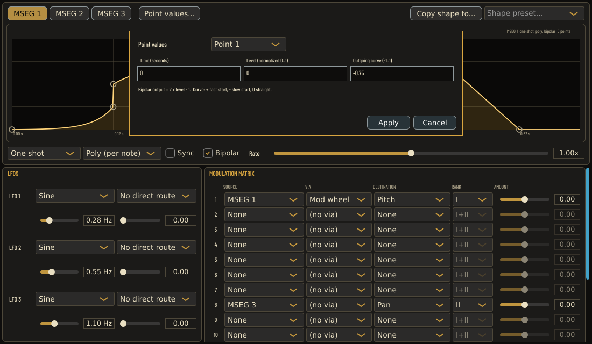

# Edit exact MSEG point values

In Studio → Modulation → MSEG + MATRIX, choose **Point values...** beside the
MSEG selectors. It opens an inline editor for the selected graph point (or
Point 1 if none is selected). The point menu reaches every point, including
coincident points. Choosing another point discards the uncommitted fields.

- **Time** is absolute from the start, in seconds with Sync off or quarter-note
  beats with Sync on. The rate multiplier remains independent and unchanged.
- The first point stays at time zero. Other times must lie between their
  immediate neighbors, or between the preceding point and 64 for the last
  point. Equal times are valid steps; there is no minimum spacing.
- **Level** is normalized 0..1, including Bipolar shapes. Bipolar matrix output
  is `2 × level − 1`, so normalized 0.5 is zero bipolar output.
- **Outgoing curve** is −1..1 for the segment starting at this point. Positive
  means fast start, negative slow start, zero straight. The final point has no
  outgoing segment, so its existing curve is read-only and preserved.

Use decimal points, optionally a sign or scientific notation (up to 128 characters). Invalid,
nonfinite, overflowing, underflow-to-zero and out-of-range values show an
error and do not change anything. Values are stored as Float32, as before;
direct nearest decimal-to-Float32 rounding still applies. Parsing uses a private
C numeric locale and restores the calling thread’s rounding mode. Displayed decimals round
trip exactly, so applying unchanged fields makes no history or state change.

**Apply** changes all three fields together in one named Undo step. **Cancel**
(or Escape in a field) discards them; Return in a field applies. Dragging,
adding/deleting points, presets and **Copy shape to...** retain their existing
behavior. No DSP law, host parameter, parameter order, state format or rate
value changes.

## Delayed edit safety

Opening captures a coherent shape/revision and the editor's selection
context. Intervening shape, routing, Sync/Bipolar, preset or undo/redo changes
invalidate Apply, including changes restored to their original values.
Changing slots and returning, starting another graph/rate gesture, disabling
the editor/page/ancestor, or opening a replacement form also invalidate it.
Cancel remains available on a stale form; reopen for current values.

PURE CS-80, disabled controls and active graph/rate gestures prevent opening
or applying a form. PURE is checked at open and Apply, not recorded as an
on/off transition history. The guards concern this page's gestures, not every
host/off-page parameter gesture. The revision check protects delayed
message-thread actions, not a compare-and-swap against concurrent host state
replacement. Safe component pointers prevent callbacks using destroyed forms
or pages. A completed or canceled request cannot run again after Undo.

## Verification scope

`CS80Snapshots --mseg-point-values-tests` is a real processor/component
callback fixture without a desktop peer. It covers short, ordinary and
32-point shapes across all three slots and every point position, endpoint
restrictions, equal times, all fields, normalized bipolar levels, decimal
syntax and Float32 round trips, invalid/no-op/cancel, named closed Undo/Redo,
all-parameter preservation, source/selection A-B-A, unit changes, routing,
disablement, PURE, active graph/rate gestures and destroyed callbacks.

The fixture renders two native component layouts offscreen when
`CS80_MSEG_VALUES_SCREENSHOTS` names an output directory. This does not qualify
physical mouse/keyboard focus traversal, OS popup interaction, screen readers,
DAW hosting or the full UI smoke suite. No Xvfb/socket setup was attempted for
this feature because that prerequisite is unavailable in this environment.

Native Windows and macOS compilation/runtime remain CI qualification; local
checks use Linux. The parser uses direct platform float conversion rather than
Apple floating `from_chars`, libc++ float streams or JUCE’s truncated decimal
reader. Native platform qualification is not inferred from the Linux checks.

Local final Release validation:
- Focused fixture: 1,201 assertions without saving images; 1,203 with the two
  saved-image assertions. Both offscreen layouts were visually inspected.
- Thirteen selected CTests passed: point values, shape copying, editor
  lifecycle, modern sliders, modern recall, undo/replay gestures, snapshot CLI,
  core MSEG, transport/retrigger rates, combined interactions, modulation
  matrix and MSEG text serialization.
- Partial ASan/UBSan: 1,447 assertions across precision editing, copying and
  editor lifecycle. The changed UI implementation and focused test/main were
  instrumented; unchanged native/JUCE/state objects were reused. Leak
  detection was disabled. This is not whole-plugin sanitizer qualification.
- Independent review verified the exact final Release binary, repeated the
  1,201-assertion fixture and six adjacent CTests successfully, and inspected
  both offscreen layouts. No blocking issue remained. The reviewer did not
  repeat the scoped sanitizer or all thirteen selected CTests.
