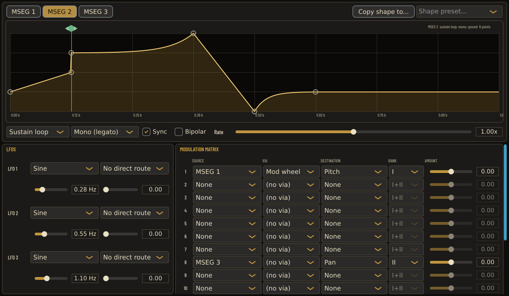

# Reuse an edited MSEG shape

In Studio → Modulation → MSEG + MATRIX, select the source MSEG and choose
**Copy shape to...** beside the shape preset menu. Choose either of the other
two MSEG slots. The selected source stays open; the destination's previous
shape is replaced. Undo restores it in one step, and Redo reapplies the copy.
An identical destination is disabled. There is no self-copy or OS clipboard.

The copy includes every serialized shape field: point count and coordinates,
segment curves, loop mode, loop start/end (including a singleton sustain point),
trigger mode, Sync and Bipolar. Sync is part of the shape, not a host parameter:
copying it intentionally changes the destination's time units between seconds
and beats. The destination's rate parameter, all matrix amounts and matrix
routing remain unchanged. Later editing either shape does not change the other.
No synthesis algorithm, automation parameter, preset format or state version
changes.

## Delayed action safety

Opening the menu captures a coherent source shape and modern-layer revision.
Any intervening modern-layer shape/routing edit, including changing it back or
undoing it, invalidates the old menu. Reopen it to use the new state. Changing
the selected slot and returning also invalidates it. So do a new menu, a new
editor pointer gesture, or a rate-slider gesture. A request can run only once.

A disabled page, ancestor, editor or copy button, PURE CS-80, an active editor
drag or a rate-slider gesture prevents copying. A menu created in one of those
states cannot become live afterward. Destruction of the page safely abandons
its pending callbacks. These guards apply again on callback delivery, not just
to the appearance of menu entries. PURE is checked at menu creation and action
delivery; this is not a history of PURE on/off transitions. Gesture guards cover
this MSEG editor and its rate control, not arbitrary concurrent host or off-page
parameter gestures. The revision check is message-thread stale-menu protection,
not an atomic compare-and-swap against concurrent host state replacement.

The revision is nonserialized and guarded by the existing state lock. It is
not read by the audio thread and does not change the audio publication path.
The successful UI action uses `ModernLayerState::setShape` within a named,
closed undo transaction and emits no host parameter gesture or value events.

## Verification

`CS80Snapshots --mseg-shape-copy-tests` / `cs80_mseg_shape_copy_tests` exercises
the real menu callbacks with a real processor. It covers all six ordered slot
pairs across short, ordinary and maximum-point shapes, coincident point times,
every loop/trigger mode, Sync/Bipolar, full source/destination/third-slot state,
parameter/routing preservation, deep-copy independence, one-step undo/redo,
self/identical destinations, pending/disabled/PURE contexts, selection and
shape/routing A-B-A, superseded/consumed callbacks, destroyed pages, all four
editor drag kinds, rate gestures and the original seven factory presets.

These are direct component/menu callbacks, not physical mouse selection of an
OS menu, keyboard focus traversal, screen-reader testing or external DAW tests.
The existing MSEG editor lifecycle, modern slider, modern state/undo and full
UI smoke suites remain separate regression checks.

Local Release validation:
- The focused shape-copy fixture passed 215 assertions.
- Twelve selected CTests passed: shape copy, editor lifecycle, modern sliders,
  modern recall, undo/replay gestures, snapshot CLI, core MSEG, synced transport
  rate, retrigger rate, combined MSEG interactions, modulation matrix and shape
  text serialization.
- Partial ASan/UBSan passed 245 assertions: the two changed UI/state translation
  units and the focused test/main were instrumented; unchanged native/JUCE
  objects were reused. Leak detection was disabled. This is not a whole-plugin
  sanitizer qualification.
- Thirty of those checks rendered the real modulation component offscreen at
  1100×640 and 1560×820, checked the copy button's bounds/nonoverlap and saved
  PNGs. Both were inspected visually. No desktop peer or popup was involved.
- Independent review verified the exact Release binary, reran the 215-assertion
  fixture and five adjacent native CTests successfully, and inspected both
  offscreen images. No blocking issue remained. The independent reviewer did
  not repeat the sanitizer or entire twelve-test selection.
- Full native UI smoke did not reach app startup. This environment prevented
  Xvfb from creating its local display sockets; an ordinary attempt and one
  normal escalated retry both failed at the display prerequisite. No native
  popup or full UI smoke pass is claimed.
