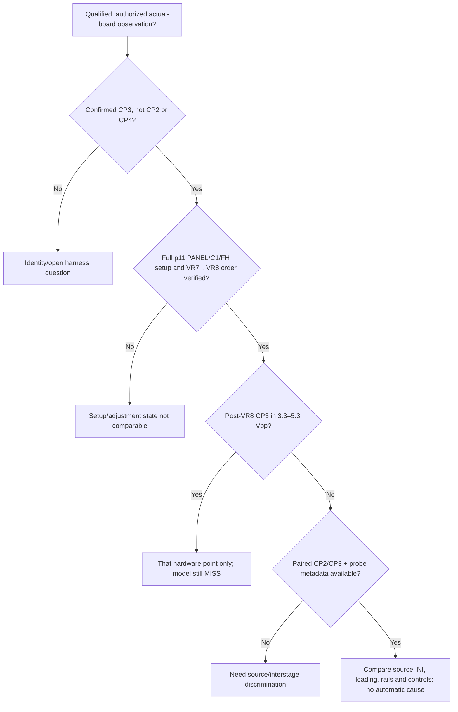

# Yamaha ADJ HP CP3 discrepancy: source-bounded physical setup decision tree

2026-11-02. **Evidence review only. No actual CS-80 bench voltages are
available.** The original frozen software fixture predicts **1.692 Vpp at
CP3** under its declared HP p11 surrogate and therefore **MISSES** Yamaha's
printed **4.3 ± 1 Vpp (3.3–5.3 Vpp)**. The original acceptance terminal,
tolerance, V1 `e5f877a025fc52c6` fingerprint and audio model remain
unchanged. This is an observational decision tree **for a qualified
synthesizer technician acting only with owner authorization**, not
instructions for an unqualified owner to open or probe energized hardware.

## Primary source record (and newly identified noise procedure)

| ID | Yamaha original source | Source limits relevant to this decision |
| --- | --- | --- |
| S1 | [CS-80 Adjustment Procedure and Bulletins PDF](https://www.therogoffs.com/cs80/CS80%20Adjustment%20Procedures%20and%20updates.PDF), 36 pages, SHA-256 `eea101eb338494f3d1d3fddced2d8aa7f1d877ec9d6155ca44cc77ece88276ba`, printed **p11** / PDF p13 | HP PANEL/C1 settings, FH +4.0 V, CP3 oscilloscope, **VR7 CP3 maximum first; VR8 CP3 4.3 ± 1 Vpp second**. No CP2 substitution or pulse-source Vpp. |
| S2 | Same original PDF, printed **p10** / PDF p12, Fig. 7 M board (local rendered page SHA-256 `dcf5295119afa1ac07195f0472849165867a153bb8f05b6975ac358b295c8fe5`) | Physical M-board VR7/VR8 and CP3 labels; **CP3 lies close to CP4** in the test-point drawing. Figure is a location aid, not a gain specification. |
| S3 | Same PDF, printed **p1–2** / PDF pp3–4 | Separate supply alignment: **+15.00 ± .01 V** and **−15.00 ± .01 V**; **+10.60 ± .01 V**, plus +8.5/−6.5 rails. Printed p2 specifically warns about damage from incorrect/incomplete PSU connector conditions under power. These are **separate rail procedures**, not CP3 gain targets. |
| S4 | Same PDF, printed **p17** / PDF p19, **NOISE GENERATOR** row (local full-page SHA-256 `25f87cc69efe4c8e2eb92bd395550743d7879f84fd0967803dc49a0fe0d90ea8`; 6× crop SHA `600066650c2dfd4fc89ff9c5558e152720cb119f884b6b256a9a7a0838b4b7c5`) | **New source distinction:** separate noise alignment with **TONE SELECTOR PANEL, VCO NOISE 10**, scope SUB **NO1 (CH I) or NO2 (CH II)**, SUB **VR1/VR2**, and printed **3.0 ± 0.1 Vpp**. Does **not** specify NO1's level/loaded impedance when following HP p11, whose NOISE setting is unstated. |
| S5 | [M circuit printed p41, KEC-4223-65](https://www.therogoffs.com/cs80/manuals/CS80_Service_Manual/41%20-%20M%20Circuit%20Diagram.jpg), SHA-256 `1278f17ff05cd82b2b84153838bf95109d3f1ea1e864119de0a3f4a4af4f0080` | SO/PO switched FET waveform mixer, fixed ground 150 kΩ and **separate NI 150 kΩ** branches, IC10 HP/IC11 LP outputs, VR7→IC10 **Vfc pin 4**, VR8→**Qadj pin 6**, CP3 before IG00151 VCA. |
| S6 | [M11/M12 board/wiring printed p44, KEP-NA03574-6Y](https://www.therogoffs.com/cs80/manuals/CS80_Service_Manual/44%20-%20M11-12%20Circuit%20Board%20%26%20Wiring.jpg), SHA-256 `3320dd2f625c79d7cca9b98abd5cade9d1b95477e6d8990a93a296c9cda71256` | **CP2(46)↔CP7(53)** interstage and **CP8(56)↔CP3(29)** post-LP wiring, NI(43) harness to SUB NO1(39) on examined channel-I board pair. Other board/voice harnesses need their own source/identity check. |
| S7 | [SUB circuit printed p29, KEC-4446-68](https://www.therogoffs.com/cs80/manuals/CS80_Service_Manual/29%20-%20SUB%20Circuit%20Diagram.jpg), SHA-256 `b81c7e5ad2927ac04d5912bfc455a631237f512a0c7700bda41250a14bd33e60` | SUB IC3/2 buffers NO1; neither output impedance nor noise waveform under multi-M-board load is established by the drawing. |
| S8 | CS-80 Service Manual **M ICs**, printed **p42**; existing [VR8 preregistered source review](ADJ_VR8_SEQUENCE_PREREG_20261102.md) | Existing modeled low-frequency Q endpoints approximately **0.5–5** at documented VQ control extremes; **Q=9 was a numerical stress test, not a verified VR8 setting**. |

**Important source correction:** A statement that *ADJ p11* gives no NO1
output target is true **only for p11**. Yamaha **does** prescribe
**3.0 ± 0.1 Vpp at SUB NO1/NO2** in its *separate* noise-generator
procedure, p17, under **NOISE=10**. Neither page supplies a measured
NO1 output impedance or the p11 NOISE knob setting. Do not transplant
the p17 target into the p11 CP3 test or treat random-noise peak-to-peak
readings as independent of acquisition time and bandwidth.

## Distinct computational predictions, none from an instrument

The existing [pre-registered NI endpoint](ADJ_NOISE_LOAD_PREREG_20261102.md)
and [sequential Q grid](ADJ_VR8_SEQUENCE_PREREG_20261102.md) have already
been executed with frozen **3 Vpp 50% C1 2′ pulse**, 192 kHz, ideal
one-FET-on/one-off switching and a **3 s linear run / last 0.2 s Vpp**
readout. The 3 Vpp input is a *software assumption*, not a p11 Yamaha
generator specification.

| Offline case (unselected) | HP CP2 | HP CP3 | What it can/cannot support |
| --- | ---: | ---: | --- |
| Frozen reference, NI open | 4.126 Vpp | **1.692 Vpp** | Registered **MISS** vs p11; not a bench value. |
| Same frozen controls, silent ideal-zero-ohm NO1 behind NI 150 kΩ | 3.812 Vpp | **1.482 Vpp** | Passive ideal NI loading **reduces** CP3 by .210 Vpp; not a repair for low CP3. Real NO1 noise and impedance remain unknown. |
| Preregistered VR7 cutoff surrogate at 236.685656 Hz, Qhp 5, NI open | 6.630 Vpp | 2.595 Vpp | Model-grid interior maximum **only at assumed Q=5**, not actual VR7 position. |
| Same model cutoff, synthetic Qhp 9, NI open | **11.027 Vpp** | **4.148 Vpp** | Arithmetic overlap with 3.3–5.3; **not a physical pass** or source-derived VR8 range. |
| Same model cutoff, synthetic Qhp 9, ideal silent NO1 | **10.899 Vpp** | **4.075 Vpp** | Also only a linear-model arithmetic overlap, with noise and IC nonlinear limits excluded. |

The **Qhp=9** branch lies above documented modeled Q≈5 endpoint and
puts **~11 Vpp at CP2**, outside the established small-signal domain:
finite supply rails, OTA clipping/compression, actual stage impedances,
FET Ron, and Qadj pin loading were **not characterized**. The Q sweep
held the VR7-model frequency fixed after its Q=5 maximization; it did
not recompute a physical VR7 peak at Q=9. No model value is selected
to make CP3 fit, and neither tolerance nor source drive is changed.

## Decision tree: conditional technician observations, not a fix workflow

Every branch starts **unresolved** until a qualified technician provides
safe, owner-authorized traces and physical board identification. A report
about another instrument, a software surrogate, or a video does not meet
any of the decision predicates.

The terminal nodes identify **the next evidence distinction**, not a
diagnosis, pass in simulation, or permission to adjust a physical CS-80.
Printed CP3 is downstream of HP IC10 output CP2 and LP IC11 output CP8,
so a CP2-only reading cannot establish the manufacturer's CP3 point.

| Source-bounded branch | What a qualified technician could record if safe and separately authorized | How it distinguishes hypotheses; what remains unknown |
| --- | --- | --- |
| **1. Test-point / connector identity** [S2,S5,S6] | Actual M-board ID, CP2(46)/CP7(53), CP8(56)/CP3(29) identity and paired same-event traces; note CP3/CP4 physical proximity and any altered/poor harness connection as **found**. | Distinguishes a CP2 or **CP4** misprobe and a board/wiring uncertainty from a genuine low CP3. M44's printed wires do not prove every installed connector is healthy. **No energized unplugging** is requested; Yamaha p2 explicitly warns of damaging PSU connector conditions. |
| **2. Printed p11 source/controls** [S1] | FEET 2′, BRILLIANCE centered, master RESONANCE max, TONE SELECTOR PANEL, VCO **pulse** ON, VCF RESH/LPF/RESL HIGH, HPF adjusted to DVM **FH +4.0 V** on the correct R51/R52 channel, C1 held, voice identity. | A missing condition invalidates direct comparison with the **hardware printed setup**, but does not validate any alternative 3 Vpp oscillator drive. The p11 table does not publish pulse output Vpp or separate NOISE knob level. |
| **3. VR7 before VR8, physical control pins** [S1,S5,S8] | CP3 amplitude versus actual VR7 at the real maximum, then CP3 after VR8; preserve CP2 simultaneously if feasible, and independently safe Vfc pin4 / Qadj pin6 observations with their probe-loading disclosure. | Distinguishes an unperformed/incorrect-order physical alignment from the frozen preset-control model. Neither angle nor pin-voltage maps to a known universal gm/Q law; **synthetic Q9** cannot be inferred. |
| **4. Scope/probe loading and timebase** [S1,S5,S6] | Probe input resistance/capacitance, coupling, analog bandwidth/limit, sampling/window, ground/reference, whether two attached probes affected the reported waveform, clipping and source temperature/warmup. | Distinguishes a recording/probe disturbance from a reproduced same-node waveform. Yamaha p11 names an oscilloscope but supplies **no numeric input-impedance or bandwidth requirement**; neither an arbitrary 50 Ω input nor ideal infinite-Z is established. |
| **5. NI and separate SUB noise alignment** [S1,S4–S7] | Under **p11**, NO1/NI connected-state waveform/spectrum (and NOISE control as found), M-board load count, while CP2/CP3 remain paired; under *separate p17 conditions*, technician may independently document the original **NOISE=10, NO1/NO2 3.0 ± .1 Vpp** source alignment. | A source-noise contribution may affect a Vpp window; p17's value is **not** the noise level for unspecified p11 NOISE control. NO1→NI wiring and a fixed 150 kΩ resistor do **not** establish source output impedance. The ideal silent NI termination made CP3 **smaller** in the frozen simulation. |
| **6. Supplies and nonlinear headroom** [S3,S5,S8] | Technician's independently warranted rail status (Yamaha separate p1 PSU conditions) and waveform clipping/compression at CP2/CP3; log M-board supply conditions where safely measurable. | Distinguishes a power/headroom concern from the **unvalidated linear ~11 Vpp CP2** Q9 stress calculation. The published ±15 V and +10.6 V PSU specifications are not an IC10-specific loaded-voltage measurement or an excuse to adjust rails to hit CP3. |
| **7. Volume and downstream loading** [S1,S5,S6] | Note master volume/expression/output state as contextual metadata; if independently safe, CP3-to-VCA input and CP4 VCA-output relationship. | **p11 does not specify** master output volume/expression setting. CP3 is **before** M41's 1 µF NP/100 kΩ series path to IG00151 VCA +IN; ordinary downstream volume changes need not directly scale the CP3 tap. Unknown VCA input/loading or supply coupling must be **observed**, never assumed as a correction. |

The Yamaha ADJ p17 noise test also uses a **different potentiometer**
(SUB VR1/VR2) from M-board HP **VR7/VR8**. No p17 noise adjustment is
part of the printed p11 HP recipe. The software one-FET-on/one-off pulse
and ideal silent-source models may help define **what to measure**, but
cannot authorize changing a factory preset, swapping a terminal, altering
rail calibration, or relaxing the original CP3 acceptance interval.

## Explicit unresolved endpoints

- **No real CP2, CP3, NO1/NI, IC10 Vfc/Qadj or rail measurement** is
  supplied by this investigation.
- No characterized **IC10/IC11 large-signal compression**, switch FET
  resistance, LP output impedance, VCA input impedance, or finite
  noisy-NO1 source impedance/response exists for the tested instrument.
- Yamaha's p11 HP **4.3 ± 1 Vpp at CP3** and p17 separate noise
  **3.0 ± .1 Vpp at NO1/NO2** are distinct source specifications.
- No evidence maps a physical VR7/VR8 trimmer to **Q=9**, and all
  **25 disputed T51–T54 tone-cell installed revisions remain hypotheses**.

The attached [test-only checklist](../../../tests/bench/ADJ_HP_TECHNICIAN_CHECKLIST_20261102.md)
provides blank evidence requests, not fabricated measurements.
Future JSON observations may use
[bench importer schema v1](../../../tests/bench/README.md), which validates
the **shape** of a technician's submissions but not their authenticity
or a manufacturer's pass/fail. In particular, v1 has a `NO1` node for
the traced channel-I path but **no `NO2` node or p17 checkpoint**: do
not encode a channel-II NO2 observation under another node; any schema
extension requires its own reviewed version.
