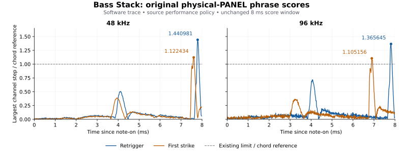

# Bass Stack: remaining original physical-PANEL phrase failures

2026-10-31. Software diagnostics at source base
`32260112971289761f9a6e8e7289916bfc7df95f`; no hardware measurements.

**The original score still fails at 48 and 96 kHz. No remaining zero-time
oscillator, filter, envelope or VCA restart was observed in these two fixtures.**
The large measured step follows the filtered oscillator waveform during the
attack response. No production source law, phrase event, scoring window,
threshold, parameter, fade or gate was changed for this investigation.

## Unchanged score and controls

The probe uses the original physical-unit PANEL control frame, rather than the
new electrical-programmer adapter. It preserves `engine_audit.cpp`'s 64-frame
event quantization and eight-millisecond step window. Both curves use the
unchanged maximum step in the preceding four-note chord as their reference.

| Host rate | Retrigger score | First-strike score | Omitted-retrigger score | Chord reference step | Retrigger step |
|---|---:|---:|---:|---:|---:|
| 48 kHz | 1.440980509990 | 1.122433965884 | 0.031434549790 | 0.007922306657 | 0.011415889487 |
| 96 kHz | 1.365645077935 | 1.105156382802 | 0.073043581667 | 0.004137575626 | 0.005650459789 |

“First strike” is the same phrase's note-on at 6.00 seconds; “retrigger” is
its second note-on at 6.25 seconds. The first strike already exceeds the
unchanged limit. Omitting the second event preserves every pre-event sample
exactly, and produces the much smaller scores shown above. This identifies the
new note's response as the large slope's source; omission alone would not
prove a reset defect.



[metrics.csv](metrics.csv) retains exact raw numbers and sample positions.
The `reference-windows-*.csv` files preserve the first-strike window, the
maximum chord-reference neighborhood, and the retrigger window. The
`output-window-*.csv` files also retain the omitted-event samples.

## Assignment boundary

The selected physical circuit is voice 6. Before the assignment it still has
pending idle time. The probe first observes that time being completed, then
observes assignment without any rendered time between the two observations.
Comparing a stale idle snapshot directly with the assigned state would confuse
this legitimate catch-up with a zero-time reset.

There are **zero bit differences in 288 captured continuation fields**: 72
fields per rank, two ranks, two sample rates. These include the complete
exposed oscillator continuation state and antialias residuals, both nodal
filter histories, both envelope charge values, and both VCA nodes. Gate
stages and selected controls are intentionally excluded from charge equality;
a note-on is supposed to change their selection.

| Host rate | Pending time completed | Filter envelope before / after assignment | Amplitude envelope before / after assignment | Captured-field differences |
|---|---:|---:|---:|---:|
| 48 kHz | 7 internal samples, approximately 72.917 µs | −1.439999938011 / −1.439999938011 | 0 / 0 | 0 of 144 |
| 96 kHz | 15 internal samples, approximately 78.125 µs | −1.439999938011 / −1.439999938011 | 0 / 0 | 0 of 144 |

Both VCA coupling values remain exactly zero across this assignment. The
previously documented cold LI-node convention still initializes its static
level at the first rendered active sample. This investigation does not turn
that declared simplification into a hardware claim.

The `assignment-*.csv` files contain every captured field before catch-up,
after catch-up, and immediately after assignment. The state preservation
agrees with the source path in `Engine::startVoice`: source policies retain
oscillator/filter memory, preserve filter-envelope charge, and start the
silent amplitude envelope from its existing zero value.

## Where the maximum step comes from

At 48 kHz the host maximum is sample **300406**, 7.791667 ms after the event.
The dominant rank-I step occurs at host-coordinate sample **300343**, internal
subsample 1. At 96 kHz the corresponding samples are **600750** and **600687**,
internal subsample 0, with a host delay of 7.8125 ms from the event. In both
cases the host maximum is **63 host samples after the dominant rank-I slope**,
matching the existing output FIR's delay. The oscillator's additional four
host samples at 2× are already present in the observed rank input.

At those internal slopes, both amplitude and filter envelopes are in
**Decay**, not undergoing a zero-time gate restart. Rank I follows its repeated
saw reset; rank II's pulse waveform contributes a nearby filtered edge. The
amplitude values are approximately 0.98549 / 0.98191 and the rank-I low-pass
cutoffs approximately 2484.99 / 2437.15 Hz at 48 / 96 kHz.

The existing VCA equation permits an algebraic slope decomposition. With
`c = LI * EG * 2^EI`, `u` its audio input, `q` the output-coupling state and
this fixture's rank scale `0.085`, it is

```text
y = 0.085 * (c * (u + 0.0025) - q)
Δy = 0.085 * (c_previous * Δu + (u_current + 0.0025) * Δc - Δq)
```

These are the unchanged software constants in `Vca.h`; they are not fitted
coefficients or measured instrument voltages. Evaluating recorded rounded
nodes in double produces a small rounding residual, which is retained.

| Rank-I slope term | 48 kHz | 96 kHz |
|---|---:|---:|
| Actual rank output step | −0.007715044543 | −0.003764631227 |
| VCA audio-input contribution | −0.007719195140 | −0.003766452010 |
| Control-gain contribution | +1.43733e−6 | +6.33305e−7 |
| Entire coupling-state contribution | +2.71106e−6 | +1.18876e−6 |
| Direct pedestal part of control term | −9.72552e−9 | −4.87574e−9 |
| Rounding residual | +2.20110e−9 | −1.28144e−9 |

The audio-input slope dominates. The control and coupling terms are orders
of magnitude smaller; the direct pedestal term is smaller again. This
supports the filtered-waveform explanation for these maxima. It does not
claim complete fidelity of the declared VCA pedestal or cold-node model.

## Why the score rose after the cold-clock correction

The previously archived before/after causal CSVs separate the retrigger step
from the chord denominator:

| Rate | Retrigger step change | Chord-reference change | Score change |
|---|---:|---:|---:|
| 48 kHz | 0.011498507112 → 0.011415889487, **−0.719%** | 0.008832618594 → 0.007922306657, **−10.306%** | 1.301823 → 1.440981 |
| 96 kHz | 0.005650554784 → 0.005650459789, **−0.00168%** | 0.004534408450 → 0.004137575626, **−8.752%** | 1.246150 → 1.365645 |

The rising score is principally a change in the earlier chord reference.
It is not evidence that the repair introduced a larger retrigger edge.
Those historical values remain identified as their original cold-clock
qualification, not relabelled as new renders.

## Neutrality, reproduction and limits

The instrumented Engine and freshly compiled uninstrumented control produce
**byte-identical complete audio**: 2,415,360 bytes at 48 kHz and 4,830,720 bytes
at 96 kHz. The one-sample trace also matches the original 64-frame rendering
exactly. [manifest.json](manifest.json) records source/header/object hashes,
compiler/linker commands, raw run logs, and binary/audio hashes. The control
objects came from the separately recorded integrated UI build at the same
base; no old Engine-layout object was mixed into that build.

[trace-only.patch](trace-only.patch) contains observation hooks only.
[probe.cpp](probe.cpp), [run.py](run.py), and [analyse.py](analyse.py) retain the
exact diagnostic and analysis drivers, including the original local paths.
The compiler commands in the manifest can be rerun in a clean checkout of the
recorded base after adjusting those paths. Full local traces and binary audio
are hashed in [summary.json](summary.json); the committed internal excerpts
retain first active samples, oscillator resets, envelope stage transitions,
and maximum-slope neighborhoods under the documented fixed selection rule.

The existing `phrase_retrigger_max = 1.0` criterion **remains open**. These two
traces establish no remaining assignment reset mechanism to remove; they do
not qualify every program or hardware behavior. The separately registered
cold-clock, capacitor-continuity, wake, noise, and phrase gates remain in force.
