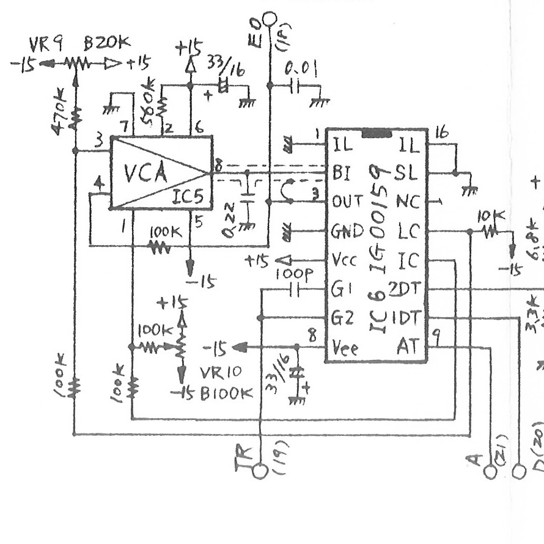
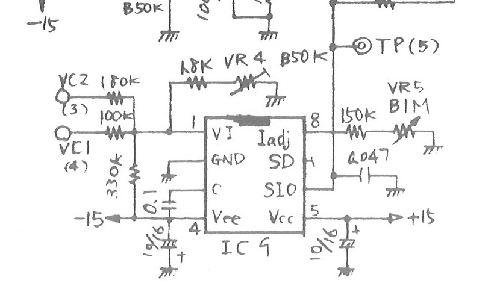

# PRA ring trigger, envelope and carrier source review

2026-11-01. **Document evidence only.** This records the printed connections and
pin descriptions relevant to the ring trigger review. It introduces no audio
change, behavioral contract, tolerance or claim of hardware measurement. The
service sheets identify the drawing as CS-80 serial number 1001 onward; this is
not proof of every installed instrument or service revision.

## Native source retrieval

The original inspection jobs remain successful and were fetched again through
the GitHub connector. Their logs contain the original-source metadata and
lossless PNG payloads, not screenshots of the Actions web page.

| Source | Inspection job | Workflow source |
| --- | --- | --- |
| Service p53, PRA circuit diagram | [40807476007 / 123229758333](https://github.com/cheshmakzanoon-ops/yamaha-cs80/actions/runs/40807476007/job/123229758333) | `c87b57c8b3b7b1ff79c8a4b4e168926a7a1f05de` |
| Service p54, PRA board, harness and IC descriptions | [40808650289 / 123233499536](https://github.com/cheshmakzanoon-ops/yamaha-cs80/actions/runs/40808650289/job/123233499536) | `c643079d1e2eebc8a26c8671efa55d973190a73f` |

Both original JPGs are 5100 × 3300 pixels. The Actions-reported source SHA-256s
match the existing [routing ledger](../../../OE1_SIGNAL_ROUTING_EVIDENCE.md):

| Original source | SHA-256 |
| --- | --- |
| [PRA53](https://www.therogoffs.com/cs80/manuals/CS80_Service_Manual/53%20-%20PRA%20Circuit%20Diagram.jpg) | `a691e710b59deecace01a62b57587e6b939e1084bfd71003efe71929bbe42c61` |
| [PRA54](https://www.therogoffs.com/cs80/manuals/CS80_Service_Manual/54%20-%20PRA%20Circuit%20Board%20%26%20Wiring.jpg) | `88703d2b43189003e3276ca7837556ef2ac5205dd057d8f5b0c6b320e1042c69` |

All twelve original native PNG payloads were decoded with contiguous chunk
indices, matching begin/end IDs, exact base64 length, strict base64 decoding,
matching PNG SHA-256 and matching dimensions. Eight relevant original PNG files
are archived here byte for byte: all six PRA53 tiles and PRA54 `r0-c1`/`r0-c2`.
The other four decoded PRA54 tiles are identified in the receipt but are not
represented as archived files. Original JPG bytes are not archived in this
review; their hashes above are source-job metadata, not a fresh local JPG hash.

The [provenance receipt](provenance.json) records every original tile, the exact
decoded job-log hash, the archived file hashes and the focused crop coordinates.
The [workflow receipt](workflow-receipt.json) preserves the retrieved run/job
identities and outcomes. Eleven overlapping PRA53 tile regions were compared
pixel for pixel; all agree. The focused crops preserve their original pixel
coordinates without resizing or filtering; their grayscale pixels were copied
losslessly into RGB for display.

## Printed PRA53 and PRA54 connections

| Printed path | Directly inspected evidence |
| --- | --- |
| Keyboard trigger | PRA53 TR(19) connects to IC6 IG00159 G2, and through a 100 pF capacitor to G1. PRA54 identifies the harness source as RA2-KAS-TR9(35). |
| Envelope state node | PRA53 IC5 OUT8 connects to IC6 BI2 and the 0.22 µF capacitor. IC6 OUT3 is a separate buffered node, EO(18), with a 0.01 µF shunt. |
| Envelope drive and feedback | The printed IC6 LC path reaches IC5 input3 through 100 kΩ and the trim network. Buffered EO returns to IC5 input4 through a separate 100 kΩ path. The G1/G2 trigger path is not drawn as a wire to the 0.22 µF node. |
| Envelope to DEPTH | PRA54 EO(18) connects to PN2-VR5-3; VC2(3) connects to PN2-VR5-2. The existing routing ledger identifies panel VR5 as DEPTH. |
| SPEED | PRA54 VC1(4) connects to PN2-VR6-2. |
| Carrier frequency input | PRA53 VC1(4) through 100 kΩ and VC2(3) through 180 kΩ join IC9 VI(1), with the printed bias/trim network. |
| Carrier timing and outputs | PRA53 shows the capacitor at IC9 C(3), SIO(6) leading toward TP(5)/the multiplier, and a separate unconnected pin7. No external TR wire is drawn to IC9. |
| Pin7 identity | PRA54's VCOII/IG00150 description identifies pin6 SIO as the sine output and pin7 SO as the **sawtooth output**. The handwritten p53 glyph initially resembled `SD`; this review reconciles it to pin7/SO using p54. It is not evidence of a reset pin. |

Focused, unresized source views:





The original [PRA54 harness/EG tile](pra54-native-r0-c1.png) and
[PRA54 VCOII description tile](pra54-native-r0-c2.png) retain the reciprocal
connector labels and the printed pin functions. These are external circuit and
functional descriptions, not transistor-level chip internals.

## IG00159 functional block evidence

The [Yamaha IC guide](https://www.goltsynth.com/resources/downloads/CS/yamaha_ic_guidebook.pdf)
was downloaded again. Its 13,608,992 bytes hash to
`ff051aed0687cad4c4b246d145f85896c229e4cc679333328483118a3e7f8cc1`, matching
the existing [envelope state-path ledger](../../../ENVELOPE_TARGET_TRANSITION_REVIEW.md).
PDF page41, printed page2-7, was rendered with the documented command:

```sh
pdftoppm -f 41 -l 41 -scale-to 2482 -singlefile -png yamaha_ic_guidebook.pdf guide41-render
```

The [complete page render](guide41-render.png) reproduces the existing
`4c60603531ae1c81300f55db5783fbdd19487b77416c7b2f44f4cb8e4704987f`
hash. Its [block crop](guide41-block-crop.png), box `[1250,380,2050,920]`,
reproduces `5dc01486af91fca5339aa1efedb9cc78225d80aa719012d7e70b6b69ccac9624`.
These two images are a PDF render and a render crop, not native embedded-raster
extracts. The original PDF is not added to the repository.

The block drawing sends G2(7) and the capacitively coupled G1(6) into the sequence
control circuit. That circuit selects the level output LC13 and time output
TC12. BI2 feeds a distinct unity-feedback buffer; BO3 returns to the sequence
control circuit. No direct G1/G2-to-BI2 reset connection is depicted in this
functional graph. The guide lists pin16 as NC and pin1 as IL; PRA53 labels both
upper IC6 positions IL and grounds them. That source-label discrepancy is
retained, as in the earlier envelope ledger.

## Limits and review boundary

The observations above locate separate trigger, selected-drive, buffered-state
and carrier paths. They do not supply internal comparator thresholds, transient
port currents, parasitic charge injection, a calibrated retrigger trajectory,
or a measured oscillator phase response. Any software continuity law or
alternative behavior must be stated and tested in a separate declared-inference
contract. This receipt does not infer behavior from the initially ambiguous SO
glyph or substitute a favorable click score for source evidence.

Two readers independently inspected the focused PRA53 trigger/carrier crops;
the reciprocal PRA54 wiring and freshly reproduced guide page are included for
independent review. No production source, parameter, gate or tolerance changes
are included in this evidence commit.
